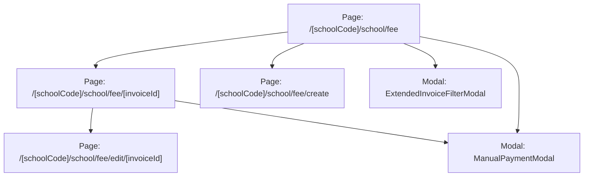

# Page: Finance Invoices (Học Phí & Hóa Đơn)

## Jira Story

- Story: As a school accountant, I want an interactive tuition billing roster, invoice detail screen with VietQR code, and batch creation wizard so that fee management is transparent and simple.
- Jira issue type: Story
- UX owner: `benny-frontend-engineer`
- Research evidence: Based on legacy screen inventory (`hp-uc01-overview.png`, `hp-uc02-chi-tiet.png`, `hp-uc03-tao-hoa-don.png`, `hp-uc04-chinh-sua.png`, `hp-uc05-da-thanh-toan.png`, `hp-uc06-lich-su-thanh-toan.png`).

## Priority

- Priority: P1
- Demo impact: High-visibility flagship interface for school cash flow operations.
- Risk if delayed: Inability to invoice parents or record payments.
- Release target: Release 1.0 (Phase 1 MVP)

## Route / Surface

| Route Pattern | View / Screen | Purpose |
| :--- | :--- | :--- |
| `/[schoolCode]/school/fee` | Tuition Invoices Overview Roster | Primary student-centric roster with month picker, class filter, and batch actions. |
| `/[schoolCode]/school/fee/[invoiceId]` | Invoice Detail View with VietQR | Detailed invoice bill showing line items, VietQR code, and cumulative payment history. |
| `/[schoolCode]/school/fee/create` | Batch Creation Wizard | Wizard for creating invoices across 4 scopes with automated meal deductions. |
| `/[schoolCode]/school/fee/edit/[invoiceId]` | Draft Invoice Editor | Edit line items, quantities, and discounts for draft invoices. |

## PM Notes

- Demo path: Navigate to `/demo/school/fee`, filter by Class 6A1, select multiple draft invoices to test batch action toolbar, open invoice `inv-6a1-001` to view itemized fees and VietQR, and click 'Xác nhận thanh toán' to log a payment entry.
- User promise: Intuitive financial workflow with automated meal deduction and clear status indicators.
- Acceptance impact: Fulfills all UI requirements in `TASK-FIN-001` and `TASK-FIN-002`.
- Visual or copy change: High-contrast status badges (Draft in Slate, Dispatched in Blue, Paid in Emerald, Overdue in Amber/Red), clear formatted VND currency, and zero misleading unpaid labels on settled bills.
- Risk: Handled with confirmation dialogs prior to invoice dispatch or cancellation.

## States

1. **Tuition Roster (`/school/fee`)**:
   - `Default State`: Displays student-centric rows for selected class and month with status pills.
   - `Batch Selection Active`: Selecting 1 or more rows reveals the contextual batch actions bar.
   - `Empty Search State`: Shows informative empty state when no student matches search keyword.
2. **Invoice Detail (`/school/fee/[invoiceId]`)**:
   - `Draft View`: Displays invoice bill with Edit and Send buttons.
   - `Dispatched View`: Displays active VietQR payment code and Manual Payment confirmation trigger.
   - `Paid View`: Displays settled status badge, hides unsettled payment prompt, and shows full payment history.
3. **Creation Wizard (`/school/fee/create`)**:
   - `Scope Selection`: Dynamic form adapting to Whole School, Grade, Class, or Student.
   - `Meal Deduction Active`: Displays auto-calculated excused absence deductions.

## Screen State & Interactive Matrix

- **Student-Centric Roster View (`InvoiceRosterTable`)**: Header controls include Search input, Class dropdown, Billing month picker, and 'Lọc mở rộng' button.
- **Invoice Detail View (`InvoiceDetailView`)**: Header, Recipient Card, Fee Line Items Table, VietQR Payment Panel, and Cumulative Payment History Table.
- **Batch Creation Wizard (`CreateInvoiceWizardModal`)**: 4 Scopes with automated attendance-linked meal deduction calculator.
- **Manual Payment Modal (`ManualPaymentModal`)**: Payment amount, method selection, payment date, and internal note.

## Relationship Map

| Relation | Target | Label | Rationale |
| :--- | :--- | :--- | :--- |
| Implements | `F-009-001-finance-invoices` | `IMPLEMENTS` | Renders user-facing tuition invoice rosters, details, and creation forms. |
| Uses | `M-009-001-finance-invoices` | `USES` | Uses invoice validation engine and Redux state machine. |
| Relates to | `docs/tasks.md#TASK-FIN-001` | `RELATES_TO` | Connects UI surfaces with tuition invoicing task. |

## Mermaid Diagram

## Verification

- Automated testing via `tests/unit/invoices.test.mjs`.
- Verified clean compilation with `npm run build`.
- Live curl checks verifying HTTP 200 on all finance invoice pages.

## Work Log

- Date: 2026-09-12
  - Action: Initialized tuition invoice page specifications, detailing routes, screen states, and responsive layouts.
  - Agent/skill: `benny-frontend-engineer`
  - Evidence: Verified against legacy design patterns from `hoc-phi.md`.

## Change Log

- Date: 2026-09-12
  - Code change: Implemented responsive components for roster, details, creation wizard, and modals.
  - Documentation update: Authored complete page documentation note.
  - Evidence: Verified in automated test suite.
