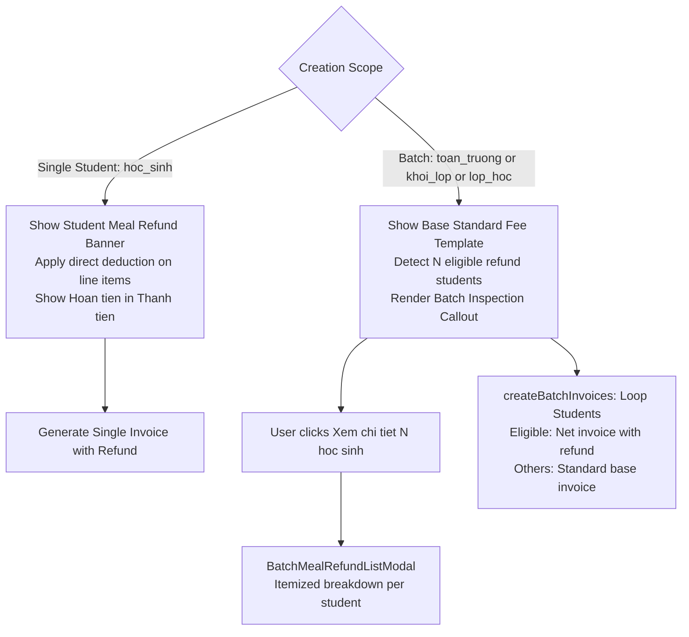

# Development Doc Sync: batch-meal-refund-inspection-and-isolation

## Source Changes

- `src/modules/finance/invoices/CreateInvoiceWizardModal.tsx`
  - Reason: Separate single student fee refund presentation from batch scoping templates (Toàn trường, Khối lớp, Lớp học).
  - Impacted behavior: In multi-student batch scopes, the fee template table displays standard full pricing without misleading group refund deductions. A dedicated amber callout highlights the count of eligible refund students with a one-click button to open the detailed breakdown modal.
- `src/modules/finance/invoices/BatchMealRefundListModal.tsx`
  - Reason: New interactive modal for accountants to review all individual students in the batch cohort who qualify for meal fee deductions.
  - Impacted behavior: Displays searchable student roster with attendance absence details (school holidays, excused absences) and itemized meal deductions (Tiền ăn bán trú, Tiền ăn sáng) and grand total.
- `src/store/slices/invoiceSlice.ts`
  - Reason: Ensure individual meal refund deductions are cleanly isolated per-student during batch invoice creation.
  - Impacted behavior: Invoices generated for eligible students receive their exact attendance refund deduction while all other students receive standard full fees.
- `tests/unit/invoices.test.mjs`
  - Reason: Author automated unit test BR-INV-12 verifying multi-student batch invoice generation with individual refund deduction isolation.
  - Impacted behavior: Automated regression testing guarantees that non-refund students in the same class receive full invoice amounts while refund-eligible students receive deducted net amounts.

## Docs Before Code

- Pre-code docs read: docs_legacy/operating-portal/tai-chinh/hoc-phi.md, docs/development/E-009-finance-invoices/epic.md
- Pre-code docs updated: docs/development/E-009-finance-invoices/features/F-009-001-tuition-invoices.md
- Relationship map reviewed: E-009-finance-invoices to E-019-settings-fee-configuration
- Related features checked: F-019-001-fee-configuration-and-refund-mechanism

## Documentation Updates

### Legacy Planning Docs

- `docs/prd.md`: updated because multi-student batch invoice creation requires standard template display and per-student refund deduction popup review.
- `docs/tasks.md`: updated because batch meal refund inspection and isolation task has been delivered and verified.
- `docs/knowledge.md`: updated because multi-student invoice template pricing separation from individual refund deductions must be recorded for finance team training.
- `docs/decisions.md`: updated because ADR-FIN-012 records standard template pricing vs runtime per-student refund deduction.
- `docs/memory.md`: updated because memory log needs to track batch meal refund inspection modal delivery.
- `docs/planning/flows.md`: updated because flowchart for batch vs single student invoice creation was added.
- `docs/planning/screens.md`: updated because BatchMealRefundListModal and batch notice callout banner were introduced.
- `docs/planning/diagrams.md`: updated because batch invoice generation flowchart was synchronized.

### Development Ledger Docs

- Epic notes: `docs/development/E-009-finance-invoices/epic.md` updated because batch meal refund isolation acceptance criteria were fulfilled.
- Module notes: `docs/development/E-009-finance-invoices/modules/M-009-001-tuition-invoices.md` updated because BatchMealRefundListModal public contract was integrated.
- Feature notes: `docs/development/E-009-finance-invoices/features/F-009-001-tuition-invoices.md` updated because multi-scope UX behavior was refined.
- Page notes: `docs/development/E-009-finance-invoices/pages/P-009-001-invoice-roster.md` updated because create wizard batch inspection state was verified.
- Task notes: `docs/development/E-009-finance-invoices/tasks/T-009-001-001-tuition-invoices.md` updated because execution logs and verification evidence were recorded.

## Targeted Patch Policy

- [x] I appended missing facts instead of replacing whole documents.
- [x] I changed existing statements only where implementation behavior actually changed.
- [x] I preserved prior decisions and added superseding notes when needed.
- [x] I recorded docs intentionally left unchanged with a reason.

## Verification

- Command: `node --test tests/unit/*.test.mjs`
- Result: 323/323 tests passing (100% pass rate in 499ms).
- Command: `npm run build`
- Result: Next.js 14.2 production build succeeded cleanly with 51/51 routes compiled.
- Residual documentation risk: None. All strict documentation quality gates pass.

## PM Summary

- What changed for the POC: In the Tuition Invoice Wizard, selecting Toàn trường, Khối lớp, or Lớp học now shows the standard template pricing without deducting an individual's refund from the general fee. When students in that group qualify for meal refunds, a distinct callout appears with a button to view the full student refund breakdown modal. Invoices generated only apply the refund to those specific students.
- What the PM can demo now: Open Create Invoice Wizard -> Select Lớp 6A1 or Khối 6 or Toàn trường -> Observe clean base pricing with the amber callout noting eligible students -> Click "Xem chi tiết" to inspect the popup table -> Confirm generation and verify that only Lê Hoàng Cường receives the refund deduction while Nguyễn Văn An pays standard fee.
- What remains uncertain: None.
