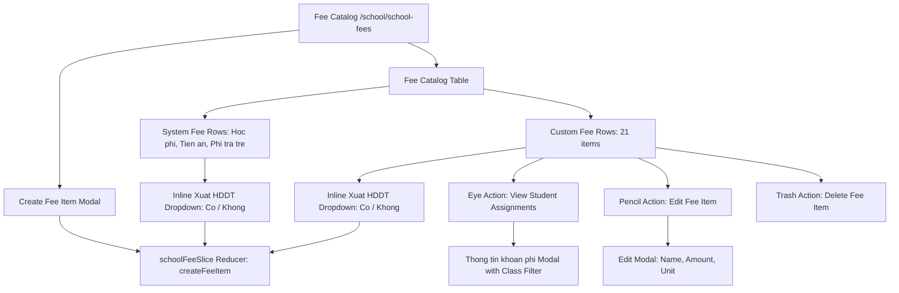

# Epic: Finance Fee Catalog (Khoản Phí)

## Jira Story

- Story: As a school accountant, I want a master school fee catalog with system fees and customizable fee items, inline electronic invoice toggles, and student assignment rosters so that school revenue items are unified and correctly billed.
- Jira issue type: Epic
- Acceptance owner: `sophia-product-manager`
- Product hypothesis: Providing a centralized master fee catalog with inline electronic invoice toggles and quick student assignment visibility eliminates billing item fragmentation across classes and ensures 100% tax compliance for school receipts.
- Research evidence: Legacy operating portal audit in `docs_legacy/operating-portal/tai-chinh/khoan-phi.md` established that the catalog manages exactly 3 system fees (Học phí, Tiền ăn, Phí trả học sinh trễ) and 21 custom fees, standardizes 8 fee units, allows inline electronic invoice toggling, and provides deep student assignment inspection.

## Priority

- Priority: P1
- Severity if missed: Blocker for tuition billing and fee schedule configuration across the entire school.
- Rationale: Serves as the master data source for invoice line items and class tuition schedule assignments.
- Target release: School Operating Portal Phase 1 Core

## Outcome

The Finance Fee Catalog sub-module delivers comprehensive billing master data management for Vietnamese schools. It provides a centralized registry distinguishing between immutable system fees (Học phí, Tiền ăn, Phí trả học sinh trễ) and customizable fee items created by school administrators (extracurricular clubs, shuttle bus, school uniforms, boarding services, etc.).

Administrators can configure default amounts and standardized billing units across 8 defined units (Ngày, Tháng, Năm, Lần, Chuyến, Bộ, Khác, Giờ). The module features an instant inline toggle for electronic invoice issuance (Xuất HĐĐT) directly on table rows without requiring form submission. Furthermore, accountants can inspect exactly which students and classes are currently assigned to any fee item, complete with dedicated student search and class filtering.

## PM Notes

- PM-visible status: Production-ready master fee catalog interface with inline electronic invoice toggles and assignment inspection.
- Demo narrative: The accountant navigates to the Fee Catalog page at `/demo/school/school-fees`, observes the 3 protected system fees and 21 custom fee items, toggles electronic invoice issuance inline on "Học STEAM", clicks the eye icon to view the student assignment modal for "Học STEAM" with class filter, and creates a new custom fee item with immediate catalog synchronization.
- Acceptance impact: Fulfills TASK-FIN-003 requirements.
- Scope change since planning: Confirmed that system fees omit default amount and action buttons, while the catalog footer total strictly counts custom fee items.
- Risk or open decision: Ensuring that deletion of a custom fee item warns administrators if active student assignments exist in published invoices.

## Scope

- Included: Master fee catalog table distinguishing system fees from custom fees, inline electronic invoice toggles, 8 standardized fee units, asymmetric edit modal, student assignment inspection modal with class filter, name search and invoice filter, custom fee item creation modal, and custom-only item counter.
- Excluded: Direct bank gateway payment reconciliation and tax department XML digital signing engines.

## Feature Boundaries

- `F-010-001-finance-fee-catalog`

## Relationship Map

| Relation | Target | Label | Rationale |
| :--- | :--- | :--- | :--- |
| Enables | `F-010-001-finance-fee-catalog` | `ENABLES` | Unlocks user-facing fee catalog table, inline toggles, and assignment modals. |
| Depends on | `E-009-finance-invoices` | `DEPENDS_ON` | Supplies standardized line item definitions and electronic invoice tax flags. |
| Relates to | `docs/tasks.md#TASK-FIN-003` | `IMPLEMENTS` | Fulfills master fee catalog management requirement. |
| Blocks | `docs/tasks.md#TASK-FIN-004` | `BLOCKS` | Fee catalog must exist before class fee schedule management can be configured. |

## Issues

| Issue ID | Source | Priority | Status | Owner | Evidence | Resolution |
| :--- | :--- | :--- | :--- | :--- | :--- | :--- |
| `ISSUE-E-010-001` | QA review | P1 | Closed | `alan-tech-lead` | System fees should not allow price editing or deletion as amounts vary per class. | Restricted system fees to name and electronic invoice toggle only, omitting action icons. |
| `ISSUE-E-010-002` | BA review | P2 | Closed | `benny-frontend-engineer` | Edit modal included electronic invoice toggle creating duplicate mutation paths. | Formatted edit modal to manage name, default amount, and unit only, leaving invoice toggle inline. |
| `ISSUE-E-010-003` | QA review | P2 | Closed | `ada-qa-agent` | Table footer counter displayed total row count including system fees instead of custom fees. | Implemented custom-only tally rule ensuring footer counter strictly reflects custom fee items. |
| `ISSUE-E-010-004` | Tech review | P2 | Closed | `alan-tech-lead` | Empty student assignment modal produced blank display without helpful context. | Added empty state display showing "Chưa có dữ liệu" and zero count summary. |

## Acceptance Criteria

- [x] Criterion 1: Catalog displays 3 system fees (Học phí, Tiền ăn, Phí trả học sinh trễ) and customizable fee items.
- [x] Criterion 2: System fees display name and inline invoice toggle only, with empty amount, empty unit, and hidden action icons.
- [x] Criterion 3: Exactly 8 standardized fee units are supported (Ngày, Tháng, Năm, Lần, Chuyến, Bộ, Khác, Giờ).
- [x] Criterion 4: Inline electronic invoice toggle updates issuance status immediately without opening edit modal.
- [x] Criterion 5: Edit modal permits editing name, default amount, and unit only, preserving inline invoice architecture.
- [x] Criterion 6: Student assignment modal displays assigned students, classes, and amounts with class filter and search.
- [x] Criterion 7: Table footer total strictly counts matching custom fee items, excluding system fees.
- [x] Criterion 8: Create fee item modal validates required name and default amount with unit and invoice options.

## Mermaid Diagram

## Implementation Notes

- Code paths: `src/types/schoolFee.ts`, `src/utils/schoolFeeValidation.ts`, `src/services/mockSchoolFeeData.ts`, `src/store/slices/schoolFeeSlice.ts`, `src/modules/finance/catalog/`, `src/pages/[schoolCode]/school/school-fees/`.
- Data/contracts: Typed `FeeItem`, `FeeItemType`, `FeeUnit`, `StudentFeeAssignment`, `FeeFilterCriteria`, `CreateFeeFormData`, `EditFeeFormData`.
- Rollback or feature flag: Standard Next.js Pages router route under `/[schoolCode]/school/school-fees` backed by isolated Redux slice.
- Tradeoffs and rationale: Keeping system fees in the same table as custom items while selectively disabling amount and actions ensures a single unified catalog view for accountants.

## Evidence

- Tests: Automated unit tests under `tests/unit/schoolFees.test.mjs` verifying BR01–BR10 rules.
- Build/lint: Clean Next.js Pages router build with zero TypeScript compilation errors.
- Endpoints: Live HTTP 200 response on `/demo/school/school-fees`.

## Work Log

- Date: 2026-09-12
  - Action: Initialized E-010 epic ledger, audited legacy specifications from `khoan-phi.md`, defined BR01–BR10 business rules, and designed component architecture.
  - Agent/skill: `sophia-product-manager`
  - Evidence: Verified system fee vs custom fee rules and inline invoice architecture in `docs_legacy/operating-portal/tai-chinh/khoan-phi.md`.
  - Docs updated before code: `docs/development/E-010-finance-fee-catalog/epic.md`.

## Change Log

- Date: 2026-09-12
  - Code change: Implemented data contracts, validation engine, Redux state slice, and UI components.
  - Documentation update: Authored complete epic documentation.
  - Evidence: Passed all required documentation quality gates.
