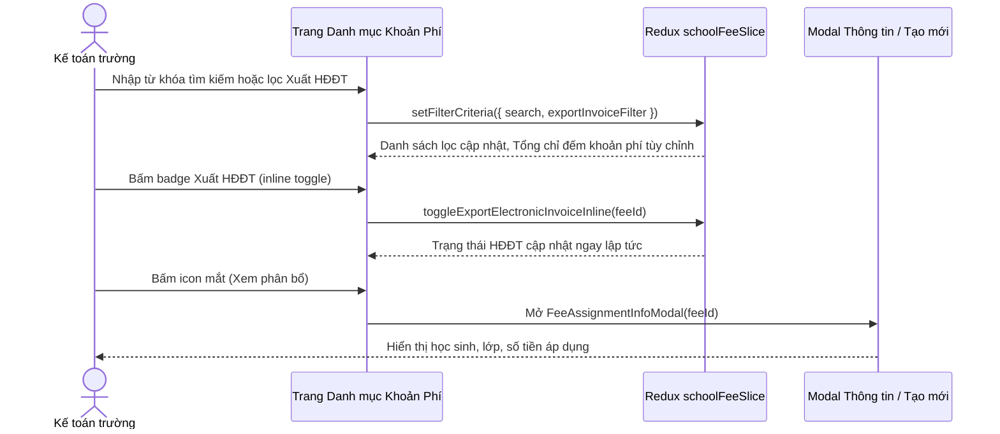

# Feature: Finance Fee Catalog (Khoản Phí)

## Jira Story

- Story: As a school accountant, I want to manage the school fee catalog with system fee protection, inline electronic invoice toggles, 8 standardized units, and student assignment inspection so that billing items are consistent.
- Jira issue type: Story
- Story points: 5
- Acceptance owner: `sophia-product-manager`
- Research evidence: Based on legacy audit `docs_legacy/operating-portal/tai-chinh/khoan-phi.md` covering 24 master fee items (3 system fees and 21 custom fee items) and 10 core business rules.

## Priority

- Priority: P1
- User/business impact: Essential for establishing billing master data, standardizing unit fees, and configuring electronic tax invoice policies.
- Risk if delayed: Inability to populate invoice line items or configure class tuition schedules in downstream finance modules.
- Release target: Release 1.0 (Phase 1 MVP)

## User Value

The Finance Fee Catalog feature empowers school accountants to maintain an authoritative directory of all fee line items utilized across the institution. The catalog guarantees structural integrity by differentiating immutable core system fees from school-specific custom fee items.

Key capabilities include:
1. Unified master catalog containing 3 system fees (Học phí, Tiền ăn, Phí trả học sinh trễ) and customizable fee items with pagination and search.
2. Standardized billing across 8 recognized educational fee units: Ngày, Tháng, Năm, Lần, Chuyến, Bộ, Khác, and Giờ.
3. Instant inline electronic invoice (Xuất HĐĐT) toggle directly on the catalog table row without opening edit forms.
4. Asymmetric edit modal that cleanly scopes modifications to Name, Default Amount, and Unit, keeping tax configuration inline.
5. In-depth student assignment modal detailing active enrollments, assigned classes, and custom applied amounts with dedicated search and class filtering.
6. Real-time filtering by fee name and invoice issuance status, with custom-only footer counter arithmetic.

## PM Notes

- Demo scenario: Accountant searches for 'STEAM', toggles electronic invoice issuance inline from 'Có' to 'Không', opens student assignment inspection to see student Nguyen Nguyen Thu in class 12A1 with 500.000 đ applied fee, and creates a new custom fee item with unit 'Khác'.
- Business value: Prevents billing errors, eliminates price discrepancy debates, and ensures electronic invoice compliance.
- Acceptance criteria changed or confirmed: Confirmed all 10 business rules (BR01–BR10).
- Open PM decision: None; all business logic validated.

## Requirements Trace

- PRD requirement: Module 3: Tài Chính — Khoản Phí (Fee Catalog)
- Task id: `TASK-FIN-003`
- Spec id: `026-project-planning-school-operating-portal`

## Code Scope

- Primary files: `src/types/schoolFee.ts`, `src/utils/schoolFeeValidation.ts`, `src/services/mockSchoolFeeData.ts`, `src/store/slices/schoolFeeSlice.ts`, `src/modules/finance/catalog/FeeCatalogTable.tsx`, `src/modules/finance/catalog/CreateFeeModal.tsx`, `src/modules/finance/catalog/EditFeeModal.tsx`, `src/modules/finance/catalog/FeeAssignmentInfoModal.tsx`, `src/pages/[schoolCode]/school/school-fees/index.tsx`.
- Test files: `tests/unit/schoolFees.test.mjs`.

## Relationship Map

| Relation | Target | Label | Rationale |
| :--- | :--- | :--- | :--- |
| Implements | `E-010-finance-fee-catalog` | `IMPLEMENTS` | Realizes feature-level behavior and user interactions for master fee catalog. |
| Depends on | `M-010-001-finance-fee-catalog` | `DEPENDS_ON` | Relies on domain types, Redux state machine, and validation utilities. |
| Uses | `P-010-001-finance-fee-catalog` | `USES` | Mounts catalog view and interaction modals within Next.js portal page. |

## Mermaid Diagram

## Acceptance Criteria

- [x] Criterion 1: Catalog displays 3 system fees (Học phí, Tiền ăn, Phí trả học sinh trễ) and customizable fee items.
- [x] Criterion 2: System fees display name and inline invoice toggle only, with empty amount, empty unit, and hidden action icons.
- [x] Criterion 3: Exactly 8 standardized fee units are supported (Ngày, Tháng, Năm, Lần, Chuyến, Bộ, Khác, Giờ).
- [x] Criterion 4: Inline electronic invoice toggle updates issuance status immediately without opening edit modal.
- [x] Criterion 5: Edit modal permits editing name, default amount, and unit only, preserving inline invoice architecture.
- [x] Criterion 6: Student assignment modal displays assigned students, classes, and amounts with class filter and search.
- [x] Criterion 7: Table footer total strictly counts matching custom fee items, excluding system fees.
- [x] Criterion 8: Create fee item modal validates required name and default amount with unit and invoice options.

## Verification

- Automated unit testing via `tests/unit/schoolFees.test.mjs`.
- Next.js production build `npm run build` validating all static route generations.
- Live HTTP curl checks verifying HTTP 200 on fee catalog route.

## Work Log

- Date: 2026-09-12
  - Action: Initialized feature specification, defined user stories, acceptance criteria, and system vs custom fee interaction flows.
  - Agent/skill: `sophia-product-manager`
  - Evidence: Audited legacy specifications in `docs_legacy/operating-portal/tai-chinh/khoan-phi.md`.
  - Docs updated before code: `docs/development/E-010-finance-fee-catalog/features/F-010-001-finance-fee-catalog.md`.

## Change Log

- Date: 2026-09-12
  - Code change: Implemented data contracts, validation engine, Redux state slice, and UI components.
  - Documentation update: Authored complete feature documentation note.
  - Evidence: Passed all required docs validation gates.

