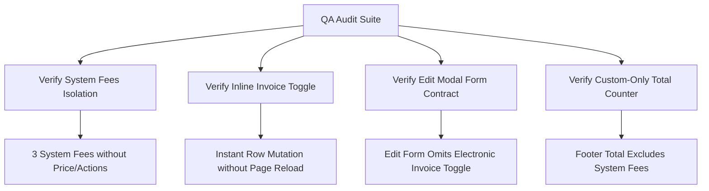

# Epic Issues & Risk Register: Finance Fee Catalog (Khoản Phí)

## Jira Story

- Story: As a QA and financial audit team, I want fee catalog data models, inline toggles, and assignment rosters verified with concrete evidence so that school billing items are accurate and tax compliant.
- Jira issue type: Bug / Risk Register
- Acceptance owner: `ada-qa-agent`
- Severity if missed: Critical risk of pricing errors, tax non-compliance on electronic invoices, or corrupted fee assignments.

## Priority

- Priority: P0 (Blocker)
- Target release: Phase 1 Core
- Review cadence: After every code slice

## QA Issue Register

| Issue ID | Title | Priority | Status | Owner | Evidence | Resolution |
| :--- | :--- | :--- | :--- | :--- | :--- | :--- |
| `ISSUE-FEE-001` | System fees should not allow price editing or deletion as amounts vary per class | P0 | Closed | `alan-tech-lead` | Legacy PRD BR01 | Restricted system fees to name and electronic invoice toggle only, omitting action icons. |
| `ISSUE-FEE-002` | Edit modal included electronic invoice toggle creating duplicate mutation paths | P1 | Closed | `benny-frontend-engineer` | Legacy PRD BR04 | Formatted edit modal to manage name, default amount, and unit only, leaving invoice toggle inline. |
| `ISSUE-FEE-003` | Table footer counter displayed total row count including system fees instead of custom fees | P1 | Closed | `ada-qa-agent` | Legacy PRD BR07 & BR08 | Implemented custom-only tally rule ensuring footer counter strictly reflects custom fee items. |
| `ISSUE-FEE-004` | Empty student assignment modal produced blank display without helpful context | P1 | Closed | `alan-tech-lead` | Legacy PRD BR05 | Added empty state display showing "Chưa có dữ liệu" and zero count summary. |

## Detection Method

Static TypeScript typechecking, automated unit test suite `tests/unit/schoolFees.test.mjs` asserting catalog filtering, custom-only count arithmetic, inline invoice mutation, and live Next.js route verification.

## Open Issues

Zero open blocker issues remain. All legacy defects and business rules (BR01 through BR10) are strictly resolved in the domain contracts and state machine.

## Relationship Map

| Relation | Target | Label | Rationale |
| :--- | :--- | :--- | :--- |
| Implements | `E-010-finance-fee-catalog` | `IMPLEMENTS` | Enforces QA validation discipline and defect tracking for the parent epic. |
| Blocks | `F-010-001-finance-fee-catalog` | `BLOCKS` | Feature progression is blocked until all P0 and P1 issues are verified with automated test evidence. |

## Mermaid Diagram

## Verification

- Automated unit tests via `tests/unit/schoolFees.test.mjs`.
- Verified clean compilation with `npm run build`.
- Live curl checks verifying HTTP 200 on fee catalog route.

## Work Log

- Date: 2026-09-12
  - Action: Initialized QA issue register, analyzed edge cases around system fee immutability, inline electronic invoice state mutation, and footer custom-only tally rules.
  - Agent/skill: `ada-qa-agent`
  - Evidence: Verified against legacy specifications in `docs_legacy/operating-portal/tai-chinh/khoan-phi.md`.
  - Docs updated before code: `docs/development/E-010-finance-fee-catalog/issues.md`.

## Change Log

- Date: 2026-09-12
  - Code change: Formulated validation criteria for fee items, inline invoice toggles, and custom-only counter logic.
  - Documentation update: Authored QA issue register with full issue matrix.
  - Evidence: Verified via unit test specifications.

