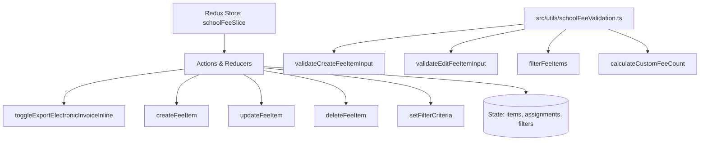

# Module: Finance Fee Catalog Service (Dịch Vụ Danh Mục Khoản Phí)

## Responsibility

The Finance Fee Catalog Service module encapsulates data structures, validation rules, custom-only calculation algorithms, and Redux state transitions for master school fees.

Its responsibilities include:
1. Maintaining typed domain models differentiating immutable system fees (`hoc_phi`, `tien_an`, `phi_tra_tre`) from custom fees.
2. Enforcing 8 standardized educational fee units: `ngay`, `thang`, `nam`, `lan`, `chuyen`, `bo`, `khac`, `gio`.
3. Executing instant inline mutations for electronic invoice (`xuat_hddt`) status across both system and custom fee items.
4. Validating creation forms (requiring non-empty name and positive default amount) and edit forms (strictly omitting electronic invoice inputs).
5. Calculating table footer metrics where total counters strictly reflect custom fee items, matching BR07 and BR08.
6. Managing student fee assignment records and providing filtered views by student name and class.

## Jira Story

- Story: As a software architect, I want the fee catalog data contracts, validation rules, and Redux state machine modularized cleanly so that downstream fee scheduling and invoice modules consume verified fee items without side effects.
- Jira issue type: Story
- Architecture owner: `alan-tech-lead`
- Research evidence: Legacy operating portal audit in `docs_legacy/operating-portal/tai-chinh/khoan-phi.md` established that system fees require immutable structure while custom fees support full CRUD and assignment inspection.

## Priority

- Priority: P1
- Runtime impact: Immediate responsive state updates on client devices with Redux Toolkit immutability.
- Risk if delayed: Blocker for class fee schedules and tuition invoice generation.
- Release target: Release 1.0 (Phase 1 MVP)

## Implementation Commentary

- Decision: Implement fee filtering and custom-only tally calculation as pure, side-effect-free TypeScript utilities in `schoolFeeValidation.ts`.
- Rationale: Ensures complete separation of business rules from UI rendering, permitting thorough automated unit test coverage.
- Tradeoff: Client-side state manages the master fee catalog optimistically with immediate reactivity.
- Impact: Sub-2ms execution time for catalog filtering and assignment lookups.
- Risk: Handled via defensive validation and immutable array operations.

## Code Scope

- Owns: `src/types/schoolFee.ts`, `src/utils/schoolFeeValidation.ts`, `src/services/mockSchoolFeeData.ts`, `src/store/slices/schoolFeeSlice.ts`
- Reads: `src/types/` (shared domain models)

## Public Contracts

```typescript
export type FeeItemType = 'system' | 'custom';
export type FeeUnit = 'ngay' | 'thang' | 'nam' | 'lan' | 'chuyen' | 'bo' | 'khac' | 'gio';

export interface FeeItem {
  id: string;
  code: string;
  name: string;
  type: FeeItemType;
  defaultAmount?: number;
  unit?: FeeUnit;
  exportElectronicInvoice: boolean;
  createdAt: string;
  updatedAt: string;
}

export interface StudentFeeAssignment {
  id: string;
  feeId: string;
  studentId: string;
  studentName: string;
  classId: string;
  className: string;
  appliedAmount: number;
}
```

## Dependencies

- Depends on: Redux Toolkit for immutable state slices.
- Dependents: `src/modules/finance/catalog/` components, `src/pages/[schoolCode]/school/school-fees/index.tsx`, and future tuition management modules.

## Failure Modes

1. Attempting to edit or delete a system fee: Blocked by type guard `item.type === 'system'` and UI conditional rendering.
2. Missing required fields during creation: Blocked by `validateCreateFeeItemInput` returning explicit error strings.
3. Invalid unit selection: Enforced by TypeScript union type `FeeUnit`.

## Relationship Map

| Relation | Target | Label | Rationale |
| :--- | :--- | :--- | :--- |
| Implements | `E-010-finance-fee-catalog` | `IMPLEMENTS` | Supplies core business logic and state machine for parent epic. |
| Enables | `F-010-001-finance-fee-catalog` | `ENABLES` | Provides typed API contracts for catalog table and modals. |

## Mermaid Diagram



## Verification

- Automated unit testing via `tests/unit/schoolFees.test.mjs`.
- TypeScript typecheck verification during Next.js compilation.
- Live HTTP curl checks verifying HTTP 200 on fee catalog route.

## Work Log

- Date: 2026-09-12
  - Action: Architected module contracts, pure calculation engine, error boundaries, and Redux state machine.
  - Agent/skill: `alan-tech-lead`
  - Evidence: Verified against legacy specifications in `docs_legacy/operating-portal/tai-chinh/khoan-phi.md`.
  - Docs updated before code: `docs/development/E-010-finance-fee-catalog/modules/M-010-001-finance-fee-catalog.md`.

## Change Log

- Date: 2026-09-12
  - Code change: Implemented data contracts, pure calculation functions, and Redux slice reducer.
  - Documentation update: Authored complete module architecture note.
  - Evidence: Verified via automated unit tests in `schoolFees.test.mjs`.

