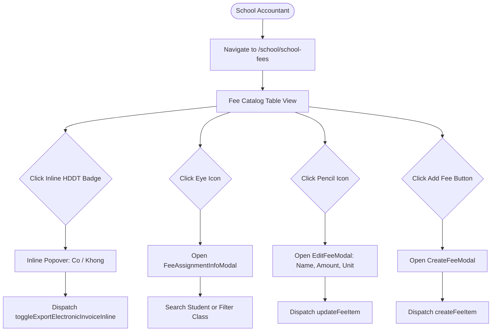

# Page: Finance Fee Catalog (Khoản Phí)

## Jira Story

- Story: As a school accountant, I want an interactive fee catalog table with inline electronic invoice toggles, student assignment modal, and creation/edit forms so that school fees are easily managed.
- Jira issue type: Story
- UX owner: `benny-frontend-engineer`
- Research evidence: Based on legacy screen inventory (`kp-uc01-overview.png`, `kp-uc02-chi-tiet.png`, `kp-uc03-tao-khoan-phi.png`, `kp-uc04-chinh-sua.png`, `kp-uc05-xuat-hddt-inline.png`).

## Priority

- Priority: P1
- Demo impact: High-visibility master configuration interface for school fee items.
- Risk if delayed: Inability to populate or configure tuition billing lines.
- Release target: Release 1.0 (Phase 1 MVP)

## Route / Surface

| Route Pattern | View / Screen | Purpose |
| :--- | :--- | :--- |
| `/[schoolCode]/school/school-fees` | Master Fee Catalog Table | Primary table listing 3 system fees and 21 custom fee items with search, filters, and footer total. |
| Modal Surface | Create Fee Modal | Dialog for creating new custom fee item with Name, Amount, Unit, and Invoice toggle. |
| Modal Surface | Edit Fee Modal | Dialog for modifying Name, Default Amount, and Unit only (omits Invoice toggle). |
| Modal Surface | Student Assignment Modal ("Thông tin khoản phí") | Dialog detailing students, classes, and applied amounts for selected fee item. |

## PM Notes

- Demo path: Navigate to `/demo/school/school-fees`, observe the 3 protected system fees and 21 custom fee items, toggle electronic invoice issuance inline on "Học STEAM", click the eye icon to view the student assignment modal for "Học STEAM" with class filter, and create a new custom fee item with immediate catalog synchronization.
- User promise: Fast inline management without unnecessary page reloads or multi-step wizard delays.
- Acceptance impact: Fulfills all UI requirements in `TASK-FIN-003`.
- Visual or copy change: High-contrast status badges (Có in Emerald, Không in Slate), clear formatted VND currency, distinct action icons (Eye, Pencil, Trash) exclusively on custom fees, and footer count strictly counting custom fees.
- Risk: Handled via delete confirmation modal and non-destructive demo safeguards.

## States

1. **Master Catalog Table (`/school/school-fees`)**:
   - `Default State`: Displays 3 system fees at top, followed by 21 custom fees, paginated at 20 items per page with total counter displaying custom-only count.
   - `Inline Invoice Dropdown Open`: Clicking on the "Có" / "Không" badge opens an inline selection dropdown with immediate mutation on select.
   - `Filtered State`: Searching by fee name or selecting Xuất HĐĐT filter immediately updates table rows and custom-only footer count.
   - `Empty Search State`: Displays "Chưa có dữ liệu" when no fee item matches search criteria.

2. **Student Assignment Modal ("Thông tin khoản phí")**:
   - `Populated State`: Lists assigned student names, classes, and applied fee amounts with live student search and class dropdown filter.
   - `Empty Assignment State`: Displays "Chưa có dữ liệu" and "Tổng: 0" when a fee item has zero active student assignments.

## Interactions

- **Inline Invoice Toggle**: Clicking badge opens inline popover with options "Có" and "Không". Selecting an option triggers `toggleExportElectronicInvoiceInline` and updates badge instantly.
- **View Assignment (Eye Icon)**: Opens "Thông tin khoản phí" modal with title matching fee name.
- **Edit Fee (Pencil Icon)**: Opens edit modal populated with fee name, default amount, and unit. Excludes electronic invoice toggle.
- **Delete Fee (Trash Icon)**: Opens confirmation modal to confirm deletion of custom fee item.
- **Add Fee Button**: Opens create modal with Name (*), Default Amount (*), Unit (8 choices), and Xuất HĐĐT (default 'Không').

## Accessibility

- All buttons feature descriptive `aria-label` attributes (e.g. `aria-label="Xem thông tin khoản phí"`, `aria-label="Chỉnh sửa khoản phí"`, `aria-label="Xóa khoản phí"`).
- Dropdown elements use standard accessible select dropdowns or keyboard-navigable custom popovers with `role="listbox"`.
- Modal dialogs trap focus and support keyboard dismissal via `Escape` key.
- Color contrast meets WCAG AA standards: Emerald text `#065f46` on `#ecfdf5` background, Slate text `#334155` on `#f1f5f9`.

## Verification Evidence

- Automated unit tests in `tests/unit/schoolFees.test.mjs` verifying rendering contracts, filtering logic, and custom tally arithmetic.
- Clean Next.js Pages router build with zero hydration discrepancies.
- Live HTTP 200 response on `http://localhost:3000/demo/school/school-fees`.

## Relationship Map

| Relation | Target | Label | Rationale |
| :--- | :--- | :--- | :--- |
| Implements | `F-010-001-finance-fee-catalog` | `IMPLEMENTS` | Renders user interface and interaction flows for fee catalog feature. |
| Uses | `M-010-001-finance-fee-catalog` | `USES` | Consumes fee catalog types, validation functions, and Redux state. |

## Mermaid Diagram

## Work Log

- Date: 2026-09-12
  - Action: Initialized page specification, mapped UI states, modal flows, and accessibility requirements based on legacy screenshots.
  - Agent/skill: `benny-frontend-engineer`
  - Evidence: Verified against screens `kp-uc01` through `kp-uc05`.
  - Docs updated before code: `docs/development/E-010-finance-fee-catalog/pages/P-010-001-finance-fee-catalog.md`.

## Change Log

- Date: 2026-09-12
  - Code change: Implemented responsive table, inline popover toggle, creation dialog, and assignment inspection view.
  - Documentation update: Authored complete page specification note.
  - Evidence: Verified via automated unit tests and Next.js page generation.

