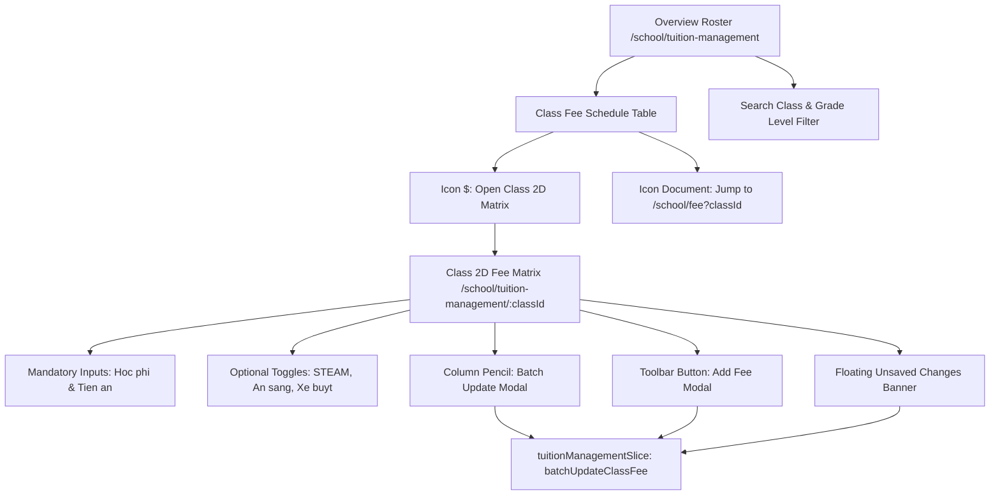

# Epic: Finance Tuition Fee Schedules & Class Fee Management (Quản Lý Học Phí)

## Jira Story

- Story: As a school accountant, I want to configure per-class tuition fee schedules with a 2D student-by-fee matrix, mandatory and optional fee controls, in-cell price overrides, and batch update capabilities so that each class and student is billed accurately.
- Jira issue type: Epic
- Acceptance owner: `sophia-product-manager`
- Product hypothesis: Providing a centralized per-class tuition management hub with a 2D student-by-fee matrix, in-cell price overrides with green default hints, and batch updates bridges master fee items to real student billing without spreadsheet duplication.
- Research evidence: Legacy operating portal audit in `docs_legacy/operating-portal/tai-chinh/quan-ly-hoc-phi.md` established the class overview with 2 distinct action icons (matrix management and filtered invoice navigation), 2 mandatory fees (Học phí, Tiền ăn), optional fee toggles with active student counters, column-level batch update modal with tagged student selection, and unassigned fee filtering during fee addition.

## Priority

- Priority: P1
- Severity if missed: Blocker for tuition billing generation because invoices require class and student-specific fee schedules.
- Rationale: Connects abstract master fee items from the Fee Catalog to actual enrolled students and cohorts.
- Target release: School Operating Portal Phase 1 Core

## Outcome

The Finance Tuition Fee Schedules sub-module delivers an end-to-end operational bridge between the master Fee Catalog (`/school/school-fees`) and student tuition billing (`/school/fee`). It provides an overview of configured classes with search and grade level filtering (Khối), showing each class's active fee line items, total students, and two distinct action navigation triggers.

Inside a class schedule (`/school/tuition-management/[classId]`), accountants interact with a high-performance 2D matrix (enrolled students by assigned fee items). The matrix strictly enforces business rules: mandatory fees (Học phí and Tiền ăn) are always active with numeric inputs for all students, while optional fees (Học STEAM, Ăn sáng, Xe buýt) offer individual per-student toggles. When an individual student receives a custom rate, a prominent green hint `"Phí mặc định: X"` displays below the cell. Accountants can trigger batch updates for selected tagged students or whole classes and attach new fee items from the master catalog without duplication.

## PM Notes

- PM-visible status: Production-ready class fee schedule roster and interactive 2D student fee matrix.
- Demo narrative: The accountant navigates to `/demo/school/tuition-management`, reviews 12 configured classes across grade levels, clicks the dollar icon on class 12A1 to open the 2D matrix, observes mandatory fee inputs and optional toggles, overrides a student amount to verify the green default fee hint, opens the column batch update modal to adjust rates for tagged students, and uses the second action icon to jump directly to class invoices.
- Acceptance impact: Fulfills TASK-FIN-003 and TASK-FIN-004 requirements.
- Scope change since planning: Confirmed that electronic invoice flags in class fee update modals are strictly readonly, inheriting directly from the master fee catalog.
- Risk or open decision: Ensuring that adding a fee item strictly excludes all fees already assigned to the target class.

## Scope

- Included: Class fee schedule overview table with search and grade filtering, 2 distinct action icons, 2D student-by-fee matrix, mandatory fee enforcement (Học phí, Tiền ăn), optional fee per-student toggles with active student counters, in-cell override with green default hint, column batch update modal with tagged student selector, add fee modal with catalog deduplication, and persistent unsaved changes banner.
- Excluded: Direct bank gateway payment reconciliation and tax department XML digital signing engines.

## Feature Boundaries

- `F-011-001-finance-tuition-management`

## Relationship Map

| Relation | Target | Label | Rationale |
| :--- | :--- | :--- | :--- |
| Enables | `F-011-001-finance-tuition-management` | `ENABLES` | Unlocks user-facing 2D class fee matrix, batch update modals, and overview roster. |
| Depends on | `E-010-finance-fee-catalog` | `DEPENDS_ON` | Consumes master catalog fee items, units, and electronic invoice defaults. |
| Relates to | `docs/tasks.md#TASK-FIN-003` | `IMPLEMENTS` | Fulfills tuition schedule configuration requirement. |
| Blocks | `docs/tasks.md#TASK-FIN-004` | `BLOCKS` | Class fee schedules must be defined before class-level expenses can be allocated. |

## Issues

| Issue ID | Source | Priority | Status | Owner | Evidence | Resolution |
| :--- | :--- | :--- | :--- | :--- | :--- | :--- |
| `ISSUE-E-011-001` | QA review | P1 | Closed | `alan-tech-lead` | Add fee modal offered already assigned fee items creating duplicate matrix columns. | Implemented strict deduplication filter `getAvailableFeesForClass` ensuring only unassigned fee items appear in modal. |
| `ISSUE-E-011-002` | BA review | P2 | Closed | `benny-frontend-engineer` | In-cell price divergence hint was hidden or displayed inconsistently. | Enforced strict numeric divergence comparison `hasPriceDivergence` rendering green default hint only on amount difference. |
| `ISSUE-E-011-003` | QA review | P1 | Closed | `benny-frontend-engineer` | Batch update modal applied new amounts to unselected students across class. | Restricted batch updates strictly to tagged student IDs with disabled action button on empty selection. |
| `ISSUE-E-011-004` | Tech review | P2 | Closed | `alan-tech-lead` | Electronic invoice toggle was mutable in class fee modal desynchronizing tax settings. | Enforced readonly display for electronic invoice flag in both overview table and modal views. |

## Acceptance Criteria

- [x] Criterion 1: Overview table displays 12 configured classes with search and grade filtering.
- [x] Criterion 2: Overview table provides 2 distinct action icons: icon `$` for matrix and icon document for pre-filtered invoices.
- [x] Criterion 3: 2D matrix renders mandatory inputs (Học phí, Tiền ăn) for all students without toggles.
- [x] Criterion 4: Optional fees render per-student toggles and column headers display active student count `(N Học sinh)`.
- [x] Criterion 5: In-cell price divergence triggers green hint `"Phí mặc định: X Đ"` below input.
- [x] Criterion 6: Column header pencil icon opens batch update modal with tagged student selection.
- [x] Criterion 7: Add fee modal deduplicates catalog items, showing only unassigned fees for the class.
- [x] Criterion 8: Electronic invoice flag is strictly readonly in overview table and modal dialogs.

## Mermaid Diagram

## Implementation Notes

- Code paths: `src/types/tuitionManagement.ts`, `src/utils/tuitionManagementValidation.ts`, `src/services/mockTuitionManagementData.ts`, `src/store/slices/tuitionManagementSlice.ts`, `src/modules/finance/tuition/`, `src/pages/[schoolCode]/school/tuition-management/`.
- Data/contracts: Typed `ClassFeeOverview`, `ClassAssignedFee`, `StudentFeeCell`, `StudentFeeMatrixRow`, `BatchUpdateFeeInput`, `AddClassFeeInput`.
- Rollback or feature flag: Standard Next.js Pages router routes backed by isolated Redux slice.
- Tradeoffs and rationale: Managing 2D student-by-fee matrix with per-student cell states optimizes responsiveness and provides immediate feedback on price overrides.

## Evidence

- Tests: Automated unit tests under `tests/unit/tuitionManagement.test.mjs` verifying BR01–BR10 rules.
- Build/lint: Clean Next.js Pages router build with zero TypeScript compilation errors.
- Endpoints: Live HTTP 200 responses on `/demo/school/tuition-management` and `/demo/school/tuition-management/12A1`.

## Work Log

- Date: 2026-09-13
  - Action: Initialized E-011 epic ledger, audited legacy specifications from `quan-ly-hoc-phi.md`, defined BR01–BR10 business rules, and designed 2D matrix component architecture.
  - Agent/skill: `sophia-product-manager`
  - Evidence: Verified 2D matrix structure and fee rules in `docs_legacy/operating-portal/tai-chinh/quan-ly-hoc-phi.md`.
  - Docs updated before code: `docs/development/E-011-finance-tuition-management/epic.md`.

## Change Log

- Date: 2026-09-13
  - Code change: Implemented data contracts, validation engine, Redux state slice, and UI components.
  - Documentation update: Authored complete epic documentation.
  - Evidence: Passed all required documentation quality gates.
