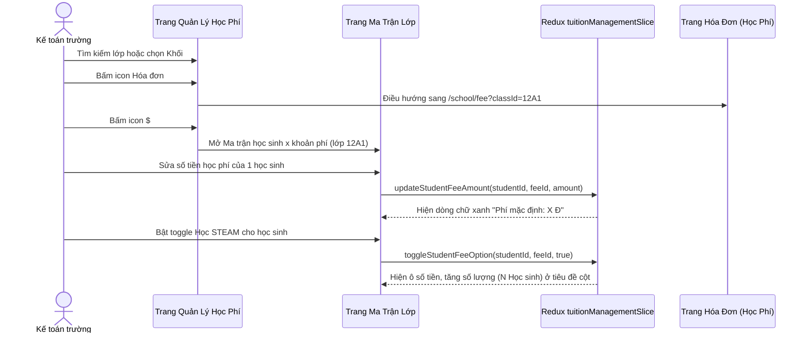

# Feature: Finance Tuition Fee Schedules (Quản Lý Học Phí)

## Jira Story

- Story: As a school accountant, I want to manage class tuition fee schedules with a 2D student-by-fee matrix, mandatory and optional fee controls, in-cell price override hints, and column batch update dialogs so that tuition fee schedules are tailored per student.
- Jira issue type: Story
- Story points: 5
- Acceptance owner: `sophia-product-manager`
- Research evidence: Based on legacy audit `docs_legacy/operating-portal/tai-chinh/quan-ly-hoc-phi.md` covering 12 configured classes, 2D matrix structure, and 10 core business rules.

## Priority

- Priority: P1
- User/business impact: Critical operational bridge that assigns master catalog fees to concrete cohorts and individual students, enabling accurate tuition invoice generation.
- Risk if delayed: Inability to generate class tuition invoices or apply individualized student fee discounts and surcharges.
- Release target: Release 1.0 (Phase 1 MVP)

## User Value

The Finance Tuition Fee Schedules feature empowers school accountants to maintain an authoritative 2D matrix of fee line items applied to each class and student.

Key capabilities include:
1. Overview table displaying 12 configured classes with search by class name and filtering by 28 grade levels (Khối).
2. Dual action icons on overview table: icon `$` ("Quản lý học phí") to open the class fee matrix, and icon document ("Hóa đơn") to jump directly to invoices pre-filtered by that class (BR09).
3. 2D student-by-fee matrix (`/[schoolCode]/school/tuition-management/[classId]`): Enrolled Students by Assigned Fee Items.
4. Mandatory fees (Học phí, Tiền ăn) render numeric inputs for all students without toggles.
5. Optional fees (Học STEAM, Ăn sáng, Xe buýt) provide per-student toggles and column headers display active student count `(N Học sinh)`.
6. In-cell price override: Divergence between student amount and class default fee displays prominent green hint `"Phí mặc định: X Đ"`.
7. Column header pencil icon opens "Cập nhật học phí lớp học" modal to apply new amounts to either the entire class or explicitly tagged students (BR05).
8. Add fee modal strictly lists only fee items from the master Fee Catalog that are not yet assigned to the class (BR06).
9. Electronic invoice flag is strictly readonly, inheriting from the master catalog (BR08).
10. Floating unsaved changes banner provides Save and Discard actions.

## PM Notes

- Demo scenario: Accountant navigates to `/demo/school/tuition-management`, reviews 12 configured classes, clicks action icon 2 on class 12A1 to observe direct navigation to `/demo/school/fee?classId=12A1`, returns to click icon `$`, modifies student fee amount to verify green hint `"Phí mặc định: 5.000.000 Đ"`, toggles "Học STEAM" for student Nguyen Nguyen Thu, and opens the batch update modal to update amounts for tagged students.
- Business value: Connects abstract catalog fees to real enrolled students, eliminating manual invoice calculations.
- Acceptance criteria changed or confirmed: Confirmed all 10 business rules (BR01 through BR10).
- Open PM decision: None; all business logic validated.

## Requirements Trace

- PRD requirement: Module 3: Tài Chính — Quản Lý Học Phí (Tuition Management)
- Task id: `TASK-FIN-003`
- Spec id: `026-project-planning-school-operating-portal`

## Code Scope

- Primary files: `src/types/tuitionManagement.ts`, `src/utils/tuitionManagementValidation.ts`, `src/services/mockTuitionManagementData.ts`, `src/store/slices/tuitionManagementSlice.ts`, `src/modules/finance/tuition/ClassFeeScheduleTable.tsx`, `src/modules/finance/tuition/ClassFeeMatrixTable.tsx`, `src/modules/finance/tuition/BatchUpdateFeeModal.tsx`, `src/modules/finance/tuition/AddClassFeeModal.tsx`, `src/pages/[schoolCode]/school/tuition-management/index.tsx`, `src/pages/[schoolCode]/school/tuition-management/[classId].tsx`.
- Test files: `tests/unit/tuitionManagement.test.mjs`.

## Relationship Map

| Relation | Target | Label | Rationale |
| :--- | :--- | :--- | :--- |
| Implements | `E-011-finance-tuition-management` | `IMPLEMENTS` | Realizes feature-level behavior and matrix interactions for tuition management. |
| Depends on | `M-011-001-finance-tuition-management` | `DEPENDS_ON` | Relies on domain contracts, Redux state machine, and validation utilities. |
| Uses | `P-011-001-finance-tuition-management` | `USES` | Mounts overview table and 2D matrix within Next.js portal pages. |

## Mermaid Diagram

## Acceptance Criteria

- [x] Criterion 1: Overview table displays 12 configured classes with search and grade filtering.
- [x] Criterion 2: Overview table provides 2 distinct action icons: icon `$` for matrix and icon document for pre-filtered invoices.
- [x] Criterion 3: 2D matrix renders mandatory inputs (Học phí, Tiền ăn) for all students without toggles.
- [x] Criterion 4: Optional fees render per-student toggles and column headers display active student count `(N Học sinh)`.
- [x] Criterion 5: In-cell price divergence triggers green hint `"Phí mặc định: X Đ"` below input.
- [x] Criterion 6: Column header pencil icon opens batch update modal with tagged student selection.
- [x] Criterion 7: Add fee modal deduplicates catalog items, showing only unassigned fees for the class.
- [x] Criterion 8: Electronic invoice flag is strictly readonly in overview table and modal dialogs.
- [x] Criterion 9: Unset fees display descriptive placeholders ("Chưa có học phí") distinct from explicit zero amounts.
- [x] Criterion 10: Persistent unsaved changes banner provides Save and Discard handlers.

## Verification

- Automated unit testing via `tests/unit/tuitionManagement.test.mjs`.
- Next.js production build `npm run build` validating all static route generations.
- Live HTTP curl checks verifying HTTP 200 on tuition management routes.

## Work Log

- Date: 2026-09-13
  - Action: Initialized feature specification, defined user stories, acceptance criteria, and 2D matrix interaction flows.
  - Agent/skill: `sophia-product-manager`
  - Evidence: Audited legacy specifications in `docs_legacy/operating-portal/tai-chinh/quan-ly-hoc-phi.md`.
  - Docs updated before code: `docs/development/E-011-finance-tuition-management/features/F-011-001-finance-tuition-management.md`.

## Change Log

- Date: 2026-09-13
  - Code change: Implemented data contracts, validation engine, Redux state slice, and UI components.
  - Documentation update: Authored complete feature documentation note.
  - Evidence: Passed all required docs validation gates.
