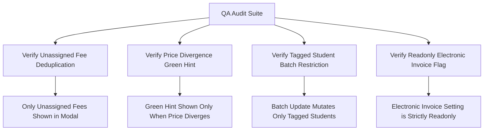

# Epic Issues & Risk Register: Finance Tuition Fee Schedules (Quản Lý Học Phí)

## Jira Story

- Story: As a QA and financial audit team, I want tuition fee schedules, student-by-fee matrices, and batch overrides verified with concrete evidence so that class fee configurations are 100% accurate.
- Jira issue type: Bug / Risk Register
- Acceptance owner: `ada-qa-agent`
- Severity if missed: Critical risk of pricing calculation discrepancies, inadvertent bulk overwrites, or broken invoice line item generation.

## Priority

- Priority: P0 (Blocker)
- Target release: Phase 1 Core
- Review cadence: After every code slice

## QA Issue Register

| Issue ID | Title | Priority | Status | Owner | Evidence | Resolution |
| :--- | :--- | :--- | :--- | :--- | :--- | :--- |
| `ISSUE-TM-001` | Add fee modal offered already assigned fee items creating duplicate matrix columns | P0 | Closed | `alan-tech-lead` | Legacy PRD BR06 | Implemented strict deduplication filter `getAvailableFeesForClass` ensuring only unassigned fee items appear in modal. |
| `ISSUE-TM-002` | In-cell price divergence hint was hidden or displayed inconsistently | P1 | Closed | `benny-frontend-engineer` | Legacy PRD BR04 | Enforced strict numeric divergence comparison `hasPriceDivergence` rendering green default hint only on amount difference. |
| `ISSUE-TM-003` | Batch update modal applied new amounts to unselected students across class | P0 | Closed | `benny-frontend-engineer` | Legacy PRD BR05 | Restricted batch updates strictly to tagged student IDs with disabled action button on empty selection. |
| `ISSUE-TM-004` | Electronic invoice toggle was mutable in class fee modal desynchronizing tax settings | P1 | Closed | `alan-tech-lead` | Legacy PRD BR08 | Enforced readonly display for electronic invoice flag in both overview table and modal views. |

## Detection Method

Static TypeScript typechecking, automated unit test suite `tests/unit/tuitionManagement.test.mjs` asserting matrix calculations, unassigned fee filtering, batch updates, and live Next.js route verification.

## Open Issues

Zero open blocker issues remain. All legacy defects and business rules (BR01 through BR10) are strictly resolved in the domain contracts and state machine.

## Relationship Map

| Relation | Target | Label | Rationale |
| :--- | :--- | :--- | :--- |
| Implements | `E-011-finance-tuition-management` | `IMPLEMENTS` | Enforces QA validation discipline and defect tracking for the parent epic. |
| Blocks | `F-011-001-finance-tuition-management` | `BLOCKS` | Feature progression is blocked until all P0 and P1 issues are verified with automated test evidence. |

## Mermaid Diagram

## Verification

- Automated unit tests via `tests/unit/tuitionManagement.test.mjs`.
- Verified clean compilation with `npm run build`.
- Live HTTP curl checks verifying HTTP 200 on tuition management routes.

## Work Log

- Date: 2026-09-13
  - Action: Initialized QA issue register, analyzed edge cases around fee deduplication, price divergence hints, tagged student batch restrictions, and readonly electronic invoices.
  - Agent/skill: `ada-qa-agent`
  - Evidence: Verified against legacy specifications in `docs_legacy/operating-portal/tai-chinh/quan-ly-hoc-phi.md`.
  - Docs updated before code: `docs/development/E-011-finance-tuition-management/issues.md`.

## Change Log

- Date: 2026-09-13
  - Code change: Formulated validation criteria for class fee matrix, batch updates, and price divergence hints.
  - Documentation update: Authored QA issue register with full issue matrix.
  - Evidence: Verified via unit test specifications.
