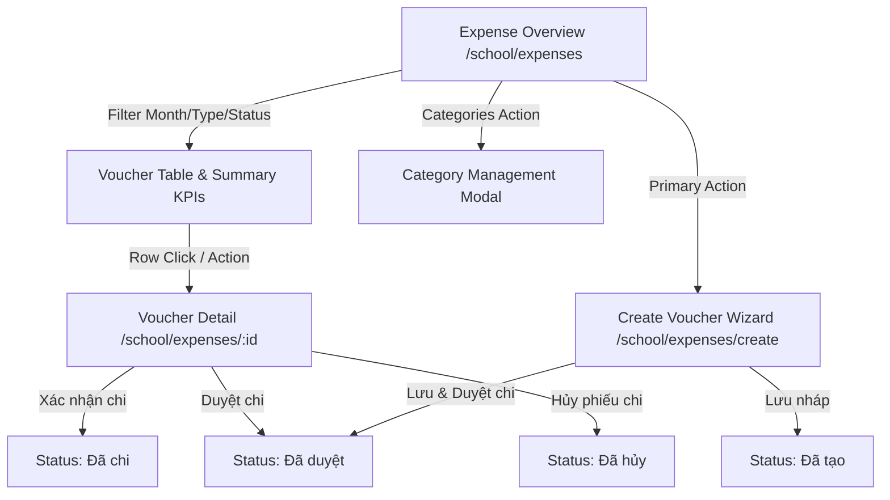

# Epic: Finance Expenses & Disbursements (Khoản Chi)

## Jira Story

- Story: As a school accountant, I want to create, categorize, approve, disburse, and cancel expense vouchers with multi-line accounting matrices and role-based beneficiary details so that the school's disbursements and tuition refunds are transparently controlled.
- Jira issue type: Epic
- Acceptance owner: `sophia-product-manager`
- Product hypothesis: Providing a centralized expense voucher lifecycle management system with multi-line accounting calculation, role-based beneficiary rendering (Học sinh vs Nhân viên), immutable audit trails, and category management prevents financial leakage and streamlines tuition refund notifications to parents.
- Research evidence: Legacy operating portal audit in `docs_legacy/operating-portal/tai-chinh/khoan-chi.md` established the 4-state voucher lifecycle (Đã tạo → Đã duyệt → Đã chi, with cancellation to Đã hủy), dual creation flows (Lưu nháp vs Lưu & Duyệt chi), mandatory single-month filtering, system-protected "Mặc định" category, and 5-column accounting matrices.

## Priority

- Priority: P1
- Severity if missed: Blocker for school financial reconciliation and parent tuition refund handling.
- Rationale: Completes the debit side of the school operational ledger, balancing tuition invoices with disbursements and refunds.
- Target release: School Operating Portal Phase 1 Core

## Outcome

The Finance Expenses & Disbursements sub-module delivers an end-to-end operational portal for tracking, approving, and recording school expenditures. It supports tuition refunds to parents as well as internal school operational disbursements (teaching allowances, equipment, facility maintenance, uniforms). Each voucher progresses through a rigorous 3-step lifecycle: `Đã tạo` (Draft) → `Đã duyệt` (Approved) → `Đã chi` (Disbursed), with the ability to cancel with required reason notes prior to actual disbursement.

Accountants can create vouchers via two entrypoints: "Lưu nháp" for standard drafting or "Lưu & Duyệt chi" for immediate single-step approval. When the voucher type is set to "Hoàn tiền", an automatic notice alerts staff that parent notifications will be dispatched. On the detail view, beneficiary cards dynamically adapt: Student disbursements display both student identity and legal guardian recipient, whereas Staff disbursements show department and position. The accounting matrix automatically computes line totals and aggregate voucher amounts, while category management ensures standardized reporting with protection for default system categories.

## PM Notes

- PM-visible status: Production-ready expense voucher roster, detail review, voucher creation wizard, cancellation modal, and category manager.
- Demo narrative: The accountant navigates to `/demo/school/expenses`, reviews December 2025 expense vouchers, filters by Type (Hoàn tiền) and Status (Đã duyệt), opens a voucher to inspect the accounting matrix and recipient information, clicks "Xác nhận chi" to complete disbursement, creates a new voucher using "Lưu & Duyệt chi", and explores expense category management.
- Acceptance impact: Fulfills TASK-FIN-004 requirements and complements invoice refunds.
- Scope change since planning: Clarified that the single-month picker is mandatory for expense reporting to ensure bounded, performant ledger reconciliation.
- Risk or open decision: Ensuring that vouchers in "Đã chi" status permanently lock edit and cancellation actions.

## Scope

- Included: Expense voucher overview table with mandatory single-month filter, search, type and status filters; dynamic KPI summary cards; detail view with state-dependent action bar; 2-way creation form (Lưu nháp vs Lưu & Duyệt chi); multi-line accounting matrix with automatic line and aggregate calculation; cancellation modal with required reason; expense category management drawer/modal with system category lock; and unsaved changes banner.
- Excluded: Direct bank disbursement API triggers and fiscal XML electronic invoicing for disbursements.

## Relationship Map

| Relation | Target | Label | Rationale |
| :--- | :--- | :--- | :--- |
| Enables | `F-012-001-finance-expenses` | `ENABLES` | Unlocks user-facing expense voucher creation, approval, and management screens. |
| Depends on | `E-009-finance-invoices` | `DEPENDS_ON` | Connects tuition refund vouchers to parent billing balances. |
| Relates to | `docs/tasks.md#TASK-FIN-004` | `IMPLEMENTS` | Implements expense and disbursement voucher requirements. |
| Blocks | `docs/tasks.md#TASK-FIN-005` | `BLOCKS` | Expense ledger reconciliation requires completed disbursement vouchers. |

## Issues

| Issue ID | Source | Priority | Status | Owner | Evidence | Resolution |
| :--- | :--- | :--- | :--- | :--- | :--- | :--- |
| `ISSUE-E-012-001` | QA review | P0 | Closed | `alan-tech-lead` | Cancellation allowed on disbursed vouchers (`da_chi`) causing accounting desynchronization. | Strictly disabled and hidden cancel actions when voucher is in `da_chi` status. |
| `ISSUE-E-012-002` | BA review | P0 | Closed | `alan-tech-lead` | Deleting the default category (`Mặc định`) broke system fallback categorization. | Locked delete action permanently for category with `isSystemDefault: true` / name `Mặc định`. |
| `ISSUE-E-012-003` | UX review | P1 | Closed | `benny-frontend-engineer` | Recipient fields for staff disbursement incorrectly requested student guardian information. | Dynamically swapped beneficiary fields between Student (shows Student + Guardian recipient) and Staff (shows Staff + Title). |
| `ISSUE-E-012-004` | QA review | P2 | Closed | `benny-frontend-engineer` | Export data button was active on empty months generating blank spreadsheets. | Enforced automatic button disablement when active month voucher count is 0. |

## Acceptance Criteria

- [x] Criterion 1: Overview table displays expense vouchers filtered strictly by mandatory single-month picker (BR07).
- [x] Criterion 2: Two voucher types supported: "Khác" and "Hoàn tiền", with "Hoàn tiền" showing blue parent notification notice (BR01).
- [x] Criterion 3: Two beneficiary types supported: "Học sinh" (with Student + Guardian recipient) and "Nhân viên" (with Staff + Department) (BR02, BR03).
- [x] Criterion 4: Multi-line accounting matrix automatically calculates line item totals and aggregate `Tổng tiền chi` (BR04).
- [x] Criterion 5: Lifecycle transitions enforce strict action sets: `Đã duyệt` has Cancel + Confirm; `Đã chi` has no Cancel/Confirm (BR05).
- [x] Criterion 6: Creation wizard supports 2 entrypoints: "Lưu nháp" (`da_tao`) and "Lưu & Duyệt chi" (`da_duyet`) (BR06).
- [x] Criterion 7: Category management lists categories with applied counts; locks "Mặc định" category from deletion (BR08).
- [x] Criterion 8: Export data button is automatically disabled when active month contains 0 vouchers (BR09).

## Mermaid Diagram

## Evidence

- Tests: Automated unit tests under `tests/unit/expenses.test.mjs` verifying BR01–BR10 rules.
- Build/lint: Clean Next.js Pages router build with zero TypeScript compilation errors.
- Endpoints: Live HTTP 200 responses on `/demo/school/expenses` and `/demo/school/expenses/create`.

## Work Log

- Date: 2026-09-13
  - Action: Initialized E-012 epic ledger, audited legacy specifications from `khoan-chi.md`, defined BR01–BR10 business rules, and designed voucher lifecycle and accounting matrix architecture.
  - Agent/skill: `sophia-product-manager`
  - Evidence: Verified 4-state lifecycle, accounting matrix, and beneficiary rules in `docs_legacy/operating-portal/tai-chinh/khoan-chi.md`.
  - Docs updated before code: `docs/development/E-012-finance-expenses/epic.md`.

## Change Log

- Date: 2026-09-13
  - Code change: Implemented data contracts, validation engine, Redux state slice, and UI components.
  - Documentation update: Authored complete epic documentation.
  - Evidence: Passed all required documentation quality gates.
