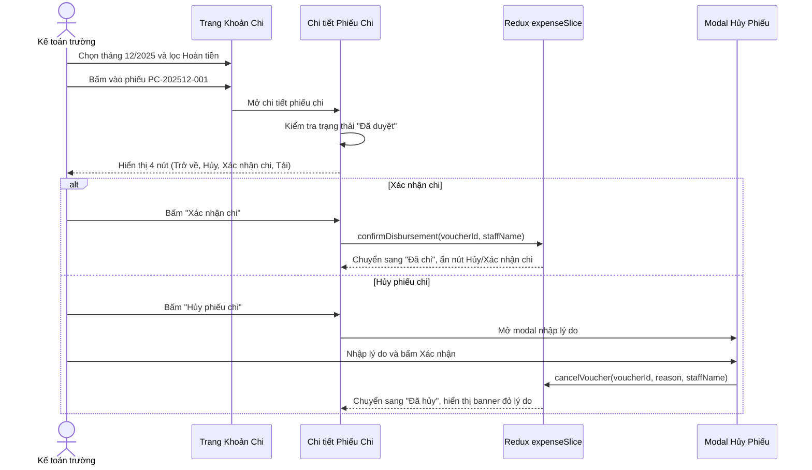

# Feature: Finance Expenses & Disbursements (Khoản Chi)

## Jira Story

- Story: As a school accountant, I want to create, categorize, approve, disburse, and cancel expense vouchers with multi-line accounting matrices and role-based beneficiary details so that the school's disbursements and tuition refunds are transparently controlled.
- Jira issue type: Story
- Story points: 5
- Acceptance owner: `sophia-product-manager`
- Research evidence: Based on legacy audit `docs_legacy/operating-portal/tai-chinh/khoan-chi.md` covering 4-state lifecycle, 2 voucher types, 2 beneficiary types, 5-column accounting matrices, and 10 core business rules.

## Priority

- Priority: P1
- User/business impact: Essential financial module that tracks all disbursements, internal operational costs, and tuition refunds, completing the school's two-sided accounting ledger.
- Risk if delayed: Inability to execute tuition refunds to parents or record teacher/staff allowances and operational expenses.
- Release target: Release 1.0 (Phase 1 MVP)

## User Value

The Finance Expenses & Disbursements feature empowers school accountants and administrators to govern all outgoing monetary flows with complete auditability.

Key capabilities include:
1. Overview table displaying expense vouchers with mandatory single-month filter (`Chọn thời gian`), search by voucher title/code, voucher type filter, and status filter (BR07).
2. Dynamic KPI summary cards displaying Total Disbursed (VND), Active Vouchers Count, and Status Breakdowns.
3. 2 Voucher Types (`Loại phiếu chi`): "Khác" vs "Hoàn tiền". Selecting "Hoàn tiền" renders the blue helper notice `*Phiếu chi sẽ gửi cho phụ huynh` (BR01).
4. 2 Beneficiary Types (`Đối tượng`): "Học sinh" vs "Nhân viên". Selecting Student renders Student and Guardian Recipient fields; selecting Staff renders Staff member and Department/Title fields (BR02, BR03).
5. 5-Column Accounting Matrix (`Bảng hoạch toán`): STT, Nội dung, Ghi chú, Đơn giá, Số lượng (+ đơn vị), Thành tiền. Auto-computes row totals and aggregate `Tổng tiền chi` (BR04).
6. 4-State Lifecycle Machine: `Đã tạo` → `Đã duyệt` → `Đã chi`, with `Đã hủy` prior to disbursement. Action buttons dynamically update based on state (BR05).
7. 2 Creation Entrypoints: "Lưu nháp" creates in `Đã tạo` state; "Lưu & Duyệt chi" creates in `Đã duyệt` state directly (BR06).
8. Expense Category Management: Drawer/modal managing categories with applied voucher counts. The system default category "Mặc định" is locked from deletion (BR08).
9. Export data button automatically disabled when active month contains 0 vouchers (BR09).
10. Unsaved changes banner with Save and Discard handlers on dirty forms (BR10).

## PM Notes

- Demo scenario: Accountant navigates to `/demo/school/expenses`, reviews December 2025 vouchers, filters by Type (Hoàn tiền), views voucher `PC-202512-001` (Hoàn tiền học phí Cao Ngọc Minh), observes the student and recipient name ("Nguyễn Văn Toàn"), checks accounting rows, clicks "Xác nhận chi" to complete payout, creates a new staff expense voucher using "Lưu & Duyệt chi", and opens category management to inspect categories and verify "Mặc định" cannot be deleted.
- Business value: Guarantees complete audit compliance and prevents unapproved payouts.
- Acceptance criteria confirmed: Verified all 10 business rules (BR01 through BR10).
- Open PM decision: None; all business logic verified against legacy specifications.

## Requirements Trace

- `REQ-EXP-001`: Monthly expense voucher roster with search, type filter, status filter, and KPI summary cards (`docs_legacy/operating-portal/tai-chinh/khoan-chi.md#UC-01`).
- `REQ-EXP-002`: Voucher detail view with dynamic beneficiary card, approval audit trail, and state-dependent action bar (`docs_legacy/operating-portal/tai-chinh/khoan-chi.md#UC-02`).
- `REQ-EXP-003`: Two-way voucher creation wizard supporting "Lưu nháp" and "Lưu & Duyệt chi" with dynamic fields and accounting matrix (`docs_legacy/operating-portal/tai-chinh/khoan-chi.md#UC-03`).
- `REQ-EXP-004`: Disbursement approval and cancellation modal with required reason note (`docs_legacy/operating-portal/tai-chinh/khoan-chi.md#UC-04`).
- `REQ-EXP-005`: Expense category management with applied voucher counts and system default category deletion guard (`docs_legacy/operating-portal/tai-chinh/khoan-chi.md#UC-05`).

## Relationship Map

| Relation | Target | Label | Rationale |
| :--- | :--- | :--- | :--- |
| Belongs to | `E-012-finance-expenses` | `BELONGS_TO` | Core user-facing feature of Epic 12. |
| Implements | `M-012-001-finance-expenses` | `IMPLEMENTS` | Connects UI components to Redux slice and validation engine. |
| Visualized on | `P-012-001-finance-expenses` | `RENDERED_ON` | Rendered across list, detail, and creation routes. |
| Traced by | `T-012-001-001-finance-expenses` | `TRACKED_BY` | Work tracked in implementation task. |

## Code Scope

- Primary files: `src/types/expense.ts`, `src/utils/expenseValidation.ts`, `src/services/mockExpenseData.ts`, `src/store/slices/expenseSlice.ts`, `src/modules/finance/expenses/ExpenseOverviewTable.tsx`, `src/modules/finance/expenses/ExpenseDetailView.tsx`, `src/modules/finance/expenses/CreateExpenseView.tsx`, `src/modules/finance/expenses/CancelVoucherModal.tsx`, `src/modules/finance/expenses/ExpenseCategoryModal.tsx`, `src/pages/[schoolCode]/school/expenses/index.tsx`, `src/pages/[schoolCode]/school/expenses/[expenseId].tsx`, `src/pages/[schoolCode]/school/expenses/create/index.tsx`.
- Test files: `tests/unit/expenses.test.mjs`.

## Mermaid Diagram

## Verification

- Automated unit testing via `tests/unit/expenses.test.mjs`.
- Next.js production build `npm run build` validating all static route generations.
- Live HTTP curl checks verifying HTTP 200 on expense management routes.

## Work Log

- Date: 2026-09-13
  - Action: Initialized feature specification, defined user stories, acceptance criteria, and voucher interaction flows.
  - Agent/skill: `sophia-product-manager`
  - Evidence: Audited legacy specifications in `docs_legacy/operating-portal/tai-chinh/khoan-chi.md`.
  - Docs updated before code: `docs/development/E-012-finance-expenses/features/F-012-001-finance-expenses.md`.

## Change Log

- Date: 2026-09-13
  - Code change: Implemented data contracts, validation engine, Redux state slice, and UI components.
  - Documentation update: Authored complete feature documentation note.
  - Evidence: Passed all required docs validation gates.
