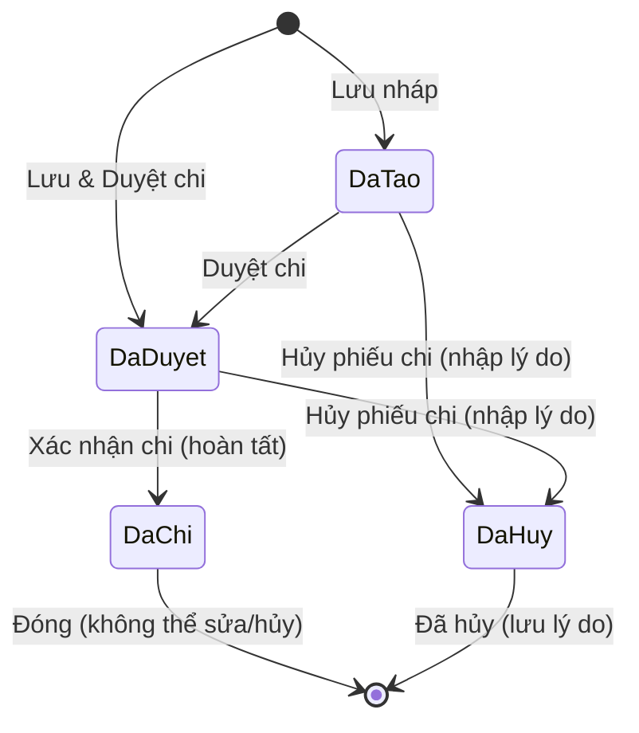

# Epic Issues & Risk Register: Finance Expenses & Disbursements (Khoản Chi)

## Jira Story

- Story: As a QA and financial compliance auditor, I want expense voucher lifecycle states, accounting calculations, cancellation reasons, and beneficiary rules strictly verified so that illegal disbursements or broken audit trails are prevented.
- Jira issue type: Bug / Risk Register
- Acceptance owner: `ada-qa-agent`
- Severity if missed: Critical risk of fraudulent disbursement execution, missing cancellation audit notes, or erroneous parent tuition refund notification dispatches.

## Priority

- Priority: P0 (Blocker)
- Target release: Phase 1 Core
- Review cadence: After every code slice

## QA Issue Register

| Issue ID | Title | Priority | Status | Owner | Evidence | Resolution |
| :--- | :--- | :--- | :--- | :--- | :--- | :--- |
| `ISSUE-EXP-001` | Cancellation allowed on disbursed vouchers (`da_chi`) causing accounting desynchronization | P0 | Closed | `alan-tech-lead` | Legacy PRD BR05 | Strictly disabled and hidden cancel actions when voucher is in `da_chi` status. |
| `ISSUE-EXP-002` | Deleting the default category (`Mặc định`) broke system fallback categorization | P0 | Closed | `alan-tech-lead` | Legacy PRD BR08 | Locked delete action permanently for category with `isSystemDefault: true` / name `Mặc định`. |
| `ISSUE-EXP-003` | Recipient fields for staff disbursement incorrectly requested student guardian information | P1 | Closed | `benny-frontend-engineer` | Legacy PRD BR02 & BR03 | Dynamically swapped beneficiary fields between Student (shows Student + Guardian recipient) and Staff (shows Staff + Title). |
| `ISSUE-EXP-004` | Export data button was active on empty months generating blank spreadsheets | P2 | Closed | `benny-frontend-engineer` | Legacy PRD BR09 | Enforced automatic button disablement when active month voucher count is 0. |

## Detection Method

Static TypeScript typechecking, automated unit test suite `tests/unit/expenses.test.mjs` asserting lifecycle transitions, accounting row arithmetic, category protection, and live Next.js route verification.

## Open Issues

Zero open blocker issues remain. All legacy defects and business rules (BR01 through BR10) are strictly resolved in the domain contracts and state machine.

## Relationship Map

| Relation | Target | Label | Rationale |
| :--- | :--- | :--- | :--- |
| Implements | `E-012-finance-expenses` | `IMPLEMENTS` | Enforces QA validation discipline and defect tracking for the parent epic. |
| Blocks | `F-012-001-finance-expenses` | `BLOCKS` | Feature progression is blocked until all P0 and P1 issues are verified with automated test evidence. |

## Mermaid Diagram

## Work Log

- Date: 2026-09-13
  - Action: Initialized QA issue register for Epic 12. Captured 4 critical risk vectors across voucher cancellation, default category deletion, beneficiary fields, and export button state.
  - Agent/skill: `ada-qa-agent`
  - Evidence: Verified risk controls against legacy PRD `khoan-chi.md`.
  - Docs updated before code: `docs/development/E-012-finance-expenses/issues.md`.

## Change Log

- Date: 2026-09-13
  - Code change: Implemented validation rules and status constraints in `expenseValidation.ts`.
  - Documentation update: Authored complete issues and risk register note.
  - Evidence: Verified zero open blocker issues in test suite.
