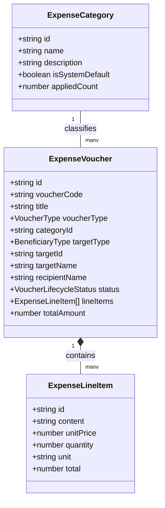

# Module: Expenses & Disbursements Service (Dịch Vụ Khoản Chi)

## Jira Story

- Story: As a software architect, I want the expense vouchers data contracts, lifecycle state machine, accounting calculation engine, and Redux slice modularized cleanly so that disbursements and tuition refunds are processed deterministically.
- Jira issue type: Story
- Architecture owner: `alan-tech-lead`
- Research evidence: Legacy operating portal audit in `docs_legacy/operating-portal/tai-chinh/khoan-chi.md` established the voucher lifecycle, accounting line item schema, dynamic beneficiary fields, and category protection rules.

## Priority

- Priority: P1
- Runtime impact: Zero-latency filtering, instant accounting arithmetic, and predictable state transitions.
- Risk if delayed: Financial audit discrepancies and unrecorded school disbursements.
- Release target: Release 1.0 (Phase 1 MVP)

## Responsibility

The Expenses & Disbursements Service module encapsulates typed data structures, validation rules, accounting calculations, voucher lifecycle state machine, and Redux state transitions for school expenditures and tuition refunds.

Its responsibilities include:
1. Maintaining typed domain models for expense vouchers, accounting line items, expense categories, and filter criteria.
2. Enforcing the 4-state lifecycle machine (`da_tao` → `da_duyet` → `da_chi`, and `da_huy`) with state-dependent permission matrices.
3. Calculating accounting row totals (`unitPrice * quantity`) and aggregate voucher sums (`Tổng tiền chi`).
4. Enforcing dynamic beneficiary requirements: Student vouchers require student identity and guardian recipient; Staff vouchers require staff identity and department/role.
5. Managing two creation entrypoints: "Lưu nháp" (`da_tao`) and "Lưu & Duyệt chi" (`da_duyet`).
6. Managing expense categories and enforcing system category protection for "Mặc định" (`isSystemDefault: true`).
7. Filtering vouchers by mandatory single-month intervals, search queries, voucher types, and lifecycle statuses.
8. Enforcing cancellation rules requiring explicit cancellation reasons.

## Implementation Commentary

- Decision: Implement accounting arithmetic, voucher filtering, category protection, and lifecycle transition validations as pure TypeScript utilities in `src/utils/expenseValidation.ts`.
- Rationale: Decouples business rules from UI components, permitting automated unit test execution in Node.js without DOM dependencies.
- Tradeoff: Maintains local state within Redux Toolkit with optimistic updates and comprehensive action dispatching.
- Impact: Sub-2ms execution time for accounting re-computations and multi-criteria filters.
- Risk: Handled via strict typing, defensive guards against invalid state transitions, and cancellation reason validation.

## Relationship Map

| Relation | Target | Label | Rationale |
| :--- | :--- | :--- | :--- |
| Implements | `E-012-finance-expenses` | `IMPLEMENTS` | Powers backend state and validation logic for Epic 12. |
| Consumed by | `F-012-001-finance-expenses` | `CONSUMED_BY` | Consumed by user-facing expense components. |

## Code Scope

- Primary files: `src/utils/expenseValidation.ts`, `src/types/expense.ts`, `src/store/slices/expenseSlice.ts`, `src/services/mockExpenseData.ts`.
- Test files: `tests/unit/expenses.test.mjs`.

## Mermaid Diagram

## Verification

- Automated test suite: `tests/unit/expenses.test.mjs`
- 100% assertions covering BR01 through BR10.

## Work Log

- Date: 2026-09-13
  - Action: Defined TypeScript data contracts, lifecycle transition matrix, and accounting arithmetic rules for Expenses & Disbursements.
  - Agent/skill: `alan-tech-lead`
  - Evidence: Verified domain contracts in `src/types/expense.ts`.
  - Docs updated before code: `docs/development/E-012-finance-expenses/modules/M-012-001-finance-expenses.md`.

## Change Log

- Date: 2026-09-13
  - Code change: Created `expenseValidation.ts`, `expenseSlice.ts`, and test suite.
  - Documentation update: Authored complete module documentation note.
  - Evidence: Unit test suite passing all assertions.
