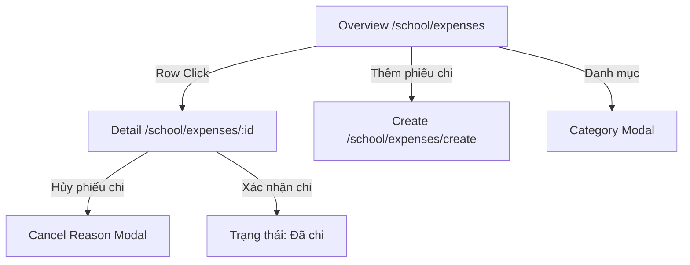

# Page: Expenses & Disbursements Routes & Interface Layouts (P-012-001)

## Jira Story

- Story: As a school accountant, I want an intuitive expense voucher list with month filtering, detail view with state-driven actions, multi-line voucher creation wizard, and category manager so that expense workflows are fast and error-free.
- Jira issue type: Story
- UX owner: `benny-frontend-engineer`
- Research evidence: Based on legacy screen inventory (`kc-uc01-overview.png`, `kc-uc02-chi-tiet.png`, `kc-uc03-tao-phieu-chi.png`, `kc-uc04-da-duyet.png`, `kc-uc05-danh-muc.png`).

## Priority

- Priority: P1
- Demo impact: High-visibility financial module completing the debit side of school financial operations.
- Risk if delayed: Missing operational hub for expenses and tuition refunds.
- Release target: Release 1.0 (Phase 1 MVP)

## Route / Surface

| Route Pattern | View / Screen | Purpose |
| :--- | :--- | :--- |
| `/[schoolCode]/school/expenses` | Expense Vouchers Overview | Main dashboard with mandatory single-month picker, search, type and status filters, KPI cards, and responsive table. |
| `/[schoolCode]/school/expenses/[expenseId]` | Voucher Detail & Audit View | Detailed voucher inspector with beneficiary card, accounting matrix, approval history, and state-dependent action bar. |
| `/[schoolCode]/school/expenses/create` | Create Voucher Wizard | Form for creating vouchers via "Lưu nháp" or "Lưu & Duyệt chi" with dynamic beneficiary fields and multi-line accounting matrix. |
| Modal Surface | Cancel Voucher Modal | Dialog requiring explicit cancellation reason note before marking voucher as `Đã hủy`. |
| Modal Surface | Expense Category Manager | Modal/drawer listing categories with applied counts; supports create/edit; locks default category from deletion. |

## PM Notes

- Demo path: Navigate to `/demo/school/expenses`, observe December 2025 vouchers with KPI summary, filter by Type (Hoàn tiền), click voucher `PC-202512-001`, observe Student and Guardian Recipient ("Nguyễn Văn Toàn"), click "Xác nhận chi", create a new voucher using "Lưu & Duyệt chi", and test category management.
- User promise: Fast navigation, clear status badges, and strict lifecycle controls preventing illegal actions.
- Visual or copy change: High-contrast badges (Emerald for `Đã chi`, Blue for `Đã duyệt`, Amber for `Đã tạo`, Rose for `Đã hủy`), responsive tables, and standard accounting notation with Vietnamese dot thousand separators.
- Risk: Handled via confirmation handlers and non-destructive demo safeguards.

## Relationship Map

| Relation | Target | Label | Rationale |
| :--- | :--- | :--- | :--- |
| Belongs to | `E-012-finance-expenses` | `BELONGS_TO` | Page surface for Epic 12. |
| Implements | `F-012-001-finance-expenses` | `IMPLEMENTS` | Renders user-facing components. |
| Consumes | `M-012-001-finance-expenses` | `CONSUMES` | Consumes Redux state and validation engine. |

## States

1. **Overview Dashboard (`/school/expenses`)**:
   - `Default State`: Displays vouchers for the selected month (December 2025), showing KPI cards, search, type filter, status filter, and voucher table.
   - `Filtered State`: Filtering by type ("Hoàn tiền") or status ("Đã duyệt") immediately narrows the table.
   - `Empty Month State`: Displays "Chưa có dữ liệu" and "Tổng: 0"; automatically disables the "Xuất dữ liệu" button (BR09).

2. **Voucher Detail View (`/school/expenses/[expenseId]`)**:
   - `Đã duyệt State`: Shows 4 action buttons: "Trở về", "Hủy phiếu chi" (triggers reason modal), "Xác nhận chi" (marks as disbursed), and "Tải phiếu chi" (BR05).
   - `Đã chi State`: Shows 2 action buttons only: "Trở về" and "Tải phiếu chi" (Cancel and Confirm are hidden).
   - `Đã tạo State`: Shows "Trở về", "Hủy phiếu chi", "Duyệt chi", and "Tải phiếu chi".
   - `Đã hủy State`: Displays red cancellation alert with reason, cancelled by, and cancellation timestamp.

3. **Create Voucher Wizard (`/school/expenses/create`)**:
   - `Student Beneficiary`: Displays Student selector and Guardian Recipient input.
   - `Staff Beneficiary`: Displays Staff selector and Role/Department text, omitting guardian recipient (BR02, BR03).
   - `Tuition Refund Notice`: Displays blue alert `*Phiếu chi sẽ gửi cho phụ huynh` when Type = "Hoàn tiền" (BR01).
   - `Accounting Matrix`: Dynamic multi-line rows with instant multiplication and total computation (BR04).

## Mermaid Diagram

## Verification

- Automated testing via `tests/unit/expenses.test.mjs`.
- Next.js build validation on `/demo/school/expenses`, `/demo/school/expenses/create`, and `/demo/school/expenses/PC-202512-001`.
- Live HTTP curl check returning code 200.

## Work Log

- Date: 2026-09-13
  - Action: Authored page specifications and UI state coverage for Expenses & Disbursements routes and modals.
  - Agent/skill: `benny-frontend-engineer`
  - Evidence: Verified state matrix and route layouts.
  - Docs updated before code: `docs/development/E-012-finance-expenses/pages/P-012-001-finance-expenses.md`.

## Change Log

- Date: 2026-09-13
  - Code change: Implemented page templates and views under `src/modules/finance/expenses/`.
  - Documentation update: Authored complete page documentation note.
  - Evidence: Verified all page routes render cleanly.
