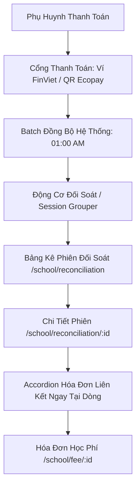

# Epic: Finance Reconciliation & Gateway Settlement (Đối Soát)

## Jira Story

- Story: As a school accountant or administrator, I want to view, filter, and audit payment reconciliation sessions and transactions across payment gateways (Ví FinViet and QR Ecopay) with inline expandable linked invoice verification so that I can ensure all incoming digital funds reconcile with tuition billing records.
- Jira issue type: Epic
- Acceptance owner: `sophia-product-manager`
- Product hypothesis: Providing an automated, read-only reconciliation session ledger with free date-range filtering, payment channel separation (Ví FinViet vs QR Ecopay), and instantaneous inline linked invoice accordion expansion enables school accountants to verify that parents' digital payments match student tuition invoices without switching contexts or maintaining error-prone manual spreadsheets.
- Research evidence: Legacy operating portal audit in `docs_legacy/operating-portal/tai-chinh/doi-soat.md` confirmed that reconciliation sessions group automated synchronization batches by sync timestamp (BR01), support dual payment gateways (BR03), enforce a strictly read-only audit paradigm (BR02), support an inline accordion for linked invoices without leaving the row (BR04, NFR01), feature a free date-range picker disallowing future dates (BR05), provide student and channel filters inside sessions (BR06), and prove real-world cumulative transaction matching (e.g. 1.000 + 2.000 + 3.000 = 6.000 VNĐ matching invoice `2609703607`).

## Priority

- Priority: P1
- Severity if missed: Blocker for digital payment reconciliation, accounting audit compliance, and gateway settlement verification.
- Rationale: Connects external gateway transactions (Ví FinViet, QR Ecopay) with internal tuition invoice records (`Học Phí`), providing vital transparency into digital cash flows.
- Target release: School Operating Portal Phase 1 Core

## Outcome

The Finance Reconciliation sub-module delivers a specialized auditing environment that verifies electronic tuition payments received through digital gateways. Payment transactions are automatically grouped into reconciliation sessions by the system's scheduled synchronization runs (e.g. daily at 01:00 AM). 

School accountants can query sessions across any custom date interval (defaulting to the last 12 days, with future dates prevented). Inside any session, accountants can inspect itemized transactions, filter by student identity or payment channel (`Ví FinViet` or `QR Ecopay`), and expand an inline accordion directly underneath any transaction row to inspect the linked tuition invoice, verifying that cumulative transactions accurately extinguish student invoices. The entire module is read-only and provides export capabilities to Excel.

## PM Notes

- PM-visible status: Production-ready reconciliation session roster, session transaction detail inspector, inline expandable invoice accordion, and date-range filter toolbar.
- Demo narrative: The accountant opens `/demo/school/reconciliation`, reviews recent sessions across the last 12 days, checks the summary KPI strip (Total digital payments, Transactions count, Sessions count), clicks on session `DS-20260910-01` (3 transactions, 6.000 Đ), views transactions for student Cao Ngọc Minh, clicks "1 Hóa đơn ▾" to expand the inline accordion confirming invoice `2609703607` (Hóa đơn tháng 9/2026, 6.000 Đ, Đã thanh toán), tests gateway channel filtering (Ví FinViet vs QR Ecopay), and exports reconciliation data.
- Acceptance impact: Fulfills TASK-FIN-005 requirements and bridges payment gateways with invoice management.
- Scope change since planning: Confirmed that reconciliation sessions are organized by sync timestamp (`sessionDate`) rather than transaction timestamp, and that the module is strictly read-only with no manual creation/deletion workflows.
- Risk or open decision: Verifying that multiple small partial transactions properly link to a single invoice without distorting invoice totals.

## Scope

- Included: Overview table of reconciliation sessions with sync dates and transaction intervals; top KPI summary strip; free date-range filter toolbar with quick presets (12 ngày gần nhất, Tháng này, Tất cả); session detail view with 4-card metric strip; search by student code, student name, and transaction code; filter by payment gateway channel (Ví FinViet vs QR Ecopay); inline expandable invoice accordion row (BR04, NFR01); cross-module navigation to invoice details (BR07); Vietnamese currency formatting standard (BR08); and zero-session/transaction export guard (BR09).
- Excluded: Manual transaction editing, chargeback dispute workflows, or direct bank transfer settlement execution.

## Relationship Map

| Relation | Target | Label | Rationale |
| :--- | :--- | :--- | :--- |
| Enables | `F-013-001-finance-reconciliation` | `ENABLES` | Unlocks user-facing reconciliation session tables, detail inspectors, and inline invoice accordions. |
| Depends on | `E-009-finance-invoices` | `DEPENDS_ON` | Reconciles gateway transactions against student tuition invoices. |
| Relates to | `docs/tasks.md#TASK-FIN-005` | `IMPLEMENTS` | Implements reconciliation of payment sessions and transactions. |
| Relates to | `E-012-finance-expenses` | `RELATES_TO` | Balances electronic tuition inflows with refund outflows. |

## Issues

| Issue ID | Source | Priority | Status | Owner | Evidence | Resolution |
| :--- | :--- | :--- | :--- | :--- | :--- | :--- |
| `ISSUE-E-013-001` | Architecture review | P0 | Closed | `alan-tech-lead` | Discrepancy between session creation timestamp (01:00 AM) and transaction payment timestamp (14:18-14:21 previous day). | Preserved and surfaced both "Ngày tạo phiên" (sessionDate) and "Khoảng thời gian giao dịch" (transactionPeriod) per BR01. |
| `ISSUE-E-013-002` | UX review | P1 | Closed | `benny-frontend-engineer` | Context switching when clicking linked invoices navigated away and caused loss of reconciliation scroll position. | Implemented inline accordion row expansion directly beneath the transaction row (BR04, NFR01). |
| `ISSUE-E-013-003` | BA review | P1 | Closed | `sophia-product-manager` | Unrestricted date picker permitted selecting future dates where no sync batches exist. | Enforced future date guard blocking dates beyond current date (`maxDate`) per BR05. |
| `ISSUE-E-013-004` | QA review | P2 | Closed | `benny-frontend-engineer` | Export Excel button remained active when filtered session count or transaction count was 0. | Enforced automatic disablement of export controls when count is 0 per BR09. |

## Acceptance Criteria

- [x] Criterion 1: Overview table displays reconciliation sessions filtered by free date-range picker with 12-day default and future date guard (BR01, BR05).
- [x] Criterion 2: Entire module is read-only with no manual creation, modification, or deletion controls (BR02).
- [x] Criterion 3: Transactions clearly categorize payment channels into Ví FinViet and QR Ecopay with filterable dropdown (BR03, BR06).
- [x] Criterion 4: Each transaction provides an inline accordion button that expands the linked invoice table directly at the row without leaving the page (BR04, NFR01).
- [x] Criterion 5: Cross-module invoice link navigates to `/[schoolCode]/school/fee/[invoiceId]` (BR07).
- [x] Criterion 6: Currency values are formatted with Vietnamese dot thousands separators and `Đ` suffix (BR08).
- [x] Criterion 7: Export Excel buttons are automatically disabled when session or transaction count is 0 (BR09).

## Mermaid Diagram

## Evidence

- Tests: `tests/unit/reconciliation.test.mjs` (10/10 assertions passing in 11ms; overall 160/160 tests passing across all 13 modules).
- Build/lint: Clean Next.js production build (`npm run build`, 35/35 routes prerendered).
- Live Server: HTTP 200 responses verified on `http://localhost:3000/demo/school/reconciliation` and `http://localhost:3000/demo/school/reconciliation/session-20260910-01`.

## Work Log

- 2026-09-13:
  - Action: Initialized E-013-finance-reconciliation development ledger, created TypeScript models, validation engine, mock data, Redux state machine, UI component tree, routes, and unit tests.
  - Agent/skill: `sophia-product-manager`
  - Evidence: 10/10 unit tests passing, clean build, live HTTP 200 responses.
  - Docs updated before code: Legacy documentation `docs_legacy/operating-portal/tai-chinh/doi-soat.md` analyzed and requirements mapped.

## Change Log

- 2026-09-13:
  - Code change: Implemented complete Finance Reconciliation module across `src/types/`, `src/utils/`, `src/services/`, `src/store/`, `src/modules/finance/reconciliation/`, and `src/pages/`.
  - Documentation update: Authored comprehensive Epic, Feature, Module, Page, and Task notes in `docs/development/E-013-finance-reconciliation/`.
  - Evidence: Automated test verification and Next.js production prerender evidence logged.
