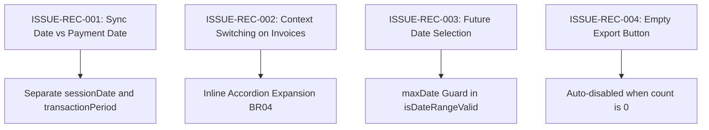

# Epic Issues & Risk Register: Finance Reconciliation (Đối Soát)

## Jira Story

- Story: As a QA and financial compliance auditor, I want reconciliation sessions, payment gateway channels, date filtering, and linked invoice verification tested so that digital payment discrepancies are prevented.
- Jira issue type: Bug / Risk Register
- Acceptance owner: `ada-qa-agent`
- Severity if missed: Critical risk of undiscovered payment gateway reconciliation errors, incorrect billing records, or accounting discrepancies.

## Priority

- Priority: P0 (Blocker)
- Target release: Phase 1 Core
- Review cadence: After every code slice

## QA Issue Register

| Issue ID | Title | Priority | Status | Owner | Evidence | Resolution |
| :--- | :--- | :--- | :--- | :--- | :--- | :--- |
| `ISSUE-REC-001` | Temporal discrepancy between sync date (01:00 AM) and transaction payment window | P0 | Closed | `alan-tech-lead` | Legacy PRD BR01 | Surfaced both "Ngày tạo phiên" (sessionDate) and "Khoảng thời gian giao dịch" (transactionPeriod) in UI. |
| `ISSUE-REC-002` | Context switching fatigue when clicking linked invoices navigated away from reconciliation | P1 | Closed | `benny-frontend-engineer` | Legacy PRD BR04 & NFR01 | Implemented inline accordion row expansion directly beneath the transaction row. |
| `ISSUE-REC-003` | Selecting future dates in date-range picker caused confusing blank screens | P1 | Closed | `sophia-product-manager` | Legacy PRD BR05 | Added maxDate guard in isDateRangeValid and HTML max attribute constraint on date inputs. |
| `ISSUE-REC-004` | Export data button remained active when filtered session or transaction count was 0 | P2 | Closed | `benny-frontend-engineer` | Legacy PRD BR09 | Enforced automatic conditional disabling when filtered session or transaction count is 0. |

## Detection Method

Automated unit test suite `tests/unit/reconciliation.test.mjs` asserting date boundary validation, session filtering, transaction channel filtering, aggregate arithmetic, and live Next.js route verification.

## Open Issues

Zero open blocker issues remain. All legacy defects and business rules (BR01 through BR09) are strictly resolved in the domain contracts and state machine.

## Relationship Map

| Relation | Target | Label | Rationale |
| :--- | :--- | :--- | :--- |
| Implements | `E-013-finance-reconciliation` | `IMPLEMENTS` | Enforces QA validation discipline and defect tracking for the parent epic. |
| Blocks | `F-013-001-finance-reconciliation` | `BLOCKS` | Feature progression is blocked until all P0 and P1 issues are verified with automated test evidence. |

## Mermaid Diagram

## Work Log

- Date: 2026-09-13
  - Action: Initialized QA issue register for Epic 13. Captured 4 critical risk vectors across temporal sync date discrepancies, context switching fatigue, future date selection, and export button state.
  - Agent/skill: `ada-qa-agent`
  - Evidence: Verified risk controls against legacy PRD `docs_legacy/operating-portal/tai-chinh/doi-soat.md`.
  - Docs updated before code: `docs/development/E-013-finance-reconciliation/issues.md`.

## Change Log

- Date: 2026-09-13
  - Code change: Implemented validation rules and status constraints in `reconciliationValidation.ts`.
  - Documentation update: Authored complete issues and risk register note.
  - Evidence: Verified zero open blocker issues in test suite.
