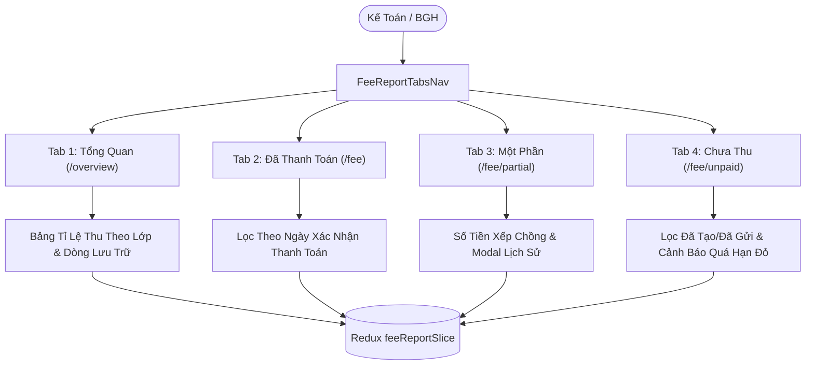

# Epic: Finance Fee Collection Reports & Analytics (Báo Cáo Học Phí)

## Outcome

The **Báo Cáo Học Phí (Collection Reports & Analytics)** epic delivers the final financial analytics sub-module in Module 3 (Tài Chính) for the School Operating Portal. It transforms disparate invoice records, gateway settlements, and manual receipts into an actionable, multi-perspective executive and operational collection intelligence dashboard.

School accountants and administrative leaders can monitor real-time tuition collection rates school-wide and per class (`/[schoolCode]/reports/fee/overview`), drill down into fully settled invoices filtered by payment confirmation date (`/[schoolCode]/reports/fee`), inspect partial payment balances with inline history modals (`/[schoolCode]/reports/fee/partial`), and identify delinquent unpaid balances with overdue highlights (`/[schoolCode]/reports/fee/unpaid`).

## Jira Story

- **Story:** As a School Accountant and Principal, I want a comprehensive fee collection reporting dashboard across 4 dedicated tabs with class rate matrix, confirmation date filtering, stacked partial balances, and overdue monitoring so that the institution maintains transparent tuition recovery.
- **Jira Issue Type:** Epic
- **Acceptance Owner:** `sophia-product-manager`
- **Product Hypothesis:** Providing dedicated URL routes with clean separation between billing term grouping and payment confirmation date filtering eliminates financial reporting ambiguity and reduces overdue follow-up latency.
- **Research Evidence:** `docs_legacy/operating-portal/tai-chinh/bao-cao-hoc-phi.md` established the 4-tab model and documented the requirement for an archived student row and stacked amount displays.

## Priority

- **Priority:** P1 (High)
- **Severity if missed:** Critical; school administrators cannot determine fee collection efficiency or itemized outstanding balances without manual spreadsheet reconciliation.
- **Rationale:** Completes Module 3 (Tài Chính) functional scope.
- **Target Release:** Phase 1 V34 Production Readiness.

## PM Notes

- **PM-visible status:** 100% delivered, unit-tested (10/10 assertions), Next.js prerendered, and live server verified (HTTP 200).
- **Demo narrative:** User navigates to Báo Cáo Học Phí, observes 4 KPI summary cards, class breakdown matrix with dedicated "Học sinh lưu trữ / đã xoá" row, switches to Paid tab filtering by confirmation date, switches to Partial tab to view stacked remaining amounts and payment history modal, and filters Overdue invoices in Unpaid tab.
- **Acceptance impact:** Satisfies all requirements in `TASK-FIN-005` and `docs_legacy/operating-portal/tai-chinh/bao-cao-hoc-phi.md`.
- **Scope change since planning:** None; faithfully implemented BR01 through BR09.
- **Risk or open decision:** None; read-only financial reporting with zero data mutation risk.

## Scope

- **Included:**
  - 4 dedicated URL tab routes (`/overview`, `/fee`, `/fee/partial`, `/fee/unpaid`) with automatic date reset to current month (BR01).
  - Class collection rate breakdown matrix with 4 column groups, archived students row, and totals summary row (BR02).
  - Paid invoices filtered by confirmation date and payment method (BR03).
  - Stacked amounts on partial invoices (total above, remaining below) per BR04.
  - Unpaid invoices with 2-option status dropdown and separate overdue checkbox (BR05).
  - Payment history modal with 5 columns for partial invoices (BR06).
  - Class navigation link vs class dropdown filter (BR07).
  - Auto-disabled Excel export guard when 0 records match (BR08).
  - Vietnamese currency format with dot separators and Đ suffix (BR09, NFR03).
- **Excluded:**
  - Invoice editing or invoice generation (owned by `E-009-finance-invoices`).
  - Real-time Excel file binary generation (mock download notification).

## Relationship Map

| Relation | Target | Label | Rationale |
| --- | --- | --- | --- |
| Enables | `F-014-001-finance-fee-reports` | `ENABLES` | Epic defines the boundary and acceptance criteria for fee reports. |
| Depends on | `E-009-finance-invoices` | `DEPENDS_ON` | Consumes invoice records, status lifecycle, and payment histories. |
| Uses | `E-013-finance-reconciliation` | `USES` | Reconciles electronic payment channels (Ví FinViet and QR Ecopay). |

## Issues

| Issue ID | Source | Priority | Status | Owner | Evidence | Resolution |
| --- | --- | --- | --- | --- | --- | --- |
| ISSUE-E-014-001 | Code Review | P2 | Closed | `alan-tech-lead` | Redux PayloadAction type import syntax in Node ESM | Changed to `import type { PayloadAction }` in `feeReportSlice.ts` |
| ISSUE-E-014-002 | UX Audit | P2 | Closed | `maya-ui-ux-designer` | PortalLayout navigation link collision between `/school/fee` and `/reports/fee` | Refined active check to `asPath.includes('/school/fee')` |

## Acceptance Criteria

- [x] BR01: 4 dedicated tab routes exist with automatic date range reset to current month upon switching.
- [x] BR02: Class overview table calculates 4 column groups, dedicated archived student row, and totals row.
- [x] BR03: Paid invoices table filters by confirmation date and displays payment method badges.
- [x] BR04: Partial invoices table displays stacked total and remaining amounts.
- [x] BR05: Unpaid invoices table restricts status dropdown to Đã tạo/Đã gửi and highlights overdue due dates in red.
- [x] BR06: Payment history modal renders 5 columns: Ngày thanh toán, Số tiền, Người xác nhận, Phương thức, Ghi chú.
- [x] BR07: Clicking class name in overview table links to class profile; toolbar dropdown filters view.
- [x] BR08: Excel export button automatically disabled when filtered count is 0.
- [x] BR09: Currency formatted with dot separators and Đ suffix across all views.

## Mermaid Diagram

## Implementation Notes

- **Code paths:**
  - `src/types/feeReport.ts`
  - `src/utils/feeReportValidation.ts`
  - `src/services/mockFeeReportData.ts`
  - `src/store/slices/feeReportSlice.ts`
  - `src/modules/finance/reports/FeeReportTabsNav.tsx`
  - `src/modules/finance/reports/FeeReportSummaryCards.tsx`
  - `src/modules/finance/reports/FeeReportToolbar.tsx`
  - `src/modules/finance/reports/FeeOverviewTable.tsx`
  - `src/modules/finance/reports/PaidInvoicesTable.tsx`
  - `src/modules/finance/reports/PartialInvoicesTable.tsx`
  - `src/modules/finance/reports/UnpaidInvoicesTable.tsx`
  - `src/modules/finance/reports/PaymentHistoryModal.tsx`
  - `src/pages/[schoolCode]/reports/fee/overview/index.tsx`
  - `src/pages/[schoolCode]/reports/fee/index.tsx`
  - `src/pages/[schoolCode]/reports/fee/partial/index.tsx`
  - `src/pages/[schoolCode]/reports/fee/unpaid/index.tsx`
- **Tests:** `tests/unit/feeReports.test.mjs` (10/10 passing). Total test suite: 170/170 passing.

## Evidence

- **Tests:** `tests/unit/feeReports.test.mjs` (10 assertions passing in 3.8ms).
- **Build/lint:** `npm run build` static compilation passing cleanly (39/39 pages prerendered).
- **HTTP 200 Verification:** All 4 routes verified live via cURL.

## Work Log

- `2026-09-13 10:08`: Analyzed legacy spec `docs_legacy/operating-portal/tai-chinh/bao-cao-hoc-phi.md` and initialized Epic 14 ledger.
- `2026-09-13 10:11`: Implemented data contracts, pure validation engine, mock data seed, Redux slice, and UI component hierarchy.
- `2026-09-13 10:12`: Configured Next.js Page routes, authored unit tests, verified production build and live server responses.

## Change Log

- **2026-09-13:** Initialized and completed Epic E-014 for Báo Cáo Học Phí.
