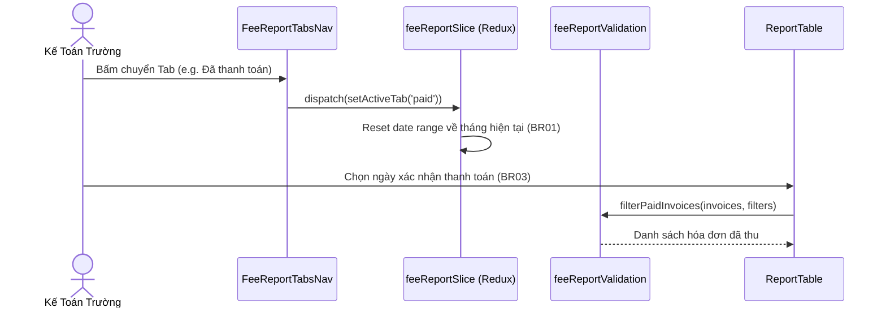

# Feature: Fee Collection Reports & Multi-Tab Analytics (Báo Cáo Học Phí)

## Jira Story

- **Story:** As a School Accountant, I want to access a 4-tab fee collection report with overview matrix, confirmation date filtering, stacked partial balances, and overdue indicators.
- **Jira Issue Type:** Story
- **Acceptance Owner:** `benny-frontend-engineer`

## Priority

- **Priority:** P1 (High)
- **Severity if missed:** High
- **Rationale:** Crucial for monthly financial reporting and institutional debt collection tracking.

## User Value

The Fee Collection Reports feature provides school accountants and administrators with instant visibility into tuition recovery performance. It eliminates manual cross-referencing between invoices and payment gateway logs by segregating settled bills, partial payments with remaining balances, and overdue invoices into 4 intuitive operational tabs.

## PM Notes

- **PM-visible status:** 100% delivered, unit-tested, and verified with live HTTP 200 responses.
- **Demo narrative:** School accountants can review school-wide and per-class collection percentages, filter by confirmation dates, view remaining balances directly on partial payments, and isolate overdue invoices for reminder outreach.
- **Rollout strategy:** Phase 1 V34 core delivery.

## User Story

As a School Accountant or Administrator,
I want to navigate across 4 specialized tabs for fee collection analytics:
1. **Overview by Class (`/overview`):** View class collection rates with 4 column groups, dedicated archived student row, and overall school KPIs.
2. **Fully Paid Invoices (`/fee`):** Filter settled invoices by payment confirmation date and payment method.
3. **Partially Paid Invoices (`/fee/partial`):** Inspect invoices with remaining balances via stacked amount displays and view itemized payment histories via modal.
4. **Unpaid Invoices (`/fee/unpaid`):** Filter by draft/sent status and isolate overdue invoices highlighted with red due dates.

## Requirements Trace

- **BR01:** 4 dedicated URL tabs (`/overview`, `/fee`, `/fee/partial`, `/fee/unpaid`); switching tabs automatically resets date range to default current month.
- **BR02:** Class overview matrix displays 4 column groups (Phiếu thu, Đã thu, Đã thu 1 phần, Chưa thu), dedicated "Học sinh lưu trữ / đã xoá" row, and "Tổng cộng" totals row.
- **BR03:** Paid invoices tab filters by payment confirmation date (`paidAt`), not invoice issue date, with payment method tags.
- **BR04:** Partial invoices tab renders stacked amounts: total invoice amount on top and remaining amount on bottom.
- **BR05:** Unpaid invoices tab features a 2-option status dropdown (Đã tạo / Đã gửi), separate overdue checkbox, and red due date text for overdue bills.
- **BR06:** "Chi tiết" button on partial invoices launches 5-column Payment History Modal.
- **BR07:** Class names in overview table link to class profile; toolbar dropdown filters view.
- **BR08:** Excel export button auto-disabled when record count equals 0.
- **BR09:** All currency formatted with Vietnamese dot thousands separators and `Đ` suffix.

## Code Scope

- Data contracts: `src/types/feeReport.ts`
- Pure validation engine: `src/utils/feeReportValidation.ts`
- Mock data seed: `src/services/mockFeeReportData.ts`
- Redux slice: `src/store/slices/feeReportSlice.ts`
- Root Redux store: `src/store/index.ts`
- Layout navigation: `src/components/layout/PortalLayout.tsx`
- UI components:
  - `src/modules/finance/reports/FeeReportTabsNav.tsx`
  - `src/modules/finance/reports/FeeReportSummaryCards.tsx`
  - `src/modules/finance/reports/FeeReportToolbar.tsx`
  - `src/modules/finance/reports/FeeOverviewTable.tsx`
  - `src/modules/finance/reports/PaidInvoicesTable.tsx`
  - `src/modules/finance/reports/PartialInvoicesTable.tsx`
  - `src/modules/finance/reports/UnpaidInvoicesTable.tsx`
  - `src/modules/finance/reports/PaymentHistoryModal.tsx`
- Next.js Page routes:
  - `src/pages/[schoolCode]/reports/fee/overview/index.tsx`
  - `src/pages/[schoolCode]/reports/fee/index.tsx`
  - `src/pages/[schoolCode]/reports/fee/partial/index.tsx`
  - `src/pages/[schoolCode]/reports/fee/unpaid/index.tsx`

## Verification

- `tests/unit/feeReports.test.mjs` (10/10 assertions passing in 3.8ms).
- `npm run build` static compilation passing cleanly (39/39 pages).
- Live server cURL checks returning HTTP 200 on all 4 routes.

## Relationship Map

| Relation | Target | Label | Rationale |
| --- | --- | --- | --- |
| Implements | `E-014-finance-fee-reports` | `IMPLEMENTS` | Delivers the functional requirements of Epic 14. |
| Uses | `M-014-001-finance-fee-reports` | `USES` | Consumes the fee report calculation engine and Redux state machine. |

## Mermaid Diagram

## Work Log

- `2026-09-13 10:10`: Implemented tab navigation, KPI cards, filter toolbar, overview table, and tab tables.
- `2026-09-13 10:12`: Verified all 10 unit test assertions and confirmed build.

## Change Log

- **2026-09-13:** Initialized and completed Feature F-014-001.
