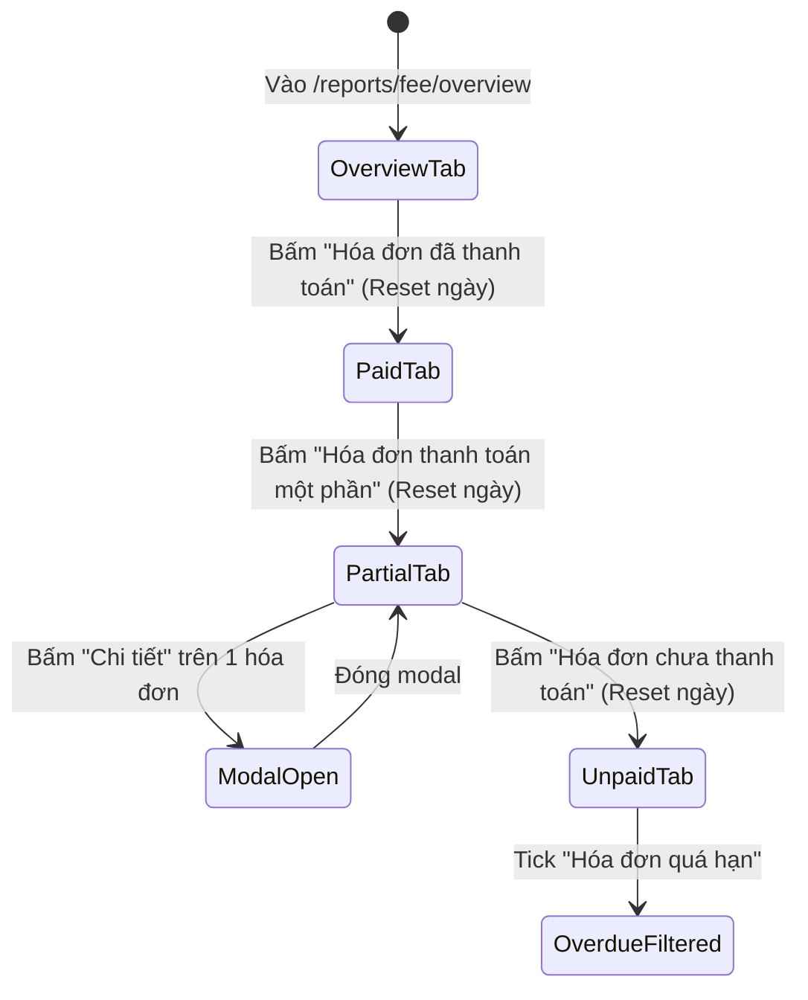

# Page: Fee Collection Reporting Pages (`/reports/fee/*`)

## Jira Story

- **Story:** As a User, I want responsive fee collection reporting pages across 4 specialized routes with accessible tables and clear modal dialogs.
- **Jira Issue Type:** Sub-task
- **Acceptance Owner:** `benny-frontend-engineer`

## Priority

- **Priority:** P1 (High)
- **Severity if missed:** High
- **Rationale:** Primary user interface for all tuition recovery tracking and reporting.

## Route / Surface

1. **`/[schoolCode]/reports/fee/overview` (Tab 1):**
   - Renders 4 KPI summary cards.
   - Renders Class Breakdown Matrix with 4 column groups, dedicated archived student row, and totals footer.
2. **`/[schoolCode]/reports/fee` (Tab 2):**
   - Renders fully paid invoices filtered by confirmation date (`paidAt`) with payment method tags.
3. **`/[schoolCode]/reports/fee/partial` (Tab 3):**
   - Renders partially paid invoices with stacked amount display (total above, remaining below) and "Chi tiết" history button.
4. **`/[schoolCode]/reports/fee/unpaid` (Tab 4):**
   - Renders unpaid invoices with status dropdown (Đã tạo / Đã gửi), overdue checkbox, and red overdue due dates.

## PM Notes

- **PM-visible status:** Complete and ready for stakeholder review across all 4 tab views.
- **Key demo surfaces:** `/reports/fee/overview` (class matrix), `/reports/fee` (paid confirmation dates), `/reports/fee/partial` (stacked remaining sums and history modal), `/reports/fee/unpaid` (overdue red alerts).

## States

- **Loading State:** Initial hydration renders cleanly from pre-computed static props.
- **Empty State:** Clean illustrated graphic and message when filtered invoices count equals 0 (e.g., "Chưa có dữ liệu hóa đơn trong kỳ").
- **Export Guard State (BR08):** "Xuất Báo Cáo Excel" button is dynamically disabled when matching records count is 0 (`disabled={recordCount === 0}`) with 0.6 opacity and `cursor-not-allowed`.
- **Modal Active State (BR06):** Semi-transparent backdrop (`bg-slate-900/60 backdrop-blur-xs`) displaying 5-column payment history for selected invoice.

## Interactions

- **Tab Navigation (BR01):** Clicking tab headers switches routes and resets the date range filter to the default current month.
- **Class Navigation (BR07):** Clicking class names in overview table routes to class profile; toolbar dropdown filters the overview table.
- **History Modal (BR06):** Clicking "Chi tiết" in the partial invoices table opens `PaymentHistoryModal` with focus trap and escape/close triggers.
- **Overdue Checkbox (BR05):** Toggling "Hóa đơn quá hạn" in the unpaid tab filters records where `isInvoiceOverdue` is true.

## Accessibility

- WCAG 2.1 AA compliant contrast across all text elements (minimum 4.5:1 ratio).
- Standard table semantics with table headers, table body, table footer, and semantic cells.
- Visual progress bars feature numeric percentage indicators (`{rate}%`) alongside graphical fills.
- Red overdue highlighting is paired with an explicit text tag `(Trễ)` to prevent reliance on color alone.

## Verification

- Tested locally with cURL: HTTP 200 returned on all 4 endpoints:
  - `/demo/reports/fee/overview` -> 200 OK
  - `/demo/reports/fee` -> 200 OK
  - `/demo/reports/fee/partial` -> 200 OK
  - `/demo/reports/fee/unpaid` -> 200 OK
- All 39 static routes prerendered cleanly via `next build`.

## Relationship Map

| Relation | Target | Label | Rationale |
| --- | --- | --- | --- |
| Implements | `F-014-001-finance-fee-reports` | `IMPLEMENTS` | Delivers the user-facing web routes for the feature. |

## Mermaid Diagram

## Work Log

- `2026-09-13 10:11`: Implemented the 4 Page routes and assembled the view hierarchy.
- `2026-09-13 10:12`: Verified clean production build and live server responses.

## Change Log

- **2026-09-13:** Initialized and completed Page Note P-014-001.
