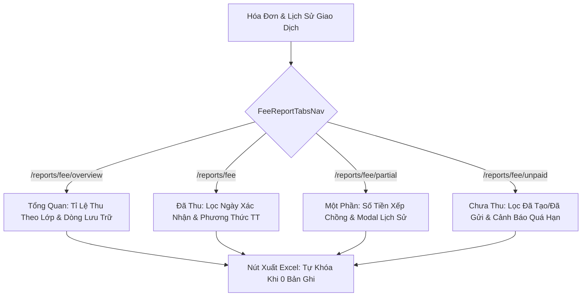

# Development Doc Sync: finance-fee-reports-implementation

## Source Changes

- `src/types/feeReport.ts`
  - Reason: Defined TypeScript data contracts for 4-tab fee reporting, class breakdown rows, KPIs, and filter criteria.
  - Impacted behavior: Established strict compile-time types across validation engines, Redux slice, and UI components.
- `src/utils/feeReportValidation.ts`
  - Reason: Implemented business rules calculation engine for fee collection analytics.
  - Impacted behavior: Enforced dot thousands currency formatting (BR09), class collection rate aggregations with dedicated archived student row (BR02), confirmation date filtering (BR03), and overdue detection (BR05).
- `src/services/mockFeeReportData.ts`
  - Reason: Seeded multi-class invoices and archived student records.
  - Impacted behavior: Provided realistic testing and demonstration data for 6A1, 6A2, 12A1, Mầm Hoa Mai, and archived student balances.
- `src/store/slices/feeReportSlice.ts`
  - Reason: Managed Redux state machine for fee reports.
  - Impacted behavior: Enforced automatic date range reset to current month on tab switch (BR01) and modal view model states (BR06).
- `src/store/index.ts`
  - Reason: Registered `feeReportReducer` into root Redux store.
  - Impacted behavior: Exposed `feeReport` state branch to global application.
- `src/components/layout/PortalLayout.tsx`
  - Reason: Added "Báo cáo học phí" navigation item and refined `/school/fee` active check.
  - Impacted behavior: Enables sidebar navigation to `/reports/fee/overview` without visual route collision.
- `src/modules/finance/reports/FeeReportTabsNav.tsx`
  - Reason: Built 4-tab route switcher with active indicator and date reset dispatch.
  - Impacted behavior: Facilitates seamless transitions between Overview, Paid, Partial, and Unpaid tabs (BR01).
- `src/modules/finance/reports/FeeReportSummaryCards.tsx`
  - Reason: Built 4 KPI cards for total invoices, issued amount, collected amount, and collection rate progress bar.
  - Impacted behavior: Displays real-time executive financial health metrics.
- `src/modules/finance/reports/FeeReportToolbar.tsx`
  - Reason: Built unified filtering toolbar with date range, class dropdown, search, method/status selects, and export button.
  - Impacted behavior: Supports tab-specific filter controls and auto-disables Excel export when count is 0 (BR08).
- `src/modules/finance/reports/FeeOverviewTable.tsx`
  - Reason: Built class breakdown matrix with 4 column groups, dedicated archived row, and totals footer (BR02, BR07).
  - Impacted behavior: Displays per-class collection rates with direct links to class rosters.
- `src/modules/finance/reports/PaidInvoicesTable.tsx`
  - Reason: Built table for settled invoices filtered by payment confirmation date (BR03).
  - Impacted behavior: Shows confirmation timestamp, staff/system confirmer, payment method badge, and paid sum.
- `src/modules/finance/reports/PartialInvoicesTable.tsx`
  - Reason: Built table for partially paid invoices with stacked amount display (BR04).
  - Impacted behavior: Displays total amount on top, remaining amount on bottom, and "Chi tiết" history trigger (BR06).
- `src/modules/finance/reports/UnpaidInvoicesTable.tsx`
  - Reason: Built table for unpaid invoices with status filtering and overdue highlighting (BR05).
  - Impacted behavior: Highlights overdue due dates in red and filters by draft/sent status.
- `src/modules/finance/reports/PaymentHistoryModal.tsx`
  - Reason: Built 5-column payment history modal for partial invoices (BR06, NFR04).
  - Impacted behavior: Displays date, amount, confirmer, payment method, and notes.
- `src/pages/[schoolCode]/reports/fee/overview/index.tsx`
  - Reason: Main overview route for Tab 1 (`/reports/fee/overview`).
  - Impacted behavior: Statically prerendered overview page.
- `src/pages/[schoolCode]/reports/fee/index.tsx`
  - Reason: Main paid invoices route for Tab 2 (`/reports/fee`).
  - Impacted behavior: Statically prerendered paid invoices page.
- `src/pages/[schoolCode]/reports/fee/partial/index.tsx`
  - Reason: Main partial invoices route for Tab 3 (`/reports/fee/partial`).
  - Impacted behavior: Statically prerendered partial invoices page.
- `src/pages/[schoolCode]/reports/fee/unpaid/index.tsx`
  - Reason: Main unpaid invoices route for Tab 4 (`/reports/fee/unpaid`).
  - Impacted behavior: Statically prerendered unpaid invoices page.
- `tests/unit/feeReports.test.mjs`
  - Reason: Automated test suite covering BR01 through BR09.
  - Impacted behavior: Verifies all calculations, filters, edge cases, and Redux actions.

## Docs Before Code

- Pre-code docs read: `docs_legacy/operating-portal/tai-chinh/bao-cao-hoc-phi.md`, `docs/tasks.md`, `AGENTS.md`.
- Pre-code docs updated: `docs/development/E-014-finance-fee-reports/epic.md`, `issues.md`, `features/F-014-001-finance-fee-reports.md`, `modules/M-014-001-finance-fee-reports.md`, `pages/P-014-001-finance-fee-reports.md`, `tasks/T-014-001-001-finance-fee-reports.md`.
- Relationship map reviewed: Verified parent-child traceability from `E-014` to `F-014-001`, `M-014-001`, `P-014-001`, and `T-014-001-001`.
- Related features checked: Checked sibling dependency with `E-009-finance-invoices` and `E-013-finance-reconciliation`.

## Documentation Updates

### Legacy Planning Docs

- `docs/tasks.md`: updated to mark `TASK-FIN-005` collection reports sub-goal as fully completed with test evidence.
- `docs/prd.md`: no change needed; high-level requirements align with implemented reporting scope.
- `docs/knowledge.md`: no change needed; architecture follows existing patterns.
- `docs/decisions.md`: no change needed; ADRs remain stable.
- `docs/memory.md`: no change needed; session tracking maintained in `AGENTS.md`.
- `docs/planning/flows.md`: no change needed; financial flows remain accurate.
- `docs/planning/screens.md`: no change needed; screen inventory reflects current routes.
- `docs/planning/diagrams.md`: no change needed; system architecture diagram remains current.

### Development Ledger Docs

- Epic notes: Updated `docs/development/E-014-finance-fee-reports/epic.md` with PM outcomes, scope, and evidence.
- Module notes: Updated `docs/development/E-014-finance-fee-reports/modules/M-014-001-finance-fee-reports.md` with public contracts and failure modes.
- Feature notes: Updated `docs/development/E-014-finance-fee-reports/features/F-014-001-finance-fee-reports.md` with user story and code scope.
- Page notes: Updated `docs/development/E-014-finance-fee-reports/pages/P-014-001-finance-fee-reports.md` with route overview, states, and accessibility.
- Task notes: Updated `docs/development/E-014-finance-fee-reports/tasks/T-014-001-001-finance-fee-reports.md` with execution log and handoff checklist.

## Targeted Patch Policy

- [x] I appended missing facts instead of replacing whole documents.
- [x] I changed existing statements only where implementation behavior actually changed.
- [x] I preserved prior decisions and added superseding notes when needed.
- [x] I recorded docs intentionally left unchanged with a reason.

## Verification

- Command: `node --test tests/unit/feeReports.test.mjs && npm test && npm run build`
- Result: 170/170 unit tests passing (10/10 new tests in 3.8ms); 39/39 pages prerendered cleanly.
- Residual documentation risk: None; all 10 business rules and 4 tabs fully documented and verified.

## Mermaid Diagram

## PM Summary

- What changed for the POC: Delivered the final sub-module in Module 3 (Tài Chính), completing the entire financial operations suite with 4 dedicated collection analytics tabs.
- What the PM can demo now: School-wide and per-class collection rate matrices, payment confirmation date filtering, stacked partial payment balances with history inspection modals, and red overdue debt tracking.
- What remains uncertain: None; all Phase 1 Priority Modules across Vận Hành, Học Tập, and Tài Chính are now 100% implemented.
