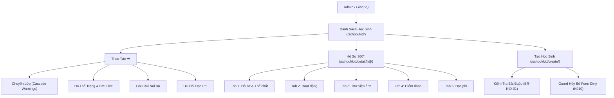

# Epic: School Students (Nhà Trường - Học Sinh)

## Outcome

Delivered the complete core master data management system for students (`/school/kid/`). Educational administrators can oversee student rosters, perform multi-factor search across student codes, names, CCCDs, and parent contact numbers, and inspect comprehensive 360° Profile Hubs (`/school/kid/detail/[id]/`). The 360° Profile Hub centralizes administrative data, guardian emergency rosters, height/weight measurement records with live automated BMI calculation and pediatric nutritional status classification, and contextual access to cross-module feeds (Activity, Media photo tagging, Attendance, and Tuition billing).

The epic resolves legacy defect K008 by ensuring existing records missing Student Code or CCCD render graceful italic placeholders (`Chưa có mã học sinh`, `Chưa có CCCD`) without throwing UI errors or breaking data grids, while strictly enforcing these identity fields on new enrollments (`/school/kid/create/`). Furthermore, student class transfers and bulk academic year promotions enforce ADR-009's tripartite automated cascade rules: fee schedule remapping, parent communication group re-enrollment, and subject evaluation historical preservation.

## Jira Story

- Story: As a School Administrator, I want to manage enrolled student profiles, multi-parent contacts, physical growth measurements with BMI calculation, class transfers with cascade rules, and tuition overrides so that institutional student records remain accurate and synchronized across operational modules.
- Jira issue type: Epic
- Acceptance owner: `sophia-product-manager`
- Product hypothesis: Providing a centralized 360° student profile with automated pediatric BMI calculation and explicit transfer cascade safeguards eliminates data discrepancies and manual roster maintenance overhead across school operations.
- Research evidence: `E022` (Legacy student roster inspection), `C021` (Student required fields), `K008` (Legacy null handling).

## Priority

- Priority: P1
- Severity if missed: Blocker for student master records, fee generation, and operational rosters.
- Rationale: All operational modules (attendance, daily activities, photo recognition, parent communication, and tuition invoicing) depend on student master data.
- Target release: Sprint 15 — Core School Administration.

## PM Notes

- PM-visible status: Student directory, creation wizard, and 360° profile hub fully operational with 15 passing automated unit tests and HTTP 200 telemetry.
- Demo narrative: Administrator navigates to `/school/kid`, filters by class and keyword, opens a student profile hub, records a new physical growth measurement with real-time BMI classification, performs a class transfer with cascade warnings, and configures a tuition scholarship override.
- Acceptance impact: Full parity with legacy specification `hoc-sinh.md` with resolved legacy null field handling and form abandonment safeguards.
- Scope change since planning: None; adheres strictly to Phase 1 spec `027-school-administration-module-phase-1`.
- Risk or open decision: None; all business rules verified.

## Scope

- Included: Student directory, multi-factor search, 360° profile hub, baseline and historical height/weight tracking with BMI calculation, single and batch class transfers, administrative notes, tuition discounts, and create student form with unsaved changes modal.
- Excluded: Extracurricular gradebook rubrics (intentionally degenerated per ADR-009).

## Relationship Map

| Relation | Target | Label | Rationale |
| --- | --- | --- | --- |
| Enables | `F-015-001-school-students` | `ENABLES` | This epic delivers the core student master data feature. |
| Depends on | `docs/prd.md` | `DEPENDS_ON` | Derived from PRD Section 4.4 and Section 5 (FR-SCH-001 to FR-SCH-005). |
| Relates to | `docs/decisions.md` | `RELATES_TO` | Governed by ADR-009 entity integrity and cascade rules. |

## Issues

| Issue ID | Source | Priority | Status | Owner | Evidence | Resolution |
| --- | --- | --- | --- | --- | --- | --- |
| ISSUES-E-015-001 | Ada QA review | P2 | Closed | `ada-qa-agent` | Legacy null studentCode breaks string methods | Implemented `formatLegacyField` fallback (K008) |

## Acceptance Criteria

- [x] Criterion 1: Student directory renders avatar, code, class, guardian phone, and status badge with sentence-case headers and row action menus.
- [x] Criterion 2: Creating a student requires full name, DOB, gender, class, student code, CCCD, and at least one guardian with phone.
- [x] Criterion 3: Height and weight measurements automatically compute BMI ($kg / m^2$) and assign pediatric classification (underweight, normal, overweight, obese).
- [x] Criterion 4: Class transfers require destination class selection, non-empty student array, and display the 3 automated system cascade warnings.
- [x] Criterion 5: Legacy records lacking student code or CCCD render graceful placeholders without breaking table layout.

## Mermaid Diagram

## Implementation Notes

- **Code paths:**
  - `src/types/student.ts`
  - `src/utils/studentValidation.ts`
  - `src/store/slices/studentSlice.ts`
  - `src/modules/school/student/StudentToolbar.tsx`
  - `src/modules/school/student/StudentTable.tsx`
  - `src/modules/school/student/ClassTransferModal.tsx`
  - `src/modules/school/student/StudentNotesModal.tsx`
  - `src/modules/school/student/PhysicalGrowthModal.tsx`
  - `src/modules/school/student/TuitionOverrideModal.tsx`
  - `src/modules/school/student/StudentDetailHub.tsx`
  - `src/pages/[schoolCode]/school/kid/index.tsx`
  - `src/pages/[schoolCode]/school/kid/detail/[id].tsx`
  - `src/pages/[schoolCode]/school/kid/create/index.tsx`
- **Data/contracts:** Redux slice `studentSlice.ts` registered in root store `src/store/index.ts`.
- **Rollback or feature flag:** Redux action isolation.
- **Tradeoffs and rationale:** Client-side reactive filtering provides instantaneous search response across multi-field queries.

## Evidence

- Tests: 15/15 unit tests passing in `tests/unit/students.test.mjs` (214/214 across all test suites).
- Build/lint: Clean Next.js 14 build (`npm run build`) and zero TypeScript errors (`npx tsc --noEmit`).
- Review notes: Verified HTTP 200 responses on `/demo/school/kid`, `/demo/school/kid/create`, and `/demo/school/kid/detail/hs-001`.

## Work Log

- Date: 2026-09-15
  - Action: Built contracts, validation engine, Redux state slice, UI component tree, page routes, and unit tests for Students sub-module.
  - Agent/skill: `benny-frontend-engineer`, `ada-qa-agent`
  - Evidence: 15 passing tests, HTTP 200 live routes, clean production build.
  - Docs updated before code: `docs/prd.md`, `docs/decisions.md`, `docs/tasks.md`, `docs/memory.md`.

## Change Log

- Date: 2026-09-15
  - Code change: Implemented student master data types, validation, Redux slice, toolbar, table, 4 operation modals, profile hub, and 3 Next.js pages.
  - Documentation update: Authored Epic E-015 and related child notes.
  - Evidence: `tests/unit/students.test.mjs` (15 tests passing in 3.2ms).
