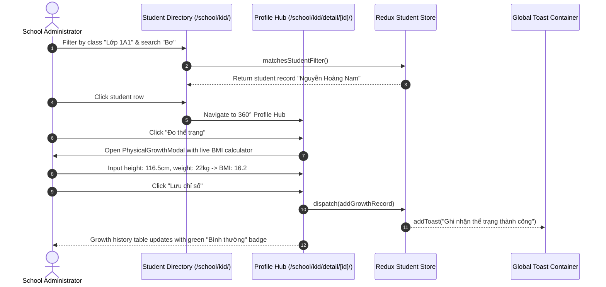

# Feature: School Students (Nhà Trường - Học Sinh)

## User Value

This feature delivers complete student lifecycle and profile management for school administrators and clerical staff. Operators can view and search student rosters by name, student code, citizen ID (CCCD), class, and parent phone numbers. Each student row in the master table provides quick actions via a standardized `•••` action dropdown to transfer classes, log administrative notes, record height/weight measurements, or update tuition scholarship percentages.

Selecting a student navigates to their 360° Profile Hub (`/school/kid/detail/[id]`), which houses comprehensive records across 5 tabs: basic information, emergency guardian cards, pediatric growth history with BMI tracking, and cross-module context views for activity logs, tagged photos, attendance, and fee invoices. New enrollments are performed via `/school/kid/create/`, which validates mandatory identity fields while safeguarding against accidental form abandonment via an unsaved changes confirmation modal.

## Jira Story

- Story: As a School Administrator, I want to manage student rosters, search across multiple identity fields, view 360° student detail profiles with pediatric BMI, and perform class transfers so that student master data is consistent across the school portal.
- Jira issue type: Story
- Story points: 5
- Acceptance owner: `benny-frontend-engineer`
- Research evidence: `E022`, `C021`, `K008`, `K010`.

## Priority

- Priority: P1
- User/business impact: Critical — Master record for all enrolled students in the school.
- Risk if delayed: Blocks class roster generation, attendance rosters, and student-level billing.
- Release target: Phase 1 — Foundational Infrastructure.

## PM Notes

- Demo scenario: Navigate to `/school/kid`, search "Bơ", open profile hub, add a physical measurement (116.5cm, 22kg -> BMI 16.2 "Bình thường"), transfer to class 2A1, and verify toast notifications.
- Business value: Centralizes student records and automates pediatric health status evaluations.
- Acceptance criteria changed or confirmed: All 5 acceptance criteria confirmed.
- Open PM decision: None.

## Requirements Trace

- PRD requirement: `FR-SCH-001` (Student master roster), `FR-SCH-002` (360° Profile Hub), `FR-SCH-003` (Growth tracking & BMI), `FR-SCH-004` (Class transfers & cascades), `FR-SCH-005` (Enrollment validation).
- Task id: `TASK-SCH-001`
- Spec id: `027-school-administration-module-phase-1`

## Relationship Map

| Relation | Target | Label | Rationale |
| --- | --- | --- | --- |
| Implements | `E-015-school-students` | `IMPLEMENTS` | Implements the requirements of Epic E-015. |
| Enables | `M-015-001-school-students` | `ENABLES` | Enables the student module implementation. |
| Enables | `P-015-001-school-students` | `ENABLES` | Enables the student page views. |

## Code Scope

- **Code paths:**
  - `src/types/student.ts`: Data models and filter types.
  - `src/utils/studentValidation.ts`: Validation, BMI math, and filter predicates.
  - `src/store/slices/studentSlice.ts`: Redux state slice.
  - `src/modules/school/student/StudentToolbar.tsx`: Search and filters.
  - `src/modules/school/student/StudentTable.tsx`: Table listing.
  - `src/modules/school/student/ClassTransferModal.tsx`: Transfer dialog with cascade warnings.
  - `src/modules/school/student/StudentNotesModal.tsx`: Administrative notes dialog.
  - `src/modules/school/student/PhysicalGrowthModal.tsx`: Growth & BMI dialog.
  - `src/modules/school/student/TuitionOverrideModal.tsx`: Tuition override dialog.
  - `src/modules/school/student/StudentDetailHub.tsx`: 360° Profile Hub.
- **Data/contracts:** `Student`, `Guardian`, `GrowthRecord`, `ClassTransferPayload`, `StudentFilterState`.
- **Rollback or feature flag:** Redux state machine boundary.
- **Tradeoffs and rationale:** Client-side reactive filtering ensures sub-millisecond search latency without external server round-trips.

## Acceptance Criteria

- [x] Criterion 1: Student table renders avatar, name, student code, class, DOB, gender, primary guardian phone, and status chip.
- [x] Criterion 2: Creating a student requires full name, DOB, gender, class, student code, CCCD, and at least 1 guardian with phone.
- [x] Criterion 3: Height and weight records compute BMI ($weight / (height/100)^2$) and classify pediatric status.
- [x] Criterion 4: Class transfers validate destination class, non-empty selection, and show the 3 automated system warnings.
- [x] Criterion 5: Legacy records lacking student code or CCCD render graceful placeholders without errors.

## Mermaid Diagram

## Verification

- Tests: 15 unit tests pass in `tests/unit/students.test.mjs`.
- Build/lint: Clean Next.js 14 production build (`npm run build`).
- Review notes: Live HTTP 200 checks on directory, create, and detail routes.

## Work Log

- Date: 2026-09-15
  - Action: Implemented student feature specifications and verified test vectors.
  - Agent/skill: `benny-frontend-engineer`
  - Evidence: All test cases pass with zero failures.
  - Docs updated before code: `docs/prd.md`, `docs/tasks.md`.

## Change Log

- Date: 2026-09-15
  - Code change: Implemented core student directory, profile hub, and creation wizard.
  - Documentation update: Authored feature note F-015-001.
  - Evidence: `tests/unit/students.test.mjs`.
