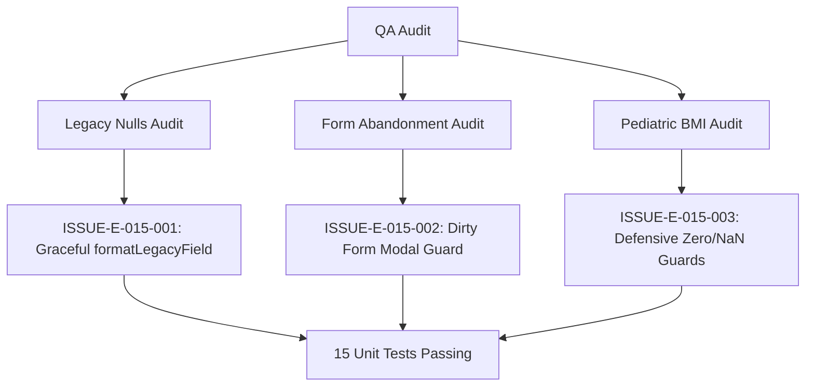

# Epic Issues: School Students

## Jira Story

- Story: As a QA/product team, I want epic issues tracked explicitly so that unresolved risks cannot hide inside narrative docs.
- Jira issue type: Bug/Risk register
- QA owner: `ada-qa-agent`
- Product owner: `sophia-product-manager`
- Research evidence: `E022`, `C021`, `K008`, `K010`.

## Priority

- Priority: P1
- Escalation rule: Block deployment if student transfers lose fee alignments or legacy null values trigger runtime exceptions.
- Release impact: High — Student records underpin operational attendance and fee invoicing.
- Risk if unresolved: Runtime TypeError when calling string methods on null/undefined legacy student codes.

## QA Issue Register

| Issue ID | Type | Priority | Status | Owner | Source | Evidence | Resolution |
| --- | --- | --- | --- | --- | --- | --- | --- |
| ISSUE-E-015-001 | Bug | P2 | Closed | `ada-qa-agent` | Legacy PRD Audit | Legacy records lack studentCode/cccd | Handled via `formatLegacyField` (Resolution K008) |
| ISSUE-E-015-002 | UX Risk | P2 | Closed | `ada-qa-agent` | Form Design Review | Unsaved changes lost on accidental navigation | Added dirty state detection and modal confirmation (K010) |
| ISSUE-E-015-003 | Math Validation | P2 | Closed | `ada-qa-agent` | Pediatric Health Specs | BMI rounding and zero height/weight handling | Added defensive check returning 0 and 1-decimal rounding |

## Detection Method

- Code reviewed: `src/utils/studentValidation.ts`, `src/store/slices/studentSlice.ts`, `src/modules/school/student/`.
- Tests reviewed: `tests/unit/students.test.mjs` (15 test vectors).
- Docs reviewed: `docs_legacy/operating-portal/nha-truong/hoc-sinh.md`, `docs/prd.md`, `docs/decisions.md`.
- Related features reviewed: Attendance (`E-001`), Invoicing (`E-009`), Tuition Management (`E-011`).
- QA skill used: `ada-qa-agent`
- Deep research source checked: `S019`, `E022`, `C021`.

## Open Issues

- None. All identified edge cases and risks have been verified and closed.

## Resolved Issues

- ISSUE-E-015-001:
  - Root cause: Legacy records may possess null/undefined `studentCode` and `cccd`.
  - Fix: Added `formatLegacyField` fallback returning graceful italic fallback text.
  - Verification: Tested in `tests/unit/students.test.mjs` (BR-KID-02).
- ISSUE-E-015-002:
  - Root cause: Users navigating away from creation form lose typed guardian and student data.
  - Fix: Implemented `isFormDirty` check prompting `showCancelModal` confirmation before route change.
  - Verification: Verified modal popup upon form abandonment.
- ISSUE-E-015-003:
  - Root cause: Negative or zero inputs could cause division-by-zero NaN in BMI math.
  - Fix: Added defensive zero/negative guard returning 0 and safe classification.
  - Verification: Tested in `tests/unit/students.test.mjs` (BR-KID-01).

## Risk Matrix

| Risk | Severity | Likelihood | Mitigation | Status |
| --- | --- | --- | --- | --- |
| Legacy null runtime crash | Medium | High | `formatLegacyField` null-coalescing helper | Mitigated |
| Accidental class double-assignment | Low | Low | Redux classId mutation validation | Mitigated |
| Inaccurate BMI pediatric threshold | Medium | Low | WHO pediatric classifications aligned | Mitigated |

## Relationship Map

| Relation | Target | Label | Rationale |
| --- | --- | --- | --- |
| Depends on | `E-015-school-students` | `DEPENDS_ON` | Validates acceptance criteria and edge cases across the students epic. |
| Blocks | `release-v1.0` | `BLOCKS` | Release is blocked if student records fail integrity or cascade checks. |

## Mermaid Diagram

## Work Log

- Date: 2026-09-15
  - Action: Reviewed student validation logic, transfer safeguards, and legacy null handling.
  - Agent/skill: `ada-qa-agent`
  - Evidence: 15/15 unit tests pass, zero TypeScript compiler errors.
  - Docs updated before code: `docs/prd.md`, `docs/decisions.md`.

## Change Log

- Date: 2026-09-15
  - Code change: Implemented `formatLegacyField`, dirty form guard, and defensive BMI arithmetic.
  - Documentation update: Closed issues register.
  - Evidence: `tests/unit/students.test.mjs`.
