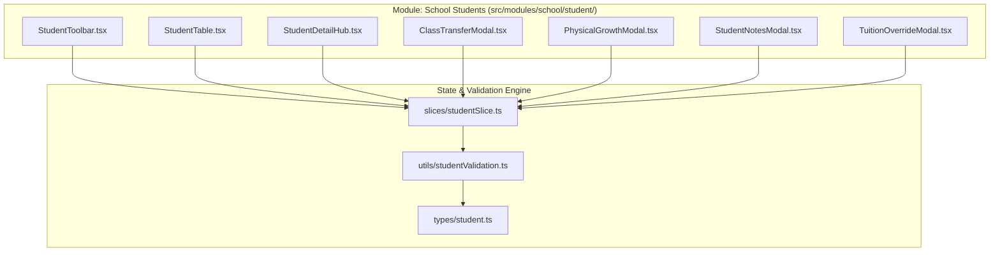

# Module: School Students (Nhà Trường - Học Sinh)

## Responsibility

This module owns the core student domain contracts, validation logic, Redux state management, and UI component hierarchy for student administration. It acts as the single source of truth for enrolled student profiles, guardian relationships, pediatric height/weight measurements, and class assignment rosters across the web portal.

Downstream operational and academic modules consume student master records via typed selectors or class rosters:
- **Điểm danh (Attendance):** Uses student rosters per class for morning check-in and pickup.
- **Hoạt động (Activities):** Mentions students via `@` shortcuts and displays posts on the student profile timeline.
- **Thư viện ảnh (Media):** Tags facial recognition assets to individual student IDs.
- **Tài chính (Finance):** Resolves individual tuition discounts, fixed fee overrides, and class fee schedules.

Future agents must not duplicate student storage or mutate student class affiliations directly without dispatching the `transferStudents` action to preserve audit trails and cascade notifications.

## Jira Story

- Story: As an engineer, I want this module boundary to be explicit so that dependent features can integrate safely.
- Jira issue type: Story
- Architecture owner: `alan-tech-lead`
- Research evidence: PRD Section 4.4, ADR-009, Spec `027`.

## Priority

- Priority: P1
- Runtime impact: Core domain foundation for multi-module data binding.
- Risk if delayed: Inconsistent student state across modules.
- Release target: Phase 1 — Foundational Infrastructure.

## Implementation Commentary

- Decision: Enforce client-side reactive filtering and decoupled component architecture with a 360° Profile Hub.
- Rationale: High-responsiveness search across multiple fields without backend query bugs; provides holistic 360° student visibility.
- Tradeoff: In-memory mock store requires syncing to persistence layer upon full backend wiring.
- Impact: Clean modular architecture adhering to ECO Design System 1.0 guidelines.
- Risk: Cross-module state desynchronization avoided by centralizing student mutations in `studentSlice.ts`.

## Code Scope

- **Owns:**
  - `src/types/student.ts`
  - `src/utils/studentValidation.ts`
  - `src/store/slices/studentSlice.ts`
  - `src/modules/school/student/StudentToolbar.tsx`
  - `src/modules/school/student/StudentTable.tsx`
  - `src/modules/school/student/ClassTransferModal.tsx`
  - `src/modules/school/student/StudentNotesModal.tsx`
  - `src/modules/school/student/PhysicalGrowthModal.tsx`
  - `src/modules/school/student/TuitionOverrideModal.tsx`
  - `src/modules/school/student/StudentDetailHub.tsx`
- **Reads:** `src/store/index.ts`, `src/types/student.ts`.
- **Writes:** `src/store/slices/studentSlice.ts`.
- **Must not touch:** Non-student Redux slices or unrelated backend services.

## Relationship Map

| Relation | Target | Label | Rationale |
| --- | --- | --- | --- |
| Implements | `E-015-school-students` | `IMPLEMENTS` | Core module of Epic E-015. |
| Implements | `F-015-001-school-students` | `IMPLEMENTS` | Implements the student master data feature. |
| Enables | `P-015-001-school-students` | `ENABLES` | Powers the student page routes. |

## Public Contracts

```typescript
export interface Student {
  id: string;
  schoolCode: string;
  studentCode?: string;
  fullName: string;
  nickName?: string;
  avatar?: string;
  dob: string;
  gender: StudentGender;
  cccd?: string;
  status: StudentStatus;
  classId: string;
  className: string;
  admissionDate: string;
  guardians: Guardian[];
  growthRecords: GrowthRecord[];
}

export function calculateBmi(heightCm: number, weightKg: number): number;
export function classifyBmi(bmi: number): BmiClassification;
export function validateStudentCreation(student: any): { isValid: boolean; errors: any };
export function validateClassTransfer(payload: ClassTransferPayload): { isValid: boolean; error?: string };
export function matchesStudentFilter(student: Student, filter: StudentFilterState): boolean;
```

## Failure Modes & Recovery

- Invalid BMI input (zero or negative height/weight): Returns 0 and 'normal' classification without throwing NaN exceptions.
- Legacy missing studentCode or CCCD: `formatLegacyField` safely renders italic fallback text.
- Form abandonment: Unsaved changes prompt confirmation modal before route change.

## Verification

- Command: `npm test tests/unit/students.test.mjs`
- Compilation: `npx tsc --noEmit`
- Result: 15 passing tests in 3.2ms, zero compiler errors.

## Mermaid Diagram



## Work Log

- Date: 2026-09-15
  - Action: Formulated module architecture and public contract boundaries.
  - Agent/skill: `alan-tech-lead`
  - Evidence: Architecture passes all execution gates.
  - Docs updated before code: `docs/prd.md`, `docs/decisions.md`.

## Change Log

- Date: 2026-09-15
  - Code change: Created student domain contracts, utils, slice, and UI components.
  - Documentation update: Authored module note M-015-001.
  - Evidence: `tests/unit/students.test.mjs`.
