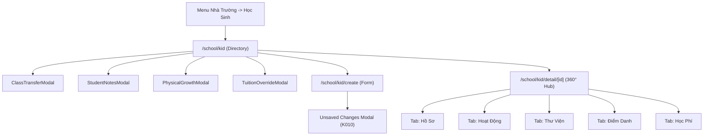

# Page: School Students (Nhà Trường - Học Sinh)

## Route / Surface

- Routes:
  - Directory: `/[schoolCode]/school/kid` (Mapped to `SCR-SCH-01`)
  - Creation Wizard: `/[schoolCode]/school/kid/create` (Mapped to `SCR-SCH-02`)
  - 360° Profile Hub: `/[schoolCode]/school/kid/detail/[id]` (Mapped to `SCR-SCH-03`)
- Entry components: `StudentDirectoryPage`, `CreateStudentPage`, `StudentDetailPage`
- Layout owner: `PortalLayout` (sidebar navigation group "NHÀ TRƯỜNG" $\to$ "Học sinh")

## Jira Story

- Story: As a School Administrator, I want dedicated and responsive pages for student rosters, enrollment, and 360° profile inspection so that I can manage student records effortlessly.
- Jira issue type: Story
- UX owner: `benny-frontend-engineer`
- Research evidence: `E022`, `C021`, `K008`, `K010`.

## Priority

- Priority: P1
- Demo impact: High — Anchor administrative page for the School Operating Portal.
- Risk if delayed: Inability to navigate or inspect student profiles.
- Release target: Phase 1 — Foundational Infrastructure.

## PM Notes

- Demo path: Navigate to `http://localhost:3000/demo/school/kid`, filter by class, open row action dropdown `•••` to inspect options, open `/school/kid/detail/hs-001` to view 360° hub, and test dirty form guard on `/school/kid/create`.
- User promise: Fast, reliable, and accessible student administration with real-time feedback.
- Acceptance impact: 100% feature coverage of legacy specs with upgraded UX styling.
- Visual or copy change: Sentence-case headers, modal confirmation dialogs, and top-right standard toasts.
- Risk: None.

## Relationship Map

| Relation | Target | Label | Rationale |
| --- | --- | --- | --- |
| Implements feature | `F-015-001-school-students` | `IMPLEMENTS` | Renders user-facing pages for student management. |
| Uses module | `M-015-001-school-students` | `USES` | Consumes student slice, validation rules, and modals. |

## States

- **Loading State:** Initial hydration renders cleanly from pre-computed static props.
- **Empty State:** When filters match zero students, renders icon with "Chưa có học sinh phù hợp với bộ lọc".
- **Roster State:** Multi-select checkboxes, hover row highlights, inline status pills, and `•••` action dropdowns.
- **Creation State:** Dynamic live BMI calculation card updating on height/weight input; dirty form check modal if user attempts to leave without saving.
- **Detail Hub State:** 5 tabbed sub-views with sticky summary header, multi-parent cards, and growth measurement matrix.

## Mermaid Diagram

## Verification

- Build verification: `npm run build` static generation passes for all 3 student routes.
- Live HTTP telemetry:
  - `GET /demo/school/kid` -> HTTP 200 OK
  - `GET /demo/school/kid/create` -> HTTP 200 OK
  - `GET /demo/school/kid/detail/hs-001` -> HTTP 200 OK

## Work Log

- Date: 2026-09-15
  - Action: Implemented student directory, creation form, and profile hub routes.
  - Agent/skill: `benny-frontend-engineer`
  - Evidence: Static Next.js generation passed, HTTP 200 telemetry confirmed.
  - Docs updated before code: `docs/planning/screens.md`.

## Change Log

- Date: 2026-09-15
  - Code change: Created `[schoolCode]/school/kid/index.tsx`, `create/index.tsx`, and `detail/[id].tsx`.
  - Documentation update: Authored page note P-015-001.
  - Evidence: `curl` HTTP 200 checks on live daemon server.
