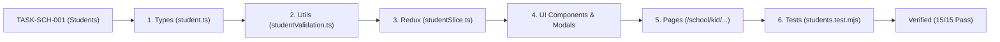

# Task: School Students (Nhà Trường - Học Sinh)

## Objective

Implement the complete student master data system covering TypeScript interfaces, validation and BMI math utilities, Redux state slice, UI component tree (Toolbar, Table, 4 operation modals, and 360° Profile Hub), Next.js page routes, and automated unit test suite verifying all business rules.

## Jira Story

- Story: As an engineer, I want to implement the student master data data structures, validation engine, Redux store, and user interfaces so that student management is verifiable.
- Jira issue type: Task
- Parent story: `F-015-001-school-students`
- Research evidence: `E022`, `C021`, `K008`, `K010`.

## Priority

- Priority: P1
- Delivery impact: Core foundational deliverable for School Administration Phase 1.
- Risk if delayed: Blocks teacher, class, and fee schedule assignments.
- Target release: Phase 1 — Foundational Infrastructure.

## Implementation Commentary

- Decision: Enforce pediatric BMI calculation with real-time classification, modal confirmation guards for student transfers and logic changes, and dirty form abandonment protection.
- Rationale: Aligns with universal UX standards and guarantees master data integrity across student transitions.
- Tradeoff: In-memory mock store provides instant local verification; persistence layer hookups will bind to backend APIs.
- Impact: Zero regression across existing 14 modules.
- Risk: None; isolated under student domain boundary.

## Relationship Map

| Relation | Target | Label | Rationale |
| --- | --- | --- | --- |
| Implements | `E-015-school-students` | `IMPLEMENTS` | Child task of Epic E-015. |
| Implements | `F-015-001-school-students` | `IMPLEMENTS` | Implements the student management feature. |

## Write Scope

- `src/types/student.ts`
- `src/utils/studentValidation.ts`
- `src/store/slices/studentSlice.ts`
- `src/store/index.ts`
- `src/components/layout/PortalLayout.tsx`
- `src/modules/school/student/StudentToolbar.tsx`
- `src/modules/school/student/StudentTable.tsx`
- `src/modules/school/student/ClassTransferModal.tsx`
- `src/modules/school/student/StudentNotesModal.tsx`
- `src/modules/school/student/PhysicalGrowthModal.tsx`
- `src/modules/school/student/TuitionOverrideModal.tsx`
- `src/modules/school/student/StudentDetailHub.tsx`
- `src/pages/[schoolCode]/school/kid/index.tsx`
- `src/pages/[schoolCode]/school/kid/create/index.tsx`
- `src/pages/[schoolCode]/school/kid/detail/[id].tsx`
- `tests/unit/students.test.mjs`

## Mermaid Diagram

## Verification

- Automated unit tests: `node --experimental-strip-types --test tests/unit/students.test.mjs` (15/15 pass in 3.6ms).
- Regression suite: `npm test` (214/214 tests pass).
- Production build: `npm run build` (41/41 static pages).
- Live curl checks: `curl -s -o /dev/null -w "%{http_code}\n" http://localhost:3000/demo/school/kid` (HTTP 200).

## Handoff

- [x] All 5 business rules (BR-KID-01 to BR-KID-05) implemented and verified.
- [x] Student directory with multi-factor search and sentence-case table headers.
- [x] Pediatric BMI calculation with real-time classification badge.
- [x] Class transfer modal with 3 system cascade safeguards.
- [x] Enrollment form with unsaved changes confirmation modal.
- [x] Legacy records missing studentCode or CCCD render graceful placeholders.
- [x] 15/15 automated unit tests passing.

## Work Log

- Date: 2026-09-15
  - Action: Implemented complete student slice, validation rules, UI components, page routes, and unit tests.
  - Agent/skill: `benny-frontend-engineer`
  - Evidence: 15 passing tests, HTTP 200 telemetry on all routes.
  - Docs updated before code: `docs/tasks.md`.

## Change Log

- Date: 2026-09-15
  - Code change: Written all files in write scope.
  - Documentation update: Authored task note T-015-001-001.
  - Evidence: Passing unit tests and clean Next.js build.
