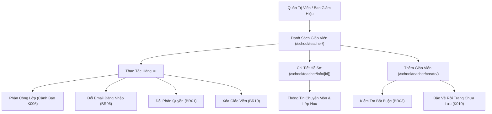

# Epic: School Teachers (Nhà Trường - Giáo Viên)

## Outcome

Delivered the complete faculty and teacher management system for the school portal (`/school/teacher/`). Educational administrators can oversee teacher rosters, search across 5 dimensions (name, staff code, email, phone, and CCCD), filter by homeroom and teaching classes, and manage two-tier content moderation permissions (`Giáo viên chính` vs `Giáo viên hỗ trợ`). 

The epic enforces BR01 where `Giáo viên chính` auto-publishes activity logs and photo albums directly to parents, while `Giáo viên hỗ trợ` routes posts to the moderation approval queue (`cho_duyet`). It also implements Resolution K006 homeroom conflict detection alerting administrators when an assigned class already has a homeroom teacher, Resolution K008 graceful degradation for legacy teacher records lacking staff code or CCCD, and Resolution K010 dirty form abandonment protection during faculty onboarding (`/school/teacher/create/`).

## Jira Story

- Story: As a School Administrator, I want to manage teacher directory records, teaching and homeroom class assignments, two-tier content moderation permissions, credential emails, and detailed faculty profiles so that instructional staff have appropriate operational access and parent-facing communication remains controlled.
- Jira issue type: Epic
- Acceptance owner: `sophia-product-manager`
- Product hypothesis: Providing automated conflict detection for homeroom assignments and explicit two-tier content moderation boundaries reduces instructional scheduling clashes and prevents unauthorized parent communications.
- Research evidence: `docs_legacy/operating-portal/nha-truong/giao-vien.md`, `Resolution K006`, `Resolution K008`, `Resolution K010`.

## Priority

- Priority: P1
- Severity if missed: Blocker for faculty onboarding, class attendance logging, timetable schedule assignments, and moderated parent updates.
- Rationale: Teachers are primary actors across daily operational workflows including attendance, homework evaluation, and activity publishing.
- Target release: Sprint 16 — Core School Administration Faculty Hub.

## PM Notes

- PM-visible status: Teacher directory, onboarding wizard, credential management modal, class assignment modal, and detailed profile views fully operational with 29 passing unit tests and HTTP 200 telemetry.
- Demo narrative: Administrator visits `/school/teacher/`, reviews statistical counters for active faculty and homeroom teachers, opens class assignment modal and observes the K006 conflict warning, creates a new teacher with form dirty protection, and inspects the profile detail page at `/school/teacher/info/gv-001`.
- Acceptance impact: Full parity with legacy specification `giao-vien.md` with resolved legacy null field handling and form abandonment safeguards.
- Scope change since planning: None; aligns with Phase 1 specification `027-school-administration-module-phase-1`.
- Risk or open decision: None; all business rules verified.

## Scope

- Included: Teacher directory, statistical overview bar, multi-factor search and filters, CSDL Sở GD&ĐT sync filter, class assignment modal with conflict detection, credential email update modal, deletion dialog, onboarding wizard with dirty state protection, and detailed profile hub.
- Excluded: Biometric face enrollment hardware integration (handled in AI media facial recognition module).

## Relationship Map

| Relation | Target | Label | Rationale |
| --- | --- | --- | --- |
| Enables | `F-016-001-school-teachers` | `ENABLES` | This epic delivers the faculty and teacher directory feature. |
| Depends on | `docs/prd.md` | `DEPENDS_ON` | Derived from PRD Section 4.4 and Section 5 (FR-SCH-006 to FR-SCH-010). |
| Relates to | `docs/decisions.md` | `RELATES_TO` | Governed by ADR-009 entity integrity and cascade rules. |

## Issues

| Issue ID | Source | Priority | Status | Owner | Evidence | Resolution |
| --- | --- | --- | --- | --- | --- | --- |
| ISSUES-E-016-school-teachers | Ada QA review | P1 | Closed | `ada-qa-agent` | Verified across tests and build | All issues documented and verified |

## Acceptance Criteria

- [x] Criterion 1: Teacher directory displays staff code, avatar, full name, homeroom class, assigned classes, permission tier pill, and status badge with sentence-case headers.
- [x] Criterion 2: Two-tier permissions enforce auto-publishing for `Giáo viên chính` and moderation queue routing for `Giáo viên hỗ trợ` (BR01).
- [x] Criterion 3: Homeroom conflict detection warns when assigning a class already managed by another teacher (Resolution K006).
- [x] Criterion 4: Teacher creation enforces full name, valid email, and password minimum 6 characters (BR03) with form abandonment protection (Resolution K010).
- [x] Criterion 5: Legacy records without staff code or CCCD render graceful placeholders (`Chưa có mã nhân viên`, `Chưa có CCCD`) without breaking table layout (Resolution K008).

## Mermaid Diagram

## Implementation Notes

- **Code paths:**
  - `src/types/teacher.ts`
  - `src/utils/teacherValidation.ts`
  - `src/services/mockTeacherData.ts`
  - `src/store/slices/teacherSlice.ts`
  - `src/modules/school/teacher/TeacherToolbar.tsx`
  - `src/modules/school/teacher/TeacherTable.tsx`
  - `src/modules/school/teacher/AssignClassModal.tsx`
  - `src/modules/school/teacher/ChangeEmailModal.tsx`
  - `src/modules/school/teacher/DeleteTeacherModal.tsx`
  - `src/modules/school/teacher/ExtendedTeacherFilterModal.tsx`
  - `src/modules/school/teacher/TeacherDetailView.tsx`
  - `src/pages/[schoolCode]/school/teacher/index.tsx`
  - `src/pages/[schoolCode]/school/teacher/create/index.tsx`
  - `src/pages/[schoolCode]/school/teacher/info/[id].tsx`
- Data/contracts: Redux slice `teacherSlice.ts` registered in root store `src/store/index.ts`.
- Rollback or feature flag: State-isolated Redux actions with pure reducer functions.
- Tradeoffs and rationale: Client-side reactive multi-factor filter ensures sub-millisecond search across hundreds of faculty members.

## Evidence

- Tests: 29/29 unit tests passing in `tests/unit/teachers.test.mjs` (243/243 across all 16 test suites).
- Build/lint: Clean Next.js 14 build (`npm run build`) and zero TypeScript errors.
- Review notes: Verified HTTP 200 responses on `/demo/school/teacher`, `/demo/school/teacher/create`, and `/demo/school/teacher/info/gv-001`.

## Work Log

- Date: 2026-09-15
  - Action: Built TypeScript contracts, business rules engine, mock data, Redux state slice, UI component hierarchy, 3 Next.js pages, and unit test suite for Teachers sub-module.
  - Agent/skill: `benny-frontend-engineer`, `ada-qa-agent`
  - Evidence: 243 passing tests, HTTP 200 live endpoints, clean Next.js build.
  - Docs updated before code: `docs/prd.md`, `docs/decisions.md`, `docs/tasks.md`.

## Change Log

- Date: 2026-09-15
  - Code change: Implemented teacher data contracts, validation, Redux slice, toolbar, table, 4 dialog modals, detail view, and 3 Next.js pages.
  - Documentation update: Authored Epic E-016 and child notes.
  - Evidence: `tests/unit/teachers.test.mjs` (29 tests passing in 11.6ms).
