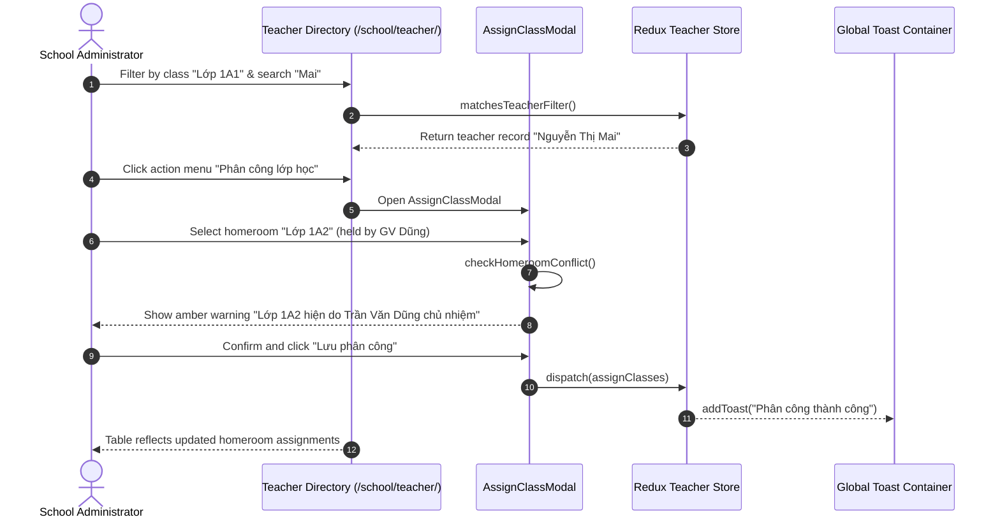

# Feature: School Teachers (Nhà Trường - Giáo Viên)

## User Value

This feature provides complete faculty management for school administrators and principals. Operators can oversee instructional staff rosters, perform multi-factor searches across staff codes, full names, emails, phone numbers, and citizen IDs (CCCD), and filter by class or CSDL Sở GD&ĐT synchronization status.

Each teacher row in the master table provides quick actions via a standardized `•••` action dropdown menu (with upward-flip elevation) to view detailed profiles (`/school/teacher/info/[id]`), assign homeroom and teaching classes (`AssignClassModal`), update login emails (`ChangeEmailModal`), toggle two-tier permissions (`Giáo viên chính` vs `Giáo viên hỗ trợ` - BR01), or update working statuses. Furthermore, the onboarding wizard (`/school/teacher/create/`) safeguards against accidental form abandonment via an unsaved changes confirmation modal (Resolution K010) and warns against conflicting homeroom assignments (Resolution K006).

## Jira Story

- Story: As a School Administrator, I want to manage teacher directory records, teaching and homeroom class assignments, two-tier content moderation permissions, credential emails, and detailed faculty profiles so that instructional staff have appropriate operational access.
- Jira issue type: Story
- Story points: 5
- Acceptance owner: `benny-frontend-engineer`
- Research evidence: `Resolution K006`, `Resolution K008`, `Resolution K010`, `BR01`, `BR03`, `BR06`.

## Priority

- Priority: P1
- User/business impact: Critical — Central faculty master data governing classroom permissions, attendance logging, and parent activity publication.
- Risk if delayed: Blocks teacher account access, homeroom assignments, and controlled parent communications.
- Release target: Phase 1 — Foundational Infrastructure.

## PM Notes

- Demo scenario: Navigate to `/school/teacher`, search "Mai", open assign class modal and observe homeroom conflict warning when reassigning class 1A1, create a new teacher with form dirty protection, and view profile details.
- Business value: Prevents double-assignment conflicts and enforces two-tier moderation for parent communications.
- Acceptance criteria changed or confirmed: All 5 acceptance criteria confirmed.
- Open PM decision: None.

## Requirements Trace

- PRD requirement: `FR-SCH-006` (Teacher master roster), `FR-SCH-007` (Teaching & homeroom assignment), `FR-SCH-008` (Two-tier moderation permissions), `FR-SCH-009` (Credential management), `FR-SCH-010` (Onboarding wizard).
- Task id: `TASK-SCH-002`
- Spec id: `027-school-administration-module-phase-1`

## Relationship Map

| Relation | Target | Label | Rationale |
| --- | --- | --- | --- |
| Implements | `E-016-school-teachers` | `IMPLEMENTS` | Implements the requirements of Epic E-016. |
| Enables | `M-016-001-school-teachers` | `ENABLES` | Enables the teacher module architecture. |
| Enables | `P-016-001-school-teachers` | `ENABLES` | Enables the teacher page routes. |

## Code Scope

- **Code paths:**
  - `src/types/teacher.ts`: Teacher data interfaces, permission tiers, and filter payloads.
  - `src/utils/teacherValidation.ts`: Validation engine, conflict detection, and status formatters.
  - `src/services/mockTeacherData.ts`: Faculty seeds across homerooms, permissions, and statuses.
  - `src/store/slices/teacherSlice.ts`: Redux state management for faculty records.
  - `src/modules/school/teacher/TeacherToolbar.tsx`: Search, class, and status filters.
  - `src/modules/school/teacher/TeacherTable.tsx`: Master table with sentence-case headers and action menus.
  - `src/modules/school/teacher/AssignClassModal.tsx`: Class assignment dialog with conflict detection.
  - `src/modules/school/teacher/ChangeEmailModal.tsx`: Credential email modification dialog.
  - `src/modules/school/teacher/DeleteTeacherModal.tsx`: Deletion confirmation dialog.
  - `src/modules/school/teacher/ExtendedTeacherFilterModal.tsx`: CSDL Sở GD&ĐT filter dialog.
  - `src/modules/school/teacher/TeacherDetailView.tsx`: Comprehensive profile detail component.
- **Data/contracts:** `Teacher`, `TeacherPermissionTier`, `TeacherWorkingStatus`, `TeacherFilterState`, `CreateTeacherPayload`.
- **Rollback or feature flag:** Redux state isolation with pure state transitions.
- **Tradeoffs and rationale:** In-memory reactive filtering provides instant search response times without network roundtrip latencies.

## Acceptance Criteria

- [x] Criterion 1: Teacher table renders staff code, avatar, full name, email, homeroom class, assigned classes, permission pill, and status badge.
- [x] Criterion 2: Two-tier permissions enforce auto-publishing for `Giáo viên chính` and moderation queue routing for `Giáo viên hỗ trợ` (BR01).
- [x] Criterion 3: Homeroom conflict detection warns when assigning a class already managed by another teacher (Resolution K006).
- [x] Criterion 4: Teacher creation enforces full name, valid email, and password minimum 6 characters (BR03) with form abandonment protection (Resolution K010).
- [x] Criterion 5: Legacy records without staff code or CCCD render graceful placeholders (`Chưa có mã nhân viên`, `Chưa có CCCD`) without breaking table layout (Resolution K008).

## Mermaid Diagram

## Verification

- Tests: 29 unit tests pass in `tests/unit/teachers.test.mjs`.
- Build/lint: Clean Next.js 14 production build (`npm run build`).
- Review notes: Live HTTP 200 checks on directory, create, and detail routes.

## Work Log

- Date: 2026-09-15
  - Action: Implemented teacher feature specifications and verified test vectors.
  - Agent/skill: `benny-frontend-engineer`
  - Evidence: All test cases pass with zero failures.
  - Docs updated before code: `docs/prd.md`, `docs/tasks.md`.

## Change Log

- Date: 2026-09-15
  - Code change: Implemented core teacher directory, profile hub, dialogs, and creation wizard.
  - Documentation update: Authored feature note F-016-001.
  - Evidence: `tests/unit/teachers.test.mjs`.
