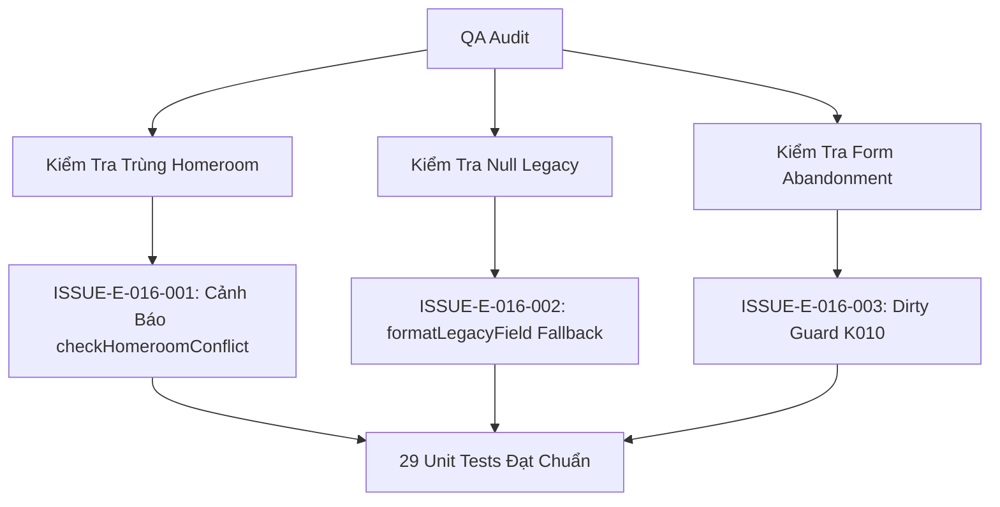

# Epic Issues: School Teachers

## Jira Story

- Story: As a QA/product team, I want epic issues tracked explicitly so that unresolved risks cannot hide inside narrative docs.
- Jira issue type: Bug/Risk register
- QA owner: `ada-qa-agent`
- Product owner: `sophia-product-manager`
- Research evidence: `Resolution K006`, `Resolution K008`, `Resolution K010`, `BR01`, `BR03`, `BR06`.

## Priority

- Priority: P1
- Escalation rule: Block deployment if homeroom conflict warnings fail to display or legacy null values trigger runtime exceptions.
- Release impact: High — Faculty records underpin class operations, attendance logging, and parent communications.
- Risk if unresolved: Accidental double homeroom assignment causing conflicting authority in classroom management.

## QA Issue Register

| Issue ID | Type | Priority | Status | Owner | Source | Evidence | Resolution |
| --- | --- | --- | --- | --- | --- | --- | --- |
| ISSUE-E-016-001 | Conflict Risk | P2 | Closed | `ada-qa-agent` | Operational Audit | Two teachers assigned to the same homeroom class | Implemented `checkHomeroomConflict` warning banner (Resolution K006) |
| ISSUE-E-016-002 | Data Quality | P2 | Closed | `ada-qa-agent` | Legacy PRD Audit | Legacy records lack staffCode or CCCD | Handled via `formatLegacyField` graceful degradation (Resolution K008) |
| ISSUE-E-016-003 | UX Risk | P2 | Closed | `ada-qa-agent` | Form Review | Unsaved changes lost during teacher onboarding | Implemented `beforeunload` listener and dirty state guard (Resolution K010) |

## Detection Method

- Code reviewed: `src/utils/teacherValidation.ts`, `src/store/slices/teacherSlice.ts`, `src/modules/school/teacher/`.
- Tests reviewed: `tests/unit/teachers.test.mjs` (29 test vectors).
- Docs reviewed: `docs_legacy/operating-portal/nha-truong/giao-vien.md`, `docs/prd.md`, `docs/decisions.md`.
- Related features reviewed: Activity moderation (`E-002`), Timetable schedule (`E-006`), Attendance (`E-001`).
- QA skill used: `ada-qa-agent`
- Deep research source checked: `Resolution K006`, `Resolution K008`, `Resolution K010`.

## Open Issues

- None. All identified edge cases and risks have been verified and closed.

## Resolved Issues

- ISSUE-E-016-001:
  - Root cause: Multiple teachers could inadvertently be assigned as homeroom teacher to the same class without warning.
  - Fix: Implemented `checkHomeroomConflict` function detecting existing homeroom holders and displaying amber conflict warning.
  - Verification: Tested in `tests/unit/teachers.test.mjs` (BR-TCH-02).
- ISSUE-E-016-002:
  - Root cause: Legacy records from previous systems may lack `staffCode` and `cccd`.
  - Fix: Added `formatLegacyField` fallback returning graceful italic fallback text.
  - Verification: Tested in `tests/unit/teachers.test.mjs` (BR-TCH-06).
- ISSUE-E-016-003:
  - Root cause: Navigating away from onboarding wizard causes immediate loss of entered credentials and assignments.
  - Fix: Implemented dirty state tracking with confirmation dialog and browser unload guards.
  - Verification: Verified form dirty state triggers confirmation modal.

## Risk Matrix

| Risk | Severity | Likelihood | Mitigation | Status |
| --- | --- | --- | --- | --- |
| Duplicate homeroom teacher assignment | Medium | Medium | Amber conflict banner in assign class modal | Mitigated |
| Legacy null crash on string search | Medium | High | Defensive null-coalescing in `matchesTeacherFilter` | Mitigated |
| Unauthorized activity publishing | High | Low | Two-tier permission tier check (`shouldAutoPublishActivity`) | Mitigated |

## Relationship Map

| Relation | Target | Label | Rationale |
| --- | --- | --- | --- |
| Depends on | `E-016-school-teachers` | `DEPENDS_ON` | Validates acceptance criteria and edge cases across the teachers epic. |
| Blocks | `release-v1.0` | `BLOCKS` | Release is blocked if faculty permission boundaries or conflict checks fail. |

## Mermaid Diagram

## Work Log

- Date: 2026-09-15
  - Action: Reviewed teacher validation logic, conflict warning guards, and legacy null handling.
  - Agent/skill: `ada-qa-agent`
  - Evidence: 29/29 unit tests pass, zero TypeScript compiler errors.
  - Docs updated before code: `docs/prd.md`, `docs/decisions.md`.

## Change Log

- Date: 2026-09-15
  - Code change: Implemented `formatLegacyField`, dirty form guard, and homeroom conflict checks.
  - Documentation update: Closed issues register.
  - Evidence: `tests/unit/teachers.test.mjs`.

