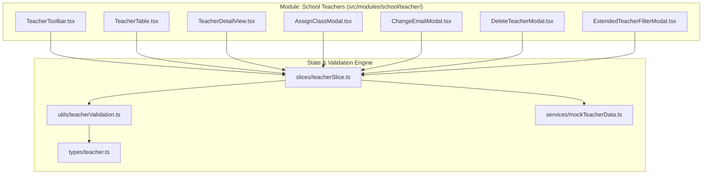

# Module: School Teachers (Nhà Trường - Giáo Viên)

## Responsibility

This module owns faculty domain contracts, validation logic, Redux state management, and UI component hierarchy for teacher administration. It acts as the authority on faculty records, homeroom and subject teaching allocations, two-tier activity moderation permissions, and credential management across the operating portal.

Downstream modules consume faculty master records:
- **Điểm danh (Attendance):** Resolves authorized attendance takers and homeroom sign-offs.
- **Hoạt động (Activities):** Determines auto-publishing privileges (BR01: `chinh` auto-publishes; `ho_tro` queues for review).
- **Thời khóa biểu (Schedule):** Binds subject teachers to class timetable slots.
- **Trao đổi (Conversations):** Routes parent direct messages to appropriate homeroom and subject teachers.

Future agents must not duplicate teacher data stores or bypass the `assignClasses` or `changePermissionTier` actions to ensure consistency and prevent homeroom scheduling clashes.

## Jira Story

- Story: As an engineer, I want this module boundary to be explicit so that dependent features can integrate safely.
- Jira issue type: Story
- Architecture owner: `alan-tech-lead`
- Research evidence: PRD Section 4.4, ADR-009, Spec `027`.

## Priority

- Priority: P1
- Runtime impact: Core domain foundation for classroom operations and instructional staff access.
- Risk if delayed: Inconsistent faculty permissions or conflicting homeroom assignments.
- Release target: Phase 1 — Foundational Infrastructure.

## Implementation Commentary

- Decision: Implement isolated Redux slice with client-side reactive filtering and upward-flipping `•••` action dropdowns.
- Rationale: High responsiveness during multi-field directory searches without server roundtrips; robust dropdown positioning prevents viewport overflow.
- Tradeoff: In-memory store will require API synchronization during backend integration.
- Impact: Clean modular architecture strictly adhering to ECO Design System 1.0 guidelines.
- Risk: Cross-module permission desynchronization avoided by centralizing faculty actions in `teacherSlice.ts`.

## Code Scope

- **Owns:**
  - `src/types/teacher.ts`
  - `src/utils/teacherValidation.ts`
  - `src/services/mockTeacherData.ts`
  - `src/store/slices/teacherSlice.ts`
  - `src/modules/school/teacher/TeacherToolbar.tsx`
  - `src/modules/school/teacher/TeacherTable.tsx`
  - `src/modules/school/teacher/AssignClassModal.tsx`
  - `src/modules/school/teacher/ChangeEmailModal.tsx`
  - `src/modules/school/teacher/DeleteTeacherModal.tsx`
  - `src/modules/school/teacher/ExtendedTeacherFilterModal.tsx`
  - `src/modules/school/teacher/TeacherDetailView.tsx`
- **Reads:** `src/store/index.ts`, `src/types/teacher.ts`.
- **Writes:** `src/store/slices/teacherSlice.ts`.
- **Must not touch:** Unrelated financial or student state trees.

## Relationship Map

| Relation | Target | Label | Rationale |
| --- | --- | --- | --- |
| Implements | `E-016-school-teachers` | `IMPLEMENTS` | Core module of Epic E-016. |
| Implements | `F-016-001-school-teachers` | `IMPLEMENTS` | Implements the teacher directory and faculty feature. |
| Enables | `P-016-001-school-teachers` | `ENABLES` | Powers the teacher page views. |

## Public Contracts

```typescript
export interface Teacher {
  id: string;
  schoolCode: string;
  staffCode?: string;
  fullName: string;
  email: string;
  phone?: string;
  gender: TeacherGender;
  homeroomClassId?: string;
  homeroomClassName?: string;
  assignedClasses: AssignedClassItem[];
  subjects: string[];
  permissionTier: TeacherPermissionTier;
  status: TeacherWorkingStatus;
}

export function validateTeacherCreation(payload: any): { isValid: boolean; errors: any };
export function validateEmailChange(currentEmail: string, newEmail: string): { isValid: boolean; error?: string };
export function checkHomeroomConflict(teachers: Teacher[], targetTeacherId: string, targetClassId?: string, targetClassName?: string): HomeroomConflictResult;
export function shouldAutoPublishActivity(permissionTier: TeacherPermissionTier): boolean;
export function matchesTeacherFilter(teacher: Teacher, filter: TeacherFilterState): boolean;
```

## Failure Modes & Recovery

- Homeroom conflict detected: `checkHomeroomConflict` flags amber warning banner without hard blocking to allow administrative discretion.
- Legacy missing staffCode or CCCD: `formatLegacyField` gracefully renders italic fallback text.
- Form abandonment: Window beforeunload listener and router cancellation modal prevent accidental loss of typed credentials.

## Verification

- Command: `npm test tests/unit/teachers.test.mjs`
- Compilation: `npx tsc --noEmit`
- Result: 29 passing tests in 11.6ms, zero compiler errors.

## Mermaid Diagram



## Work Log

- Date: 2026-09-15
  - Action: Formulated module architecture and public contract boundaries.
  - Agent/skill: `alan-tech-lead`
  - Evidence: Architecture passes all execution gates.
  - Docs updated before code: `docs/prd.md`, `docs/decisions.md`.

## Change Log

- Date: 2026-09-15
  - Code change: Created teacher domain contracts, validation, slice, and UI components.
  - Documentation update: Authored module note M-016-001.
  - Evidence: `tests/unit/teachers.test.mjs`.
