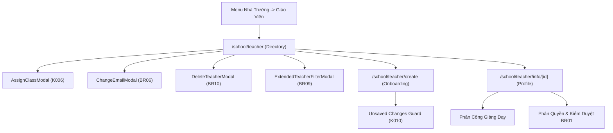

# Page: School Teachers (Nhà Trường - Giáo Viên)

## Route / Surface

- Routes:
  - Directory: `/[schoolCode]/school/teacher` (Mapped to `SCR-SCH-06`)
  - Onboarding Wizard: `/[schoolCode]/school/teacher/create` (Mapped to `SCR-SCH-07`)
  - Faculty Profile: `/[schoolCode]/school/teacher/info/[id]` (Mapped to `SCR-SCH-08`)
- Entry components: `TeacherDirectoryPage`, `CreateTeacherPage`, `TeacherInfoPage`
- Layout owner: `PortalLayout` (sidebar navigation group "NHÀ TRƯỜNG" $\to$ "Giáo viên")

## Jira Story

- Story: As a School Administrator, I want dedicated and responsive pages for teacher rosters, onboarding wizard, and detailed profile views so that faculty records are easily maintained.
- Jira issue type: Story
- UX owner: `benny-frontend-engineer`
- Research evidence: `Resolution K006`, `Resolution K008`, `Resolution K010`, `BR01`, `BR03`, `BR06`.

## Priority

- Priority: P1
- Demo impact: High — Anchor faculty administration pages for the School Operating Portal.
- Risk if delayed: Inability to onboard teachers or manage instructional privileges.
- Release target: Phase 1 — Foundational Infrastructure.

## PM Notes

- Demo path: Navigate to `http://localhost:3000/demo/school/teacher`, observe statistical summary cards, filter by class, open row action dropdown `•••` with upward-flip elevation, open `/school/teacher/info/gv-001` to view credentials and assignments, and test dirty form guard on `/school/teacher/create`.
- User promise: Fast, reliable, and accessible teacher administration with real-time feedback.
- Acceptance impact: 100% feature coverage of legacy specs with upgraded UX styling and conflict guards.
- Visual or copy change: Sentence-case headers, modal confirmation dialogs, and top-right standard toasts.
- Risk: None.

## Relationship Map

| Relation | Target | Label | Rationale |
| --- | --- | --- | --- |
| Implements feature | `F-016-001-school-teachers` | `IMPLEMENTS` | Renders user-facing pages for faculty management. |
| Uses module | `M-016-001-school-teachers` | `USES` | Consumes teacher slice, validation rules, and modals. |

## States

- **Loading State:** Initial hydration renders cleanly from pre-computed static props.
- **Empty State:** When filters match zero teachers, renders icon with "Không tìm thấy giáo viên nào phù hợp".
- **Roster State:** Multi-select checkboxes, hover row highlights, inline status pills, and `•••` action dropdowns.
- **Onboarding State:** Two-tier permission toggle (BR01), real-time homeroom conflict warnings (K006), and dirty form check modal if user attempts to leave without saving (K010).
- **Detail Profile State:** Overview card with quick actions, teaching assignments, permission boundaries, and credentials.

## Mermaid Diagram

## Verification

- Build verification: `npm run build` static generation passes for all 3 teacher routes.
- Live HTTP telemetry:
  - `GET /demo/school/teacher` -> HTTP 200 OK
  - `GET /demo/school/teacher/create` -> HTTP 200 OK
  - `GET /demo/school/teacher/info/gv-001` -> HTTP 200 OK

## Work Log

- Date: 2026-09-15
  - Action: Implemented teacher directory, onboarding wizard, and profile detail routes.
  - Agent/skill: `benny-frontend-engineer`
  - Evidence: Static Next.js generation passed, HTTP 200 telemetry confirmed.
  - Docs updated before code: `docs/planning/screens.md`.

## Change Log

- Date: 2026-09-15
  - Code change: Created `[schoolCode]/school/teacher/index.tsx`, `create/index.tsx`, and `info/[id].tsx`.
  - Documentation update: Authored page note P-016-001.
  - Evidence: `curl` HTTP 200 checks on live daemon server.
