# Task: School Teachers (Nhà Trường - Giáo Viên)

## Objective

Implement the complete faculty and teacher management system covering TypeScript interfaces, validation and conflict detection utilities, Redux state slice, UI component tree (Toolbar, Table, 4 operation modals, and Detail Profile View), Next.js page routes, and automated unit test suite verifying all business rules.

## Jira Story

- Story: As an engineer, I want to implement teacher master data structures, validation engine, Redux store, and user interfaces so that faculty management is verifiable.
- Jira issue type: Task
- Parent story: `F-016-001-school-teachers`
- Research evidence: `Resolution K006`, `Resolution K008`, `Resolution K010`, `BR01`, `BR03`, `BR06`.

## Priority

- Priority: P1
- Delivery impact: Core foundational deliverable for School Administration Phase 1.
- Risk if delayed: Blocks teacher classroom assignments, attendance tracking, and moderated parent posts.
- Target release: Phase 1 — Foundational Infrastructure.

## Implementation Commentary

- Decision: Enforce homeroom conflict detection with real-time amber warning banners, two-tier content moderation boundaries (BR01), upward-flipping `•••` action dropdowns, and dirty form abandonment protection (Resolution K010).
- Rationale: Aligns with universal UX standards and guarantees master data integrity across faculty assignments.
- Tradeoff: In-memory mock store provides instant local verification; persistence layer hookups will bind to backend APIs.
- Impact: Zero regression across existing 15 modules.
- Risk: None; isolated under teacher domain boundary.

## Relationship Map

| Relation | Target | Label | Rationale |
| --- | --- | --- | --- |
| Implements | `E-016-school-teachers` | `IMPLEMENTS` | Child task of Epic E-016. |
| Implements | `F-016-001-school-teachers` | `IMPLEMENTS` | Implements the teacher management feature. |

## Write Scope

- `src/types/teacher.ts`
- `src/utils/teacherValidation.ts`
- `src/services/mockTeacherData.ts`
- `src/store/slices/teacherSlice.ts`
- `src/store/index.ts`
- `src/components/layout/PortalLayout.tsx`
- `src/modules/school/teacher/TeacherToolbar.tsx`
- `src/modules/school/teacher/TeacherTable.tsx`
- `src/modules/school/teacher/AssignClassModal.tsx`
- `src/modules/school/teacher/ChangeEmailModal.tsx`
- `src/modules/school/teacher/DeleteTeacherModal.tsx`
- `src/modules/school/teacher/ExtendedTeacherFilterModal.tsx`
- `src/modules/school/teacher/TeacherDetailView.tsx`
- `src/pages/[schoolCode]/school/teacher/index.tsx`
- `src/pages/[schoolCode]/school/teacher/create/index.tsx`
- `src/pages/[schoolCode]/school/teacher/info/[id].tsx`
- `tests/unit/teachers.test.mjs`

## Mermaid Diagram

```mermaid
flowchart LR
    Task["TASK-SCH-002 (Teachers)"] --> Types["1. Types (teacher.ts)"]
    Types --> Utils["2. Utils (teacherValidation.ts)"]
    Utils --> Redux["3. Redux (teacherSlice.ts)"]
    Redux --> UI["4. UI Components & Modals"]
    UI --> Pages["5. Pages (/school/teacher/...)"]
    Pages --> Tests["6. Tests (teachers.test.mjs)"]
    Tests --> Verified["Verified (29/29 Pass)"]
```

## Verification

- Automated unit tests: `node --experimental-strip-types --test tests/unit/teachers.test.mjs` (29/29 pass in 11.6ms).
- Regression suite: `npm test` (243/243 tests pass).
- Production build: `npm run build` (44/44 static pages).
- Live curl checks: `curl -s -o /dev/null -w "%{http_code}\n" http://localhost:3000/demo/school/teacher` (HTTP 200).

## Handoff

- [x] All 7 business rules (BR-TCH-01 to BR-TCH-07) implemented and verified.
- [x] Teacher directory with multi-factor search and sentence-case table headers.
- [x] Two-tier moderation permissions enforcing auto-publish vs queue (BR01).
- [x] Homeroom assignment conflict warning banner (Resolution K006).
- [x] Onboarding wizard with unsaved changes confirmation modal (Resolution K010).
- [x] Legacy records missing staffCode or CCCD render graceful placeholders (Resolution K008).
- [x] 29/29 automated unit tests passing.

## Work Log

- Date: 2026-09-15
  - Action: Implemented complete teacher slice, validation rules, UI components, page routes, and unit tests.
  - Agent/skill: `benny-frontend-engineer`
  - Evidence: 29 passing tests, HTTP 200 telemetry on all routes.
  - Docs updated before code: `docs/tasks.md`.

## Change Log

- Date: 2026-09-15
  - Code change: Written all files in write scope.
  - Documentation update: Authored task note T-016-001-001.
  - Evidence: Passing unit tests and clean Next.js build.
