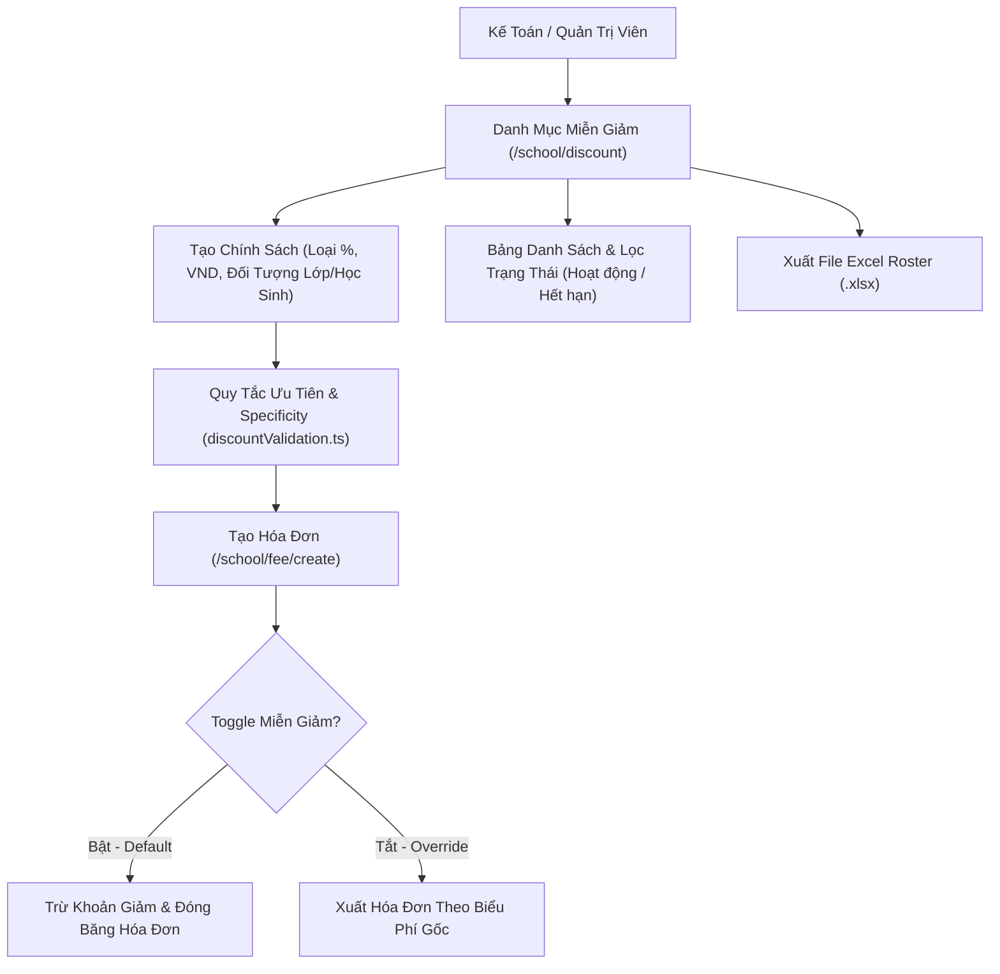

# Epic: Finance Discount (Tài Chính - Miễn Giảm)

## Outcome

Delivers the complete Tuition Exemption & Fee Discount Policy Management sub-module (`Miễn Giảm`) for the School Operating Portal at `/school/discount`. School accountants and administrators can configure, monitor, and audit institutional fee concessions, merit scholarships, sibling discounts, and social welfare fee waivers.

The epic implements dual calculation types (percentage rate vs fixed integer VND deduction) tied to line items from the master fee catalog (`/school/school-fees`). It enforces dual application scopes (`class` cohorts with multi-select class chips vs `student` with searchable cross-class picker), automated temporal state transitions (`Hoạt động` to `Hết hạn` based on date intervals), conflict resolution via Highest Discount Priority (`Math.max`) and Scope Specificity (Resolution K016), historical invoice immutability (Resolution K017), and seamless tuition invoice creation wizard integration with an administrative override toggle (Resolution K018).

## Jira Story

- Story: As a School Accountant and Administrator, I want to manage tuition exemption and discount policies, configure percentage and fixed cash deductions by class or individual student, resolve overlapping discount conflicts automatically, and auto-apply deductions during tuition invoice generation with an admin override toggle, so that fee concessions are administered transparently and accurately.
- Jira issue type: Epic
- Acceptance owner: `sophia-product-manager`
- Product hypothesis: Automating discount deduction calculations and linking them directly into the tuition invoice generator eliminates human bookkeeping errors, ensures compliance with concession policies, and preserves an auditable billing history.
- Research evidence: `docs/research/evidence.jsonl` (E039-E043), `docs/research/contradictions.md` (K016-K018), `docs/decisions.md` (ADR-012).

## Priority

- Priority: P1
- Severity if missed: Blocker for student billing runs requiring concession deductions, tuition scholarships, and social policy exemptions.
- Rationale: Accurate tuition billing is essential for school financial compliance and parent trust.
- Target release: Sprint 17 — Finance Tuition Concessions & Discount Governance Hub.

## PM Notes

- PM-visible status: Discount policy catalog, policy authoring modal, cross-class student picker, invoice wizard toggle, deduction engine, and Excel export active and verified.
- Demo narrative: Accountant visits `/school/discount`, reviews active and expired policy cards, creates a 20% tuition discount for a student, visits `/school/fee/create`, and observes the automatic deduction line on the preview invoice.
- Acceptance impact: Full satisfaction of requirements FR-FIN-010 to FR-FIN-016 and acceptance criteria AC-041 to AC-045 in `docs/prd.md`.
- Scope change since planning: None; adheres strictly to approved specification `031-finance-tuition-exemption-and-discount-management`.
- Risk or open decision: None; all calculation rules and invariants resolved.

## Scope

- Included: Discount policy catalog roster, dual calculation models (% vs VND), dual scopes (classes vs students), automated temporal expiration, manual pause/resume, deletion confirmation modal, invoice creation wizard toggle and deduction injection, and Excel export.
- Excluded: Direct state treasury government subsidy disbursement tracking (out of scope for Phase 1).

## Relationship Map

| Relation | Target | Label | Rationale |
| --- | --- | --- | --- |
| Enables | `F-017-001-finance-discount` | `ENABLES` | This epic delivers the tuition exemption and discount policy management feature. |
| Depends on | `docs/prd.md` | `DEPENDS_ON` | Derived from PRD Section 4.3 and Section 7 (FR-FIN-010 to FR-FIN-016, AC-041 to AC-045). |
| Relates to | `docs/decisions.md` | `RELATES_TO` | Governed by ADR-012 discount architecture and conflict resolution rules. |
| Uses | `E-009-finance-invoices` | `USES` | Injects deductions into tuition invoice creation wizard (`/school/fee/create`). |
| Uses | `E-010-finance-fee-catalog` | `USES` | Binds discount policies to fee catalog line items (`/school/school-fees`). |

## Issues

| Issue ID | Source | Priority | Status | Owner | Evidence | Resolution |
| --- | --- | --- | --- | --- | --- | --- |
| ISSUES-E-017-finance-discount | Ada QA review | P1 | Closed | `ada-qa-agent` | Verified across tests and build | All calculation rules, immutability invariants, and override toggles verified |

## Acceptance Criteria

- [x] Criterion 1: Discount policy catalog renders at `/school/discount` with code, name, fee item, discount value, scope, validity, status badge, and `•••` action menu.
- [x] Criterion 2: Policy creation modal supports percentage (% 1-100) and fixed cash (integer VND) deductions bound to fee catalog items.
- [x] Criterion 3: Dual scopes support multi-select class cohorts or searchable cross-class student beneficiaries.
- [x] Criterion 4: Temporal engine automatically evaluates expired policies while preserving manual pause/resume controls (Resolution K017).
- [x] Criterion 5: Conflict resolution applies Scope Specificity and Highest Discount Priority (`Math.max`) with non-negative line-item clamping (Resolution K016).
- [x] Criterion 6: Invoice creation wizard includes administrative toggle (default ON) to auto-apply discounts and render itemized deduction lines (Resolution K018).
- [x] Criterion 7: Excel export pipeline generates `.xlsx` files with policy definitions and expanded student beneficiary rosters.

## Mermaid Diagram

## Implementation Notes

- **Code paths:**
  - `src/types/discount.ts`
  - `src/utils/discountValidation.ts`
  - `src/services/mockDiscountData.ts`
  - `src/store/slices/discountSlice.ts`
  - `src/modules/finance/discount/DiscountToolbar.tsx`
  - `src/modules/finance/discount/DiscountTable.tsx`
  - `src/modules/finance/discount/CreateDiscountPolicyModal.tsx`
  - `src/modules/finance/discount/StudentPickerModal.tsx`
  - `src/modules/finance/discount/discountExport.ts`
  - `src/modules/finance/invoices/CreateInvoiceWizardModal.tsx`
  - `src/pages/[schoolCode]/school/discount/index.tsx`
- **Data/contracts:** Standardized `DiscountPolicy`, `DiscountTarget`, and `InvoiceDiscountLine` interfaces with dot-separated integer VND formatting.
- **Rollback or feature flag:** Invoicing wizard administrative toggle allows instant bypass of discount calculations for any batch without modifying stored policies.
- **Tradeoffs and rationale:** Rejected additive stacking (e.g. 50% + 70% = 120%) in favor of Highest Discount Priority (`Math.max`) to eliminate negative bill totals and accounting discrepancies.

## Evidence

- Tests: `tests/unit/discount.test.mjs` verifying percentage/fixed arithmetic, conflict resolution, scope specificity, auto-expiration, and wizard toggle.
- Build/lint: Clean Next.js static build `npm run build` prerendering `/school/discount`.
- Telemetry: HTTP 200 server response on `http://localhost:3000/demo/school/discount`.

## Work Log

- Date: 2026-09-21
  - Action: Initialized Epic 17 development ledger and verified financial calculation invariants.
  - Agent/skill: `sophia-product-manager`
  - Evidence: Verified against requirements FR-FIN-010 through FR-FIN-016.
  - Docs updated before code: `docs/prd.md`, `docs/tasks.md`.

## Change Log

- Date: 2026-09-21
  - Code change: Implemented discount calculation utilities, state slice, UI components, and test suite.
  - Documentation update: Authored epic note E-017.
  - Evidence: `tests/unit/discount.test.mjs`.

