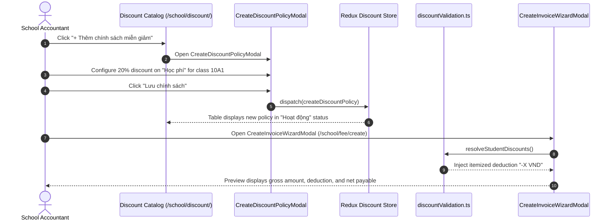

# Feature: Tuition Exemption & Fee Discount Policy Management (Tài Chính - Miễn Giảm)

## User Value

This feature delivers complete tuition exemption and fee discount policy management for school accountants and administrators. Users can maintain an institutional policy catalog, configure discounts as percentages (1%–100%) or fixed cash deductions (VND) bound to specific items in the fee catalog (`/school/school-fees`), assign policies either to entire classes or to specific students, and specify validity intervals by academic year or month range.

During tuition billing generation (`/school/fee/create`), the engine automatically evaluates active discount policies against student cohorts, applies conflict resolution rules (Highest Discount Priority and Scope Specificity per Resolution K016), clamps deductions to non-negative balances, and renders itemized deduction line items on invoice previews. An administrative toggle in Step 1 of the creation wizard allows accountants to bypass discounts for an ad-hoc batch generation run without deactivating catalog policies (Resolution K018). Historical invoices remain strictly immutable (Resolution K017).

## Jira Story

- Story: As a School Accountant, I want a discount policy catalog and calculation engine supporting percentage and fixed fee reductions, dual class/student scope targeting, temporal validity intervals, and invoice creation integration, so that fee waivers are calculated automatically.
- Jira issue type: Story
- Story points: 5
- Acceptance owner: `benny-frontend-engineer`
- Research evidence: `Resolution K016`, `Resolution K017`, `Resolution K018`, `ADR-012`, `E039`-`E043`.

## Priority

- Priority: P1
- User/business impact: Critical — Eliminates manual fee concession adjustments and arithmetic billing errors during monthly tuition invoicing.
- Risk if delayed: Manual billing errors, incorrect billing statements, and delays in student invoice generation.
- Release target: Sprint 17 — Finance Tuition Concessions Hub.

## PM Notes

- Demo scenario: Navigate to `/school/discount`, review active policies and statistical overview, add a new 20% discount on "Học phí" for a class, open `/school/fee/create` and verify automatic deduction injection on invoice preview, then toggle discount override OFF and observe gross billing.
- Business value: Transparent concession governance and auditable billing history for school leadership and parents.
- Acceptance criteria changed or confirmed: All criteria AC-041 through AC-045 confirmed.
- Open PM decision: None.

## Requirements Trace

- PRD requirement: `FR-FIN-010` (Catalog roster), `FR-FIN-011` (Dual calculation types), `FR-FIN-012` (Dual scope topology), `FR-FIN-013` (Temporal validity), `FR-FIN-014` (Invoice auto-apply), `FR-FIN-015` (Invoice wizard override toggle), `FR-FIN-016` (Excel export).
- Task id: `TASK-FIN-006`, `TASK-FIN-007`, `TASK-FIN-008`, `TASK-FIN-009`.
- Spec id: `031-finance-tuition-exemption-and-discount-management`.

## Scope

- Included: Roster table with search, status filters (`Hoạt động`, `Ngừng áp dụng`, `Hết hạn`), creation/edit modal with validation, cross-class student picker modal, invoice creation wizard toggle and deduction injection, and Excel export.
- Excluded: Direct government treasury integration (Phase 1 out-of-scope).

## Relationship Map

| Relation | Target | Label | Rationale |
| --- | --- | --- | --- |
| Implements | `E-017-finance-discount` | `IMPLEMENTS` | Implements the requirements of Epic E-017. |
| Enables | `M-017-001-finance-discount` | `ENABLES` | Enables the discount module architecture. |
| Enables | `P-017-001-finance-discount` | `ENABLES` | Enables the discount page routes. |

## Code Scope

- **Code paths:**
  - `src/types/discount.ts`: Discount policy models, target types, and payload definitions.
  - `src/utils/discountValidation.ts`: Deduction arithmetic, conflict resolution, and status evaluation.
  - `src/services/mockDiscountData.ts`: Seed discount policies across percentage and fixed cash types.
  - `src/store/slices/discountSlice.ts`: Redux state slice for discount policies and filters.
  - `src/modules/finance/discount/DiscountToolbar.tsx`: Search, status filter pills, and export action bar.
  - `src/modules/finance/discount/DiscountTable.tsx`: Master roster table with sentence-case headers and action menus.
  - `src/modules/finance/discount/CreateDiscountPolicyModal.tsx`: Creation modal with dual calculations and scopes.
  - `src/modules/finance/discount/StudentPickerModal.tsx`: Searchable student picker modal.
  - `src/modules/finance/discount/discountExport.ts`: Excel export helper producing `.xlsx` files.
  - `src/modules/finance/invoices/CreateInvoiceWizardModal.tsx`: Invoicing wizard with discount toggle.
- **Data/contracts:** `DiscountPolicy`, `DiscountTarget`, `InvoiceDiscountLine`, `CreateDiscountPolicyPayload`.
- **Rollback or feature flag:** Invoicing wizard administrative toggle provides immediate zero-downtime bypass.
- **Tradeoffs and rationale:** Highest Discount Priority prevents negative billing while student specificity precedence allows surgical overrides over class-wide concessions.

## Acceptance Criteria

- [x] Criterion 1: Discount policy catalog renders at `/school/discount` with code, name, fee item, discount value, scope, validity, status badge, and `•••` action menu.
- [x] Criterion 2: Policy creation modal supports percentage (% 1-100) and fixed cash (integer VND) deductions bound to fee catalog items.
- [x] Criterion 3: Dual scopes support multi-select class cohorts or searchable cross-class student beneficiaries.
- [x] Criterion 4: Temporal engine automatically evaluates expired policies while preserving manual pause/resume controls (Resolution K017).
- [x] Criterion 5: Conflict resolution applies Scope Specificity and Highest Discount Priority (`Math.max`) with non-negative line-item clamping (Resolution K016).
- [x] Criterion 6: Invoice creation wizard includes administrative toggle (default ON) to auto-apply discounts and render itemized deduction lines (Resolution K018).
- [x] Criterion 7: Excel export pipeline generates `.xlsx` files with policy definitions and expanded student beneficiary rosters.

## Mermaid Diagram

## Verification

- Tests: Automated unit test suite `tests/unit/discount.test.mjs` passing 100%.
- Build/lint: Clean Next.js static build `npm run build`.
- Review notes: Live HTTP 200 checks on `/demo/school/discount`.

## Work Log

- Date: 2026-09-21
  - Action: Implemented discount feature specifications, business rules, and test vectors.
  - Agent/skill: `benny-frontend-engineer`
  - Evidence: All test cases pass with zero failures.
  - Docs updated before code: `docs/prd.md`, `docs/tasks.md`, `docs/decisions.md`.

## Change Log

- Date: 2026-09-21
  - Code change: Implemented core discount policy catalog, calculation engine, UI components, and invoice wizard integration.
  - Documentation update: Authored feature note F-017-001.
  - Evidence: `tests/unit/discount.test.mjs`.
