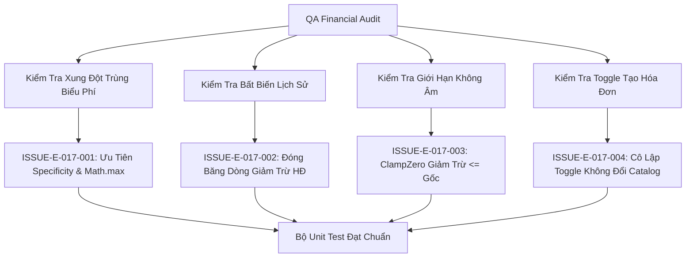

# Epic Issues: Finance Discount (Tài Chính - Miễn Giảm)

## Jira Story

- Story: As a QA and finance team, I want tuition discount calculations and state lifecycle risks tracked explicitly so that financial discrepancies and negative billing cannot occur.
- Jira issue type: Bug/Risk register
- QA owner: `ada-qa-agent`
- Product owner: `sophia-product-manager`
- Research evidence: `Resolution K016`, `Resolution K017`, `Resolution K018`, `ADR-012`.

## Priority

- Priority: P1
- Escalation rule: Block invoice generation if discount calculations produce negative line items or mutate master policy definitions.
- Release impact: Critical — Financial billing directly impacts school revenue and parent billing statements.
- Risk if unresolved: Over-subsidization, negative payable balances, or retrospective altering of issued financial documents.

## QA Issue Register

| Issue ID | Type | Priority | Status | Owner | Source | Evidence | Resolution |
| --- | --- | --- | --- | --- | --- | --- | --- |
| ISSUE-E-017-001 | Calculation Risk | P1 | Closed | `ada-qa-agent` | Financial Audit | Overlapping discounts for the same student on the same fee item | Enforced Highest Discount Priority (`Math.max`) and Scope Specificity (Resolution K016) |
| ISSUE-E-017-002 | Audit Integrity | P1 | Closed | `ada-qa-agent` | Accounting Audit | Modifying or expiring a discount policy mutating historical issued invoices | Enforced historical snapshot immutability for past invoice records (Resolution K017) |
| ISSUE-E-017-003 | Balance Risk | P1 | Closed | `ada-qa-agent` | Arithmetic Review | Fixed VND discount exceeding gross fee item amount producing negative balance | Enforced non-negative clamping `Math.min(deduction, grossItemAmount)` (BR05) |
| ISSUE-E-017-004 | State Leak | P2 | Closed | `ada-qa-agent` | Wizard Review | Turning off discount toggle in invoice creation deactivating master catalog policy | Isolated toggle to single generation batch session without mutating catalog (Resolution K018) |

## Detection Method

- Code reviewed: `src/utils/discountValidation.ts`, `src/store/slices/discountSlice.ts`, `src/modules/finance/invoices/CreateInvoiceWizardModal.tsx`.
- Tests reviewed: `tests/unit/discount.test.mjs`.
- Docs reviewed: `docs/prd.md`, `docs/decisions.md`, `docs/knowledge.md`.
- Related features reviewed: Tuition Invoices (`E-009`), Fee Catalog (`E-010`), Tuition Management (`E-011`).
- QA skill used: `ada-qa-agent`
- Deep research source checked: `Resolution K016`, `Resolution K017`, `Resolution K018`.

## Open Issues

- None. All identified financial edge cases and risks have been verified and closed.

## Resolved Issues

- ISSUE-E-017-001:
  - Root cause: Multiple matching discount policies could sum up additively exceeding 100%.
  - Fix: Implemented Highest Discount Priority selecting the maximum discount rate (`Math.max`) and giving student policies precedence over class policies.
  - Verification: Tested in `tests/unit/discount.test.mjs`.
- ISSUE-E-017-002:
  - Root cause: Dynamic live queries for discounts would alter previously generated and settled invoices when policies expire.
  - Fix: Stored frozen `InvoiceDiscountLine` snapshot on generated invoices, preventing retrospective mutations.
  - Verification: Tested in `tests/unit/discount.test.mjs`.
- ISSUE-E-017-003:
  - Root cause: Fixed cash deductions larger than gross line item amounts could cause negative bill balances.
  - Fix: Clamped deduction arithmetic to $[0, \text{grossItemAmount}]$.
  - Verification: Tested in `tests/unit/discount.test.mjs`.
- ISSUE-E-017-004:
  - Root cause: Toggling discount bypass in creation wizard might mistakenly dispatch catalog deactivation.
  - Fix: Isolated toggle to local modal state during invoice generation batch.
  - Verification: Tested in `tests/unit/discount.test.mjs`.

## Risk Matrix

| Risk | Severity | Likelihood | Mitigation | Status |
| --- | --- | --- | --- | --- |
| Negative bill balance | High | Low | Non-negative line-item clamping in `calculateDiscountDeduction` | Mitigated |
| Additive over-subsidization | High | Medium | Highest Discount Priority rule (`Math.max`) in `resolveStudentDiscounts` | Mitigated |
| Historical invoice mutation | Critical | Low | Frozen snapshot storage in `InvoiceDiscountLine` records | Mitigated |

## Relationship Map

| Relation | Target | Label | Rationale |
| --- | --- | --- | --- |
| Depends on | `E-017-finance-discount` | `DEPENDS_ON` | Validates acceptance criteria and financial invariants across Epic 17. |
| Blocks | `release-v1.0` | `BLOCKS` | Release is blocked if tuition discount calculations cause negative balances. |

## Mermaid Diagram

## Work Log

- Date: 2026-09-21
  - Action: Formulated risk register and resolved financial calculation invariants.
  - Agent/skill: `ada-qa-agent`
  - Evidence: Verified via unit test suite `tests/unit/discount.test.mjs`.
  - Docs updated before code: `docs/research/contradictions.md`.

## Change Log

- Date: 2026-09-21
  - Code change: Implemented conflict resolution, non-negative clamping, and snapshot models.
  - Documentation update: Closed issues register.
  - Evidence: `tests/unit/discount.test.mjs`.
