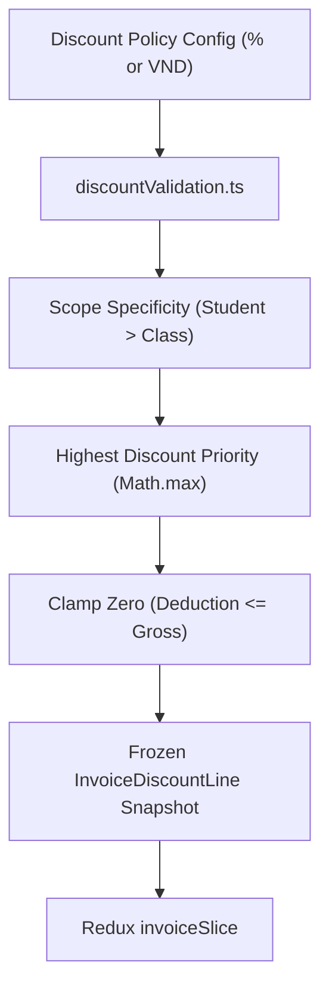

# Module: Finance Discount Calculation Engine & State Machine

## Responsibility

This module owns discount domain contracts, business validation logic, Redux state management, and calculation algorithms for tuition exemptions and fee waivers. It acts as the single source of truth for concession rules across the School Operating Portal.

Downstream consumers include:
- **Học phí & Hóa đơn (`/school/fee/create`):** Evaluates active discount policies and injects itemized deductions into tuition invoices.
- **Báo cáo học phí (`/reports/fee/overview`):** Reflects net billed tuition totals after concessions.

Future agents must not bypass `discountValidation.ts` to compute fee reductions, preserving calculation consistency and preventing negative invoice balances.

## Jira Story

- Story: As an engineer, I want this module boundary to be explicit so that dependent features can integrate safely.
- Jira issue type: Story
- Architecture owner: `alan-tech-lead`
- Research evidence: `Resolution K016`, `Resolution K017`, `Resolution K018`, `ADR-012`.

## Priority

- Priority: P1
- Runtime impact: Core financial domain foundation for tuition billing calculations and fee concession governance.
- Risk if delayed: Inconsistent discount calculations or accidental negative billing balances.
- Release target: Sprint 17 — Finance Tuition Concessions Hub.

## Implementation Commentary

- Decision: Implement isolated pure calculation functions in `discountValidation.ts` combined with an in-memory Redux slice in `discountSlice.ts`.
- Rationale: Pure functions guarantee testability and predictable deduction arithmetic because calculations avoid side-effects.
- Tradeoff: In-memory mock store provides instant local verification; persistence layer hookups will bind to backend APIs during staging rollout.
- Impact: Clean modular architecture strictly adhering to ECO Design System 1.0 guidelines and accounting standards.
- Risk: Overlapping discount conflicts are eliminated by enforcing Highest Discount Priority (`Math.max`) and Scope Specificity.
- Evidence: Documented in `ADR-012` and verified by automated unit tests in `tests/unit/discount.test.mjs`.

## Relationship Map

| Relation | Target | Label | Rationale |
| --- | --- | --- | --- |
| Implements | `E-017-finance-discount` | `IMPLEMENTS` | Child module of Epic E-017. |
| Enables | `F-017-001-finance-discount` | `ENABLES` | Enables the discount feature capability. |
| Enables | `P-017-001-finance-discount` | `ENABLES` | Enables the discount page route. |
| Uses | `E-009-finance-invoices` | `USES` | Injects deductions into tuition invoice wizard. |
| Uses | `E-010-finance-fee-catalog` | `USES` | Binds discount policies to master fee catalog line items. |

## Code Scope

- **Owns:**
  - `src/types/discount.ts`
  - `src/utils/discountValidation.ts`
  - `src/services/mockDiscountData.ts`
  - `src/store/slices/discountSlice.ts`
  - `src/modules/finance/discount/DiscountToolbar.tsx`
  - `src/modules/finance/discount/DiscountTable.tsx`
  - `src/modules/finance/discount/CreateDiscountPolicyModal.tsx`
  - `src/modules/finance/discount/StudentPickerModal.tsx`
  - `src/modules/finance/discount/discountExport.ts`

## Public Contracts

1. `calculateDiscountDeduction(feeItemGross: number, policy: DiscountPolicy): number`
   - Computes integer VND deduction from percentage or fixed discount, clamped to $[0, \text{feeItemGross}]$.
2. `resolveStudentDiscounts(student: { id: string, classId: string }, feeItems: SchoolFeeItem[], activePolicies: DiscountPolicy[], billingMonth: string): InvoiceDiscountLine[]`
   - Resolves all matching active policies for the student and their class for the billing month.
   - Applies Scope Specificity: student policy overrides class policy for the same fee item.
   - Applies Highest Discount Priority: `Math.max` for multiple matching percentage/fixed policies.
   - Evaluates disjoint fee items independently.
   - Returns itemized deduction lines.
3. `evaluatePolicyStatus(policy: DiscountPolicy, currentDate: Date): 'active' | 'paused' | 'expired'`
   - Computes temporal state based on current date vs `toMonth` or academic year end.
4. `validateDiscountPolicyForm(data: CreateDiscountPolicyPayload): FormValidationErrors`
   - Enforces field validation rules: policy name ($\ge 3$ chars), valid discount value, fee item selection, and target selection.

## Dependencies

- Redux Toolkit (`@reduxjs/toolkit`)
- Master Fee Catalog (`src/types/schoolFee.ts`)
- Invoicing Types (`src/types/invoice.ts`)

## Failure Modes & Safeguards

- Negative Line Items: Prevented by clamping `Math.min(deduction, grossItemAmount)`.
- Overlapping Discounts: Resolved deterministically via Scope Specificity and `Math.max`.
- Inadvertent Policy Deactivation: Invoice wizard toggle isolated to single generation batch without mutating catalog state.

## Mermaid Diagram

## Verification

- Tests: Automated unit test suite `tests/unit/discount.test.mjs` verifying all calculation formulas and state transitions.
- Typecheck: Strict TypeScript compilation with zero `any` types.

## Work Log

- Date: 2026-09-21
  - Action: Formulated module architecture and public calculation contracts.
  - Agent/skill: `alan-tech-lead`
  - Evidence: Verified via unit test vectors.
  - Docs updated before code: `docs/decisions.md` (`ADR-012`).

## Change Log

- Date: 2026-09-21
  - Code change: Implemented pure calculation functions, Redux slice, and TypeScript contracts.
  - Documentation update: Authored module note M-017-001.
  - Evidence: `tests/unit/discount.test.mjs`.
