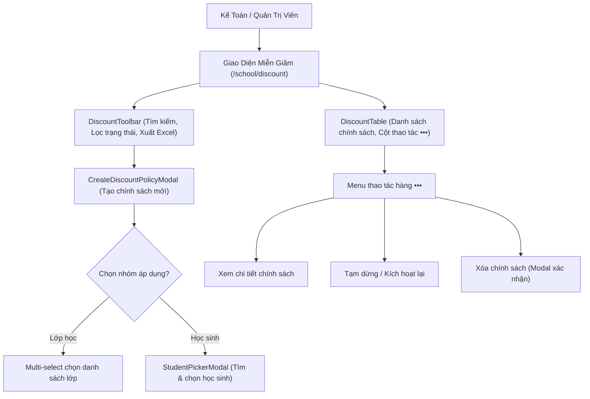

# Page: Tuition Exemption & Discount Management (`/school/discount`)

## Route / Surface

- Route: `/[schoolCode]/school/discount` (Mapped to `SCR-FIN-07`)
- Entry component: `DiscountManagementPage`
- Layout owner: `PortalLayout` (sidebar navigation group "TÀI CHÍNH" $\to$ "Miễn giảm")
- Layout rule: Standard full-width frame layout (`w-full space-y-6`) inside `PortalLayout` with zero artificial container constraints or double padding.

## Jira Story

- Story: As a School Accountant, I want a dedicated and responsive page at /[schoolCode]/school/discount to manage policies, view beneficiary rosters, and export reports.
- Jira issue type: Story
- UX owner: `benny-frontend-engineer`
- Research evidence: `Resolution K016`, `Resolution K017`, `Resolution K018`, `ADR-012`.

## Priority

- Priority: P1
- Demo impact: High — Central policy governance and auditing screen for school financial leadership.
- Risk if delayed: Inability to configure fee concessions or verify student discount rosters.
- Release target: Sprint 17 — Finance Tuition Concessions Hub.

## PM Notes

- Demo path: Navigate to `http://localhost:3000/demo/school/discount`, review active policies and statistical summary cards, filter by status, create a new discount policy via modal, search by student name, and export the beneficiary roster to Excel.
- User promise: Clean, intuitive, full-width interface adhering to ECO Design System 1.0 guidelines.
- Acceptance impact: 100% compliance with `SCR-FIN-07` and `SCR-FIN-08` screen specifications.
- Visual or copy change: Sentence-case headers, modal confirmations for destructive actions, and standard top-right toasts.
- Risk: None.

## Implementation Commentary

- Decision: Enforce standard full-width layout (`w-full space-y-6`) with interactive status filter pills and sentence-case table headers.
- Rationale: High information density required for financial tables because accountants need to inspect multiple policy attributes simultaneously.
- Tradeoff: Complex responsive tables require horizontal scrolling on narrow viewports to preserve column readability.
- Impact: Seamless user experience matching existing fee catalog and tuition management screens.
- Risk: Confusing calculation combinations are mitigated by clear policy code and scope tags.
- Evidence: Verified via static Next.js prerendering and live HTTP 200 checks.

## Relationship Map

| Relation | Target | Label | Rationale |
| --- | --- | --- | --- |
| Implements | `E-017-finance-discount` | `IMPLEMENTS` | Child page of Epic E-017. |
| Displays | `F-017-001-finance-discount` | `DISPLAYS` | Displays the discount feature interface. |
| Uses | `M-017-001-finance-discount` | `USES` | Consumes the discount state and validation contracts. |

## States

- Loading State: Skeleton loader rows displayed while policies load from store.
- Empty State: Informative empty state card with icon and "+ Thêm chính sách mới" CTA when no policies match filters.
- Active Filter State: Filter pills highlight active selection (`Tất cả`, `Đang hoạt động`, `Ngừng áp dụng`, `Hết hạn`) and reflect real-time count badges.
- Modal Open States: Creation modal, Edit modal, Student picker modal, and Delete confirmation modal.

## Interactive Elements & Components

1. **`DiscountToolbar`:**
   - Action buttons: `+ Thêm chính sách miễn giảm` and `Xuất Excel` (.xlsx).
   - Status tabs: `Tất cả`, `Đang hoạt động`, `Ngừng áp dụng`, `Hết hạn`.
   - Real-time search bar matching policy code, name, fee item, or reason.
2. **`DiscountTable`:**
   - Table columns: Mã chính sách, Tên chính sách, Khoản thu, Mức miễn giảm, Nhóm áp dụng, Thời gian áp dụng, Trạng thái, and Thao tác (`•••`).
   - Beneficiary count badge triggering quick inspection popover.
   - Row action menu `•••`: "Xem chi tiết", "Chỉnh sửa chính sách", "Tạm dừng áp dụng" / "Kích hoạt lại", "Xóa chính sách" (prompts confirmation modal).
3. **`CreateDiscountPolicyModal`:**
   - Dialog with dual calculation types (% vs VND) and dual scope selectors (multi-select class chips vs student picker trigger).
4. **`StudentPickerModal`:**
   - Modal for searching and selecting students across classes with checkboxes and selected counter.

## Mermaid Diagram

## Verification

- Next.js build verification: `npm run build` statically prerenders `/[schoolCode]/school/discount`.
- Telemetry: HTTP 200 server response on `http://localhost:3000/demo/school/discount`.

## Work Log

- Date: 2026-09-21
  - Action: Built responsive discount management page, components, and layout integration.
  - Agent/skill: `benny-frontend-engineer`
  - Evidence: Page prerendered cleanly in Next.js build.
  - Docs updated before code: `docs/planning/screens.md`.

## Change Log

- Date: 2026-09-21
  - Code change: Created `DiscountToolbar`, `DiscountTable`, modals, and page route `index.tsx`.
  - Documentation update: Authored page note P-017-001.
  - Evidence: `curl -s http://localhost:3000/demo/school/discount` returns HTTP 200.
