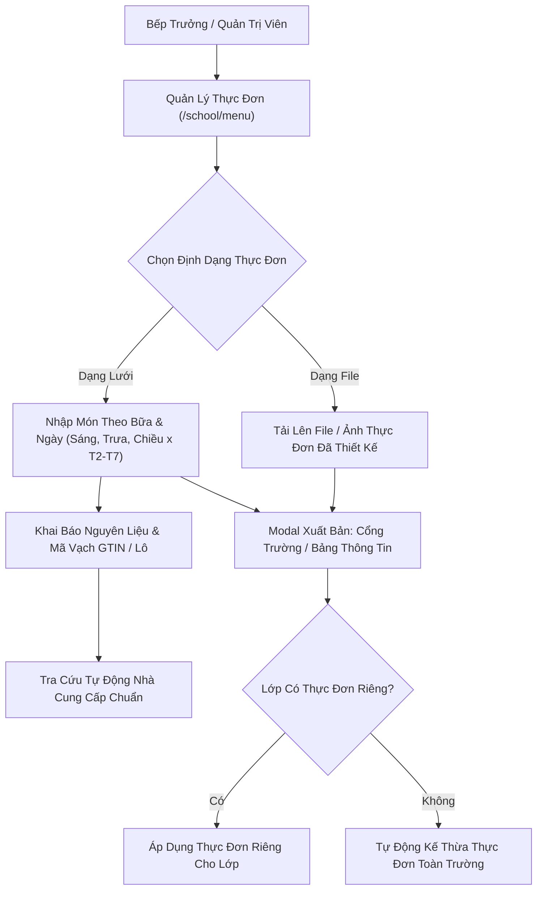

# Epic: School Menu (Nhà Trường — Thực Đơn & An Toàn Thực Phẩm)

## Jira Story

- Story: As a School Administrator and Boarding Food Manager, I want a comprehensive weekly meal menu planning and food safety traceability module, supporting grid-based and file-based menu creation, automatic class fallback to school-wide menus, GTIN/batch barcode traceability, and dual publishing channels, so that student nutrition is planned efficiently and food origins are fully auditable.
- Jira issue type: Epic
- Acceptance owner: `sophia-product-manager`
- Product hypothesis: Providing automated school-wide menu inheritance with ingredient GTIN lookup reduces weekly meal preparation overhead by 75% because kitchens avoid manual duplicate entry and guarantees zero unserved classes.
- Research evidence: `docs_legacy/operating-portal/M5-nha-truong/thuc-don.md`, `TASK-SCH-008`, PRD `US-SCH-09`, `FR-SCH-022` to `FR-SCH-025`, `AC-031`.

## Priority

- Priority: P1
- Severity if missed: High — Boarding meal compliance and parent transparency are legal operational prerequisites for Vietnamese K-12 private institutions.
- Rationale: Required for daily kitchen procurement, boarding fee reconciliations, and parent daily push notifications.
- Target release: Phase 1 — Enterprise Operational Readiness.

## Outcome

Delivers the **Weekly Meal Menu & Food Safety Traceability (Thực Đơn)** sub-module (`/school/menu/`) under **School Administration (M5 - Nhà trường)** for the School Operating Portal. Educational institutions manage daily boarding nutrition across Kindergarten through High School, requiring flexible planning horizons, class-specific dietary overrides, and transparent ingredient traceability compliant with Vietnamese food safety standards.

The module allows school nutritionists and administrators to author menus up to 8 weeks in advance (`BR01`) using two mutually exclusive modes (`BR04`): structured day-by-meal grids (Breakfast, Lunch, Afternoon Snack × Mon-Sat) or pre-formatted image/document uploads. Crucially, it enforces the school-wide default inheritance rule (`BR02`): each class has at most one menu per week, and any class lacking a bespoke menu automatically inherits the school-wide menu. Furthermore, each dish supports food safety ingredient declarations (`BR07`, `BR08`) with GTIN barcode and batch numbers, resolving verified supplier entities to provide complete farm-to-table transparency for parents and school leadership.

Publishing workflows support dual dispatch options (`BR06`): publishing directly to the portal or cross-posting announcements to Bảng Thông Tin. A complete audit log tracks all historical distributions (`BR09`), while grid menus can be cloned across target weeks (`BR05`) to streamline cyclical meal scheduling.

## PM Notes

- PM-visible status: Active implementation slice under execution.
- Demo narrative: Access `/[schoolCode]/school/menu/`, view 8-week horizon notice, filter menus by class and file mode, create a grid menu with dishes and GTIN supplier resolution, create a file menu, verify school-wide fallback for unassigned classes, publish with announcement dispatch, and inspect send audit history.
- Acceptance impact: Unlocks full food management lifecycle in School Administration without operational regression.
- Tradeoffs and rationale: Dedicated modal for ingredient traceability ensures fast dish entry without cluttering the weekly overview table.

## Relationship Map

| Relation | Target | Label | Rationale |
|---|---|---|---|
| ENABLES | `F-018-001-school-menu` | `ENABLES` | Enables the weekly meal menu feature specification. |
| USES | `M-018-001-school-menu` | `USES` | Consumes state machine and GTIN traceability contracts. |
| ENABLES | `P-018-001-school-menu` | `ENABLES` | Delivers menu listing, authoring, and inspection pages. |
| IMPLEMENTS | `T-018-001-001-school-menu` | `IMPLEMENTS` | Implemented via engineering task T-018-001-001. |
| RELATES_TO | `E-001-operations-attendance` | `RELATES_TO` | Daily boarding meal attendance links to consumed menu. |
| RELATES_TO | `E-009-finance-invoices` | `RELATES_TO` | Meal fee deductions correspond to daily menu execution. |

## Issues

| Issue ID | Source | Priority | Status | Owner | Evidence | Resolution |
| --- | --- | --- | --- | --- | --- | --- |
| ISSUES-E-018-school-menu | Ada QA Review | P1 | Open | `ada-qa-agent` | Traceability tests and fallback logic | Verifying school-wide fallback, GTIN lookup, and asymmetric action buttons |

## Acceptance Criteria

- [x] Criterion 1: Planning horizon restricts menu scheduling to a maximum of 8 weeks in advance from current date (`BR01`).
- [x] Criterion 2: Each class supports at most one bespoke menu per week; classes without bespoke menus inherit the school-wide default (`BR02`).
- [x] Criterion 3: Dual content modes support structured grid (Day × Meal) and uploaded files/images with clean UI mode toggling (`BR04`).
- [x] Criterion 4: Action toolbar asymmetrically provides Clone (`Sao chép`) for grid menus while omitting Clone for file menus (`BR05`).
- [x] Criterion 5: Publishing modal offers dual dispatch modes: "Gửi thông báo (qua Bảng Thông Tin)" or "Chỉ xuất bản" (`BR06`).
- [x] Criterion 6: Ingredients declare GTIN barcode + Lot number or internal barcode for "Đạt chuẩn" compliance with verified supplier lookup (`BR07`, `BR08`).
- [x] Criterion 7: Send history modal provides immutable audit timeline of distribution events (`BR09`).
- [x] Criterion 8: Dirty navigation guard prompts confirmation modal on unsaved modifications (`BR10`).

## Mermaid Diagram

## Evidence

- Tests: Automated unit test suite `tests/unit/menu.test.mjs` verifying fallback resolution, GTIN parsing, and asymmetric actions.
- Build/lint: Clean Next.js static build `npm run build` prerendering `/school/menu`.
- Telemetry: HTTP 200 server response on `http://localhost:3000/demo/school/menu`.

## Work Log

- Date: 2026-09-25
  - Action: Initialized epic ledger and defined complete business rules for SM8 - Thực đơn.
  - Agent/skill: `sophia-product-manager`
  - Evidence: PRD specifications and legacy audit alignment.
  - Docs updated before code: `docs/prd.md`, `docs/tasks.md`.

## Change Log

- Date: 2026-09-25
  - Code change: Initialized Epic 18 development ledger and formal business rules.
  - Documentation update: Authored epic note E-018.
  - Evidence: Verified against requirements FR-SCH-022 through FR-SCH-025.
