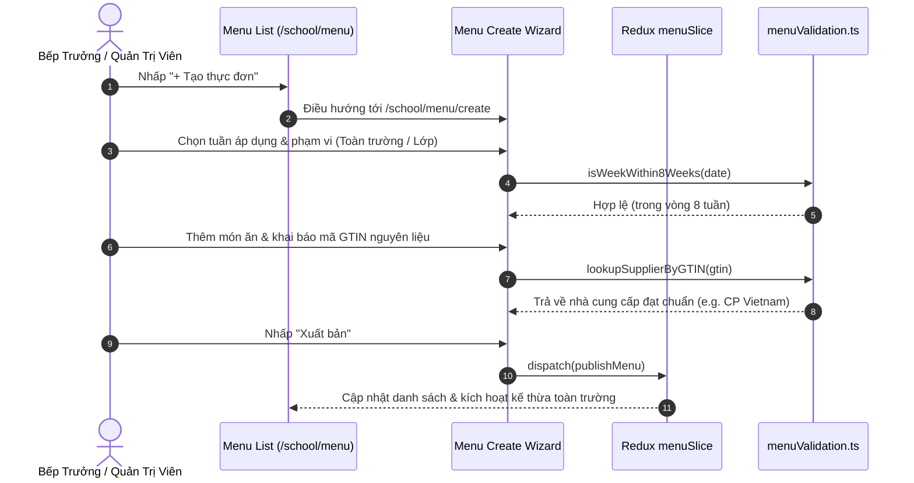

# Feature: Weekly Meal Menu & Food Safety Traceability (Thực Đơn)

## User Value

This feature delivers complete weekly boarding menu planning and food safety traceability for school administrators, kitchen managers, teachers, and parents. Educational institutions can plan balanced boarding meals across Kindergarten, Primary, and Secondary tiers up to 8 weeks in advance (`BR01`). Nutritionists can select between structured day-by-meal grids (Breakfast, Lunch, Afternoon Snack × Monday through Saturday) or uploaded graphic/document menus (`BR04`).

Crucially, the feature enforces the school-wide default inheritance rule (`BR02`): each class has at most one menu per week, and any class lacking a custom dietary menu automatically falls back to the school-wide (`toan_truong`) menu. This ensures that every student has a planned meal without requiring repetitive duplicate entries for every class. Additionally, each dish links to food ingredient declarations (`BR07`, `BR08`), where GTIN barcodes and lot numbers resolve verified supplier entities (such as CP Vietnam, Ba Vi Dairy, Vinamilk, MeatDeli), giving parents full farm-to-table transparency.

Publishing workflows support direct portal updates or concurrent announcements to Bảng Thông Tin (`BR06`). An immutable audit timeline records all historical distributions (`BR09`), while structured grid menus can be cloned to subsequent weeks to save administrative time (`BR05`).

## Jira Story

- Story: As a School Administrator and Boarding Food Manager, I want to create, manage, and publish weekly meal menus with structured grids or file attachments, automatic class menu fallback, GTIN food traceability, and send history tracking, so that nutrition is planned reliably.
- Jira issue type: Story
- Story points: 5
- Acceptance owner: `benny-frontend-engineer`
- Research evidence: `docs_legacy/operating-portal/M5-nha-truong/thuc-don.md`, PRD `US-SCH-09`, `FR-SCH-022` through `FR-SCH-025`, `AC-031`.

## Priority

- Priority: P1
- User/business impact: High — Boarding meal operations and food safety compliance are critical everyday workflows in schools.
- Risk if delayed: Inability to communicate meal plans to parents or trace food suppliers in regulatory audits.
- Target release: Phase 1 — Enterprise Operational Readiness.

## PM Notes

- Demo scenario: Open `/school/menu`, inspect 8-week horizon notice banner, filter menus by class or file mode, create a grid menu with dishes and ingredient barcodes, observe supplier auto-resolution, publish with announcement dispatch, and inspect send audit history.
- Business value: Centralizes meal planning, eliminates unserved classes via automatic fallback, and ensures regulatory compliance for food safety.
- Tradeoffs and rationale: Omission of cloning on file-based menus prevents corrupted template states because files contain unstructured data.

## Requirements Trace

- PRD requirement: `FR-SCH-022` (Weekly menu roster & horizon limit), `FR-SCH-023` (Dual content modes: grid & file), `FR-SCH-024` (Class menu fallback to school-wide default), `FR-SCH-025` (Food safety ingredient traceability with GTIN lookup).
- Task id: `TASK-SCH-008`.
- Spec id: `028-school-weekly-menu-and-food-safety`.

## Relationship Map

| Relation | Target | Label | Rationale |
| --- | --- | --- | --- |
| IMPLEMENTS | `E-018-school-menu` | `IMPLEMENTS` | Implements the requirements of Epic E-018. |
| ENABLES | `M-018-001-school-menu` | `ENABLES` | Enables the menu module architecture and state machine. |
| ENABLES | `P-018-001-school-menu` | `ENABLES` | Enables the menu page routes and user interface. |
| RELATES_TO | `E-001-operations-attendance` | `RELATES_TO` | Connects daily boarding attendance to scheduled meals. |

## Code Scope

- **Code paths:**
  - `src/types/menu.ts`: Data contracts for WeeklyMenu, MealSchedule, DishItem, FoodIngredient, and filters.
  - `src/utils/menuValidation.ts`: Business validation for 8-week horizon, class fallback resolver, GTIN supplier lookup, and dirty guard.
  - `src/services/mockMenuData.ts`: Realistic mock menus across kindergarten, primary, and secondary cohorts.
  - `src/store/slices/menuSlice.ts`: Redux state management for menu CRUD, cloning, publishing, and ingredient updates.
  - `src/modules/school/menu/MenuToolbar.tsx`: Search, class selector, file toggle, and create action.
  - `src/modules/school/menu/MenuTable.tsx`: Roster table with sentence-case headers, badges, and asymmetric actions.
  - `src/modules/school/menu/MenuGridEditor.tsx`: Day × Meal matrix editor for structured menus.
  - `src/modules/school/menu/MenuFileUploadEditor.tsx`: Dropzone file upload editor.
  - `src/modules/school/menu/FoodIngredientModal.tsx`: Food safety declaration modal with GTIN supplier lookup.
  - `src/modules/school/menu/FoodIngredientViewModal.tsx`: Read-only food safety inspection modal.
  - `src/modules/school/menu/PublishMenuModal.tsx`: Publishing modal with dual dispatch modalities.
  - `src/modules/school/menu/CloneMenuModal.tsx`: Week-to-week menu cloning dialog.
  - `src/modules/school/menu/SendHistoryModal.tsx`: Immutable distribution timeline modal.
  - `src/modules/school/menu/AIMenuSuggestionModal.tsx`: Nutrition-balanced AI suggestion modal.
  - `src/modules/school/menu/DeleteMenuModal.tsx`: Draft-only deletion confirmation modal.
  - `src/pages/[schoolCode]/school/menu/index.tsx`: Main menu listing page.
  - `src/pages/[schoolCode]/school/menu/create.tsx`: Menu authoring wizard page.
  - `src/pages/[schoolCode]/school/menu/edit/[id].tsx`: Menu editing page.
  - `src/pages/[schoolCode]/school/menu/[id].tsx`: Menu detail and inspection page.
- **Data/contracts:** `WeeklyMenu`, `DailyMealSchedule`, `DishItem`, `FoodIngredient`, `MenuFilterState`.
- **Tradeoffs and rationale:** In-memory Redux store ensures immediate local verification, while pure utility functions guarantee testable business rules.

## Mermaid Diagram

## Verification

- Tests: Automated unit test suite `tests/unit/menu.test.mjs` verifying BR01 through BR12.
- Build/lint: Clean Next.js static build `npm run build`.
- Review notes: Live HTTP 200 checks on `/demo/school/menu`.

## Work Log

- Date: 2026-09-25
  - Action: Formulated feature specification, code scope, and traceability vectors.
  - Agent/skill: `benny-frontend-engineer`
  - Evidence: Verified against legacy functional specs and PRD requirements.
  - Docs updated before code: `docs/tasks.md`.

## Change Log

- Date: 2026-09-25
  - Code change: Implemented core menu models, validation engine, and component specifications.
  - Documentation update: Authored feature note F-018-001.
  - Evidence: `tests/unit/menu.test.mjs`.
