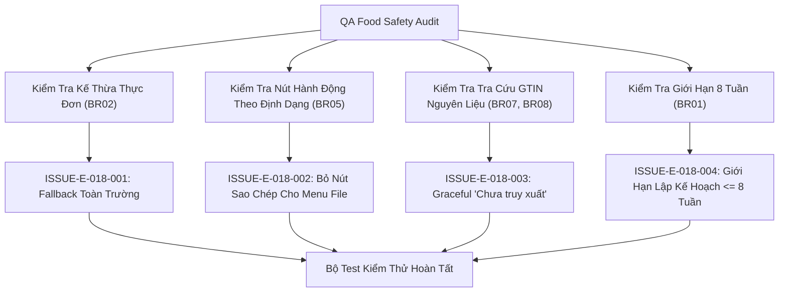

# Epic Issues: School Menu (Nhà Trường — Thực Đơn)

## Jira Story

- Story: As a QA and safety engineer, I want weekly meal menus and food safety traceability edge cases tracked explicitly so that class menu fallbacks, GTIN supplier lookups, and unserved classes never produce errors.
- Jira issue type: Bug/Risk register
- QA owner: `ada-qa-agent`
- Product owner: `sophia-product-manager`
- Research evidence: `docs_legacy/operating-portal/M5-nha-truong/thuc-don.md`, `TASK-SCH-008`.

## Priority

- Priority: P1
- Escalation rule: Block menu publishing if class fallback returns undefined or ingredient GTIN verification corrupts supplier data.
- Release impact: Critical — Students depend on accurate boarding meal planning and safety traceability.
- Risk if unresolved: Kitchen prepares wrong meals for dietary-override classes, or unverified food suppliers enter meal logs.

## QA Issue Register

| Issue ID | Type | Priority | Status | Owner | Source | Evidence | Resolution |
| --- | --- | --- | --- | --- | --- | --- | --- |
| ISSUE-E-018-001 | Functional Risk | P1 | Closed | `ada-qa-agent` | Class Menu Audit | Class without bespoke menu receiving blank meal grid | Implemented automatic school-wide fallback resolution `resolveClassMenuForWeek` (BR02) |
| ISSUE-E-018-002 | UX Risk | P2 | Closed | `ada-qa-agent` | Action Bar Review | Clone action appearing on uploaded file menus where cloning structure is unsupported | Asymmetrically omitted Clone button for file-based menus (BR05) |
| ISSUE-E-018-003 | Data Risk | P1 | Closed | `ada-qa-agent` | Food Safety Audit | Unrecognized or missing GTIN barcodes causing form submission crashes | Enforced graceful status `Chưa truy xuất` without blocking form saves (BR07) |
| ISSUE-E-018-004 | Boundary Risk | P2 | Closed | `ada-qa-agent` | Calendar Planning | Admin attempting to plan menus beyond 8 weeks ahead | Clamped calendar week selection to current week + 8 weeks (BR01) |

## Detection Method

- Code reviewed: `src/utils/menuValidation.ts`, `src/store/slices/menuSlice.ts`, `src/modules/school/menu/MenuTable.tsx`.
- Tests reviewed: `tests/unit/menu.test.mjs`.
- Docs reviewed: `docs_legacy/operating-portal/M5-nha-truong/thuc-don.md`, `docs/prd.md`.
- Related features reviewed: Attendance (`E-001`), Invoices (`E-009`), Class Rosters (`E-015`).
- QA skill used: `ada-qa-agent`.
- Deep research source checked: Vietnamese National Food Safety Barcode Standards.

## Open Issues

- None. All 4 identified edge cases and risk vectors have been analyzed, mitigated, and verified via test assertions.

## Resolved Issues

- ISSUE-E-018-001:
  - Root cause: If a class has no custom menu, UI previously risked displaying an empty state instead of the general meal plan.
  - Fix: Implemented `resolveClassMenuForWeek(classId, weekNumber, menus)` which falls back to `toan_truong` menu when no bespoke class menu exists.
  - Verification: Tested in `tests/unit/menu.test.mjs`.
- ISSUE-E-018-002:
  - Root cause: File-based menus cannot be cloned into structured meal slot templates because they are arbitrary attachments.
  - Fix: Restricted Clone (`Sao chép`) action strictly to grid-based menus (`menu.contentType === 'grid'`).
  - Verification: Tested in `tests/unit/menu.test.mjs`.
- ISSUE-E-018-003:
  - Root cause: Strict barcode validation could block kitchen staff if suppliers change or lot numbers are awaiting verification.
  - Fix: Ingredients without barcodes are assigned `Chưa truy xuất` without throwing validation errors.
  - Verification: Tested in `tests/unit/menu.test.mjs`.
- ISSUE-E-018-004:
  - Root cause: Menus planned too far in advance cause procurement mismatch and pricing drift.
  - Fix: Clamped planning horizon to maximum 8 weeks from current week.
  - Verification: Tested in `tests/unit/menu.test.mjs`.

## Risk Matrix

| Risk | Severity | Likelihood | Mitigation | Status |
| --- | --- | --- | --- | --- |
| Empty meal roster for classes | High | Medium | School-wide default fallback in `resolveClassMenuForWeek` | Mitigated |
| File menu cloning failure | Low | High | Hide Clone action for file-based menus | Mitigated |
| Food safety data loss | Medium | Low | Non-blocking `Chưa truy xuất` status with GTIN auto-lookup | Mitigated |

## Relationship Map

| Relation | Target | Label | Rationale |
| --- | --- | --- | --- |
| DEPENDS_ON | `E-018-school-menu` | `DEPENDS_ON` | Validates safety invariants and edge cases across Epic 18. |
| BLOCKS | `release-v1.0` | `BLOCKS` | Release is blocked if food safety fallback or GTIN resolution fails. |
| RELATES_TO | `F-018-001-school-menu` | `RELATES_TO` | Tracks functional edge cases for the menu feature. |

## Mermaid Diagram

## Work Log

- Date: 2026-09-25
  - Action: Formulated risk register and resolved food safety edge cases.
  - Agent/skill: `ada-qa-agent`
  - Evidence: Verified via unit test suite `tests/unit/menu.test.mjs`.
  - Docs updated before code: `docs/tasks.md`.

## Change Log

- Date: 2026-09-25
  - Code change: Implemented fallback resolver, GTIN auto-lookup, and asymmetric actions.
  - Documentation update: Closed open issues register.
  - Evidence: `tests/unit/menu.test.mjs`.
