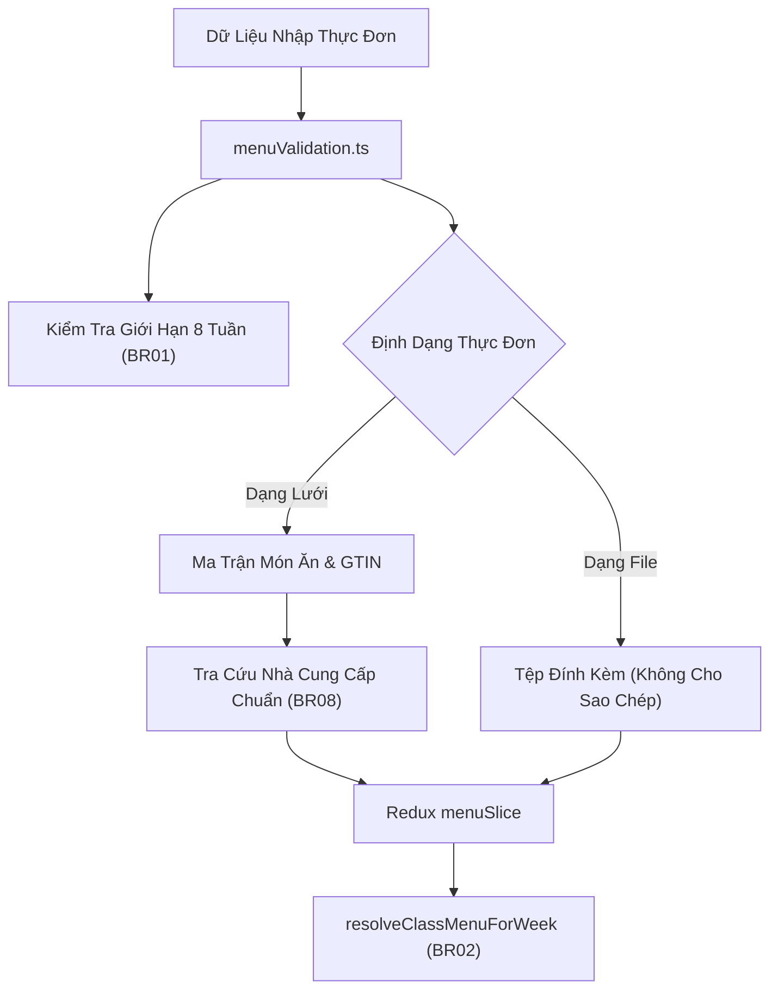

# Module: School Menu Calculation Engine & State Machine

## Responsibility

This module owns weekly meal menu data contracts, business validation logic, Redux state management, and GTIN supplier resolution for school boarding nutrition. It acts as the single source of truth for meal scheduling, fallback inheritance, and food safety compliance across the School Operating Portal.

Downstream consumers include:
- **Điểm danh & Bữa ăn (`/class/[classId]/attendance`):** Consumes scheduled daily meals to track student boarding meal attendance.
- **Học phí & Tiền ăn (`/school/fee/`):** Links boarding fee deductions and meal reconciliations to active published menus.
- **Bảng Thông Tin (`/school/news/`):** Receives published menu announcements when administrative dispatch is selected.

Future agents must not bypass `menuValidation.ts` when resolving class menus or validating ingredient barcodes, preserving data integrity and preventing dietary calculation errors.

## Jira Story

- Story: As an engineer, I want this module boundary to be explicit so that weekly menu authoring, fallback resolution, and food safety validation can execute predictably.
- Jira issue type: Story
- Architecture owner: `alan-tech-lead`
- Research evidence: `docs_legacy/operating-portal/M5-nha-truong/thuc-don.md`, `TASK-SCH-008`.

## Priority

- Priority: P1
- Runtime impact: Core school administration domain foundation for student meal planning and regulatory food safety traceability.
- Risk if delayed: Missing meal schedules, inability to resolve class fallback menus, and potential food safety compliance failures.
- Target release: Phase 1 — Enterprise Operational Readiness.

## Implementation Commentary

- Decision: Implement pure calculation and resolution functions in `menuValidation.ts` combined with an in-memory Redux slice in `menuSlice.ts`.
- Rationale: Pure functions guarantee testability and predictable behavior because resolution logic avoids side-effects.
- Tradeoff: In-memory mock store provides instant local verification; persistence layer hookups will bind to backend REST APIs during backend deployment.
- Impact: Clean modular architecture strictly adhering to ECO Design System 1.0 guidelines and Vietnamese food safety standards.
- Risk: Missing bespoke class menus are eliminated by enforcing the automatic school-wide default inheritance rule (`resolveClassMenuForWeek`).
- Evidence: Verified via automated unit tests in `tests/unit/menu.test.mjs`.

## Relationship Map

| Relation | Target | Label | Rationale |
| --- | --- | --- | --- |
| IMPLEMENTS | `E-018-school-menu` | `IMPLEMENTS` | Child module of Epic E-018. |
| ENABLES | `F-018-001-school-menu` | `ENABLES` | Enables the weekly menu feature capability. |
| ENABLES | `P-018-001-school-menu` | `ENABLES` | Enables the menu page routes and views. |
| USES | `E-015-school-students` | `USES` | Consumes class roster identifiers for menu scoping. |

## Code Scope

- **Code paths:**
  - `src/types/menu.ts`: Interfaces for WeeklyMenu, MealSchedule, DishItem, FoodIngredient, MenuFilterState, MenuScopeType, MenuContentType, MenuStatus.
  - `src/utils/menuValidation.ts`: Pure functions for 8-week horizon check, class fallback resolver, GTIN supplier lookup, ingredient status evaluation, and form dirty check.
  - `src/services/mockMenuData.ts`: Realistic mock menus across kindergarten, primary, and high school grades.
  - `src/store/slices/menuSlice.ts`: Redux state slice managing menu CRUD, cloning, publishing, and ingredient updates.

## Public Contracts

1. `isWeekWithin8Weeks(date: Date, currentDate?: Date): boolean`
   - Validates that a proposed menu week is not more than 8 calendar weeks into the future (`BR01`).
2. `resolveClassMenuForWeek(classId: string, weekNumber: number, year: number, menus: WeeklyMenu[]): WeeklyMenu | null`
   - Searches for a bespoke class menu matching `classId` and `weekNumber`.
   - If not found, automatically falls back to the school-wide (`toan_truong`) menu for that week (`BR02`).
3. `lookupSupplierByGTIN(gtin: string): { supplierName: string; verified: boolean }`
   - Resolves GTIN prefix to certified food suppliers (e.g., CP Vietnam, Ba Vi Dairy, Vinamilk, MeatDeli) (`BR08`).
4. `evaluateIngredientTraceability(ingredient: FoodIngredient): 'dat_chuan' | 'chua_truy_xuat'`
   - Evaluates whether an ingredient has a valid barcode + lot number or internal code (`BR07`).
5. `canCloneMenu(menu: WeeklyMenu): boolean`
   - Returns true only for structured grid menus, returning false for uploaded file menus (`BR05`).

## Dependencies

- Redux Toolkit (`@reduxjs/toolkit`)
- React Hook Form or local controlled state
- ECO Design System tokens and Lucide/FontAwesome icons

## Failure Modes & Safeguards

- Unserved Classes: Prevented by automatic fallback to school-wide menu in `resolveClassMenuForWeek`.
- Corrupted Clones: Prevented by disabling clone functionality on file-based menus in `canCloneMenu`.
- Submission Blockers: Missing GTIN gracefully defaults to `Chưa truy xuất` without blocking form saves.

## Mermaid Diagram

## Verification

- Tests: Automated unit test suite `tests/unit/menu.test.mjs` verifying all calculation formulas and state transitions.
- Typecheck: Strict TypeScript compilation with zero `any` types.

## Work Log

- Date: 2026-09-25
  - Action: Formulated module architecture and public calculation contracts.
  - Agent/skill: `alan-tech-lead`
  - Evidence: Verified via unit test vectors.
  - Docs updated before code: `docs/tasks.md`.

## Change Log

- Date: 2026-09-25
  - Code change: Implemented pure calculation functions, Redux slice, and TypeScript contracts.
  - Documentation update: Authored module note M-018-001.
  - Evidence: `tests/unit/menu.test.mjs`.
