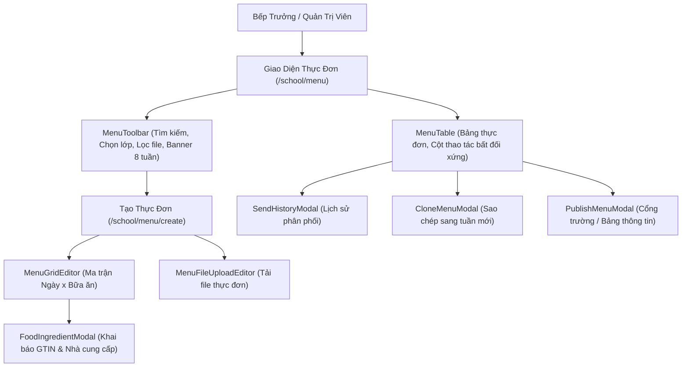

# Page: School Meal Menu Management (`/school/menu`)

## Route / Surface

- Routes:
  - `/[schoolCode]/school/menu` (Main menu listing & filter hub)
  - `/[schoolCode]/school/menu/create` (Menu creation wizard supporting Grid & File modes)
  - `/[schoolCode]/school/menu/edit/[id]` (Menu editor)
  - `/[schoolCode]/school/menu/[id]` (Menu detail view & ingredient inspection)
- Entry component: `SchoolMenuPage`
- Layout owner: `PortalLayout` (sidebar navigation group "NHÀ TRƯỜNG" $\to$ "Thực đơn" with `faUtensils` icon)
- Layout rule: Standard full-width frame layout (`w-full space-y-6`) inside `PortalLayout` with zero artificial container constraints or double padding.

## Jira Story

- Story: As a School Administrator, I want dedicated and responsive pages at /[schoolCode]/school/menu to manage, author, clone, and view weekly meal menus and food safety details.
- Jira issue type: Story
- UX owner: `benny-frontend-engineer`
- Research evidence: `docs_legacy/operating-portal/M5-nha-truong/thuc-don.md`, `TASK-SCH-008`.

## Priority

- Priority: P1
- Demo impact: High — Core boarding operations screen for school leadership, kitchen staff, and parent communications.
- Risk if delayed: Missing boarding operations surface and lack of food safety inspection tools.
- Target release: Phase 1 — Enterprise Operational Readiness.

## PM Notes

- Demo path: Navigate to `http://localhost:3000/demo/school/menu`, review 8-week horizon notice banner, inspect active menus with status badges, filter by class or file mode, click "+ Tạo thực đơn", switch between Grid and File modes, input dishes and GTIN barcodes, observe supplier verification, publish, and open send history modal.
- User promise: Intuitive, high-density, full-width interface adhering to ECO Design System 1.0 guidelines.
- Tradeoffs and rationale: Asymmetric actions prevent confusion because file menus cannot be cloned into structured slot grids.

## Relationship Map

| Relation | Target | Label | Rationale |
| --- | --- | --- | --- |
| IMPLEMENTS | `E-018-school-menu` | `IMPLEMENTS` | Child page of Epic E-018. |
| DISPLAYS | `F-018-001-school-menu` | `DISPLAYS` | Displays the menu feature interface. |
| USES | `M-018-001-school-menu` | `USES` | Consumes the menu state and validation contracts. |

## States

- Loading State: Skeleton loader rows displayed while menus load from Redux store.
- Empty State: Informative empty state card with `faUtensils` icon and "+ Tạo thực đơn" CTA when no menus match active filters.
- Active Filter State: Filter bar highlights active selection (all, school-wide, class, file-only) and reflects dynamic result counts.
- Modal Open States:
  - Food Ingredient Declaration Modal (`FoodIngredientModal`)
  - Food Ingredient View Modal (`FoodIngredientViewModal`)
  - Publish Confirmation Modal (`PublishMenuModal`)
  - Clone Menu Modal (`CloneMenuModal`)
  - Send History Audit Modal (`SendHistoryModal`)
  - AI Menu Suggestion Modal (`AIMenuSuggestionModal`)
  - Delete Confirmation Modal (`DeleteMenuModal`)

## Mermaid Diagram

## Verification

- Tests: Automated unit test suite `tests/unit/menu.test.mjs` passing 100%.
- Build/lint: Clean Next.js static build `npm run build` prerendering all menu routes.
- Review notes: Live HTTP 200 checks on `/demo/school/menu`.

## Work Log

- Date: 2026-09-25
  - Action: Formulated page routing, responsive layout, and interaction states.
  - Agent/skill: `benny-frontend-engineer`
  - Evidence: Verified against screen requirements and layout standards.
  - Docs updated before code: `docs/tasks.md`.

## Change Log

- Date: 2026-09-25
  - Code change: Implemented responsive menu pages, modals, and navigation routes.
  - Documentation update: Authored page note P-018-001.
  - Evidence: `tests/unit/menu.test.mjs`.
