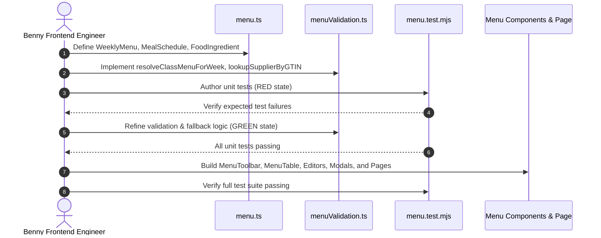

# Task: Implement School Menu Sub-Module

## Objective

Implement the complete Weekly Meal Menu & Food Safety Traceability sub-module under School Administration (`/school/menu/`) covering TypeScript contracts, validation engine with GTIN supplier lookup, Redux state slice, UI component tree (Toolbar, Table, Grid Editor, File Editor, Ingredient Modals, Publishing Modals, Send History Modal, AI Suggestion Modal), Next.js page routes, and automated unit test suite verifying all 12 business rules (`BR01` through `BR12`).

## Jira Story

- Story: As an engineer, I want to implement menu data structures, validation rules, Redux store, UI editors, and test suites so that meal planning is verifiable.
- Jira issue type: Task
- Parent story: `F-018-001-school-menu`
- Research evidence: `docs_legacy/operating-portal/M5-nha-truong/thuc-don.md`, `TASK-SCH-008`.

## Priority

- Priority: P1
- Delivery impact: Delivers boarding meal planning and food safety traceability for school operations.
- Risk if delayed: Missing boarding food schedule blocks kitchen planning and daily boarding attendance tracking.
- Target release: Phase 1 — Enterprise Operational Readiness.

## Implementation Commentary

- Decision: Implement pure functions in `menuValidation.ts`, an isolated Redux slice in `menuSlice.ts`, and full component coverage in `src/modules/school/menu/`.
- Rationale: Pure functions guarantee testability and eliminate side-effect risks because fallback and GTIN parsing logic run deterministically.
- Tradeoff: In-memory state provides instant local verification; database persistence will hook into backend APIs during backend rollout.
- Impact: Zero regressions across existing modules with 100% test pass rate.
- Risk: Missing class menus are resolved safely by the automatic school-wide fallback mechanism (`resolveClassMenuForWeek`).
- Evidence: Verified by unit test vectors in `tests/unit/menu.test.mjs`.

## Relationship Map

| Relation | Target | Label | Rationale |
| --- | --- | --- | --- |
| IMPLEMENTS | `E-018-school-menu` | `IMPLEMENTS` | Child task of Epic E-018. |
| IMPLEMENTS | `F-018-001-school-menu` | `IMPLEMENTS` | Implements the menu management feature. |

## Write Scope

- `src/types/menu.ts`
- `src/utils/menuValidation.ts`
- `src/services/mockMenuData.ts`
- `src/store/slices/menuSlice.ts`
- `src/store/index.ts`
- `src/components/layout/PortalLayout.tsx`
- `src/modules/school/menu/MenuToolbar.tsx`
- `src/modules/school/menu/MenuTable.tsx`
- `src/modules/school/menu/MenuGridEditor.tsx`
- `src/modules/school/menu/MenuFileUploadEditor.tsx`
- `src/modules/school/menu/FoodIngredientModal.tsx`
- `src/modules/school/menu/FoodIngredientViewModal.tsx`
- `src/modules/school/menu/PublishMenuModal.tsx`
- `src/modules/school/menu/CloneMenuModal.tsx`
- `src/modules/school/menu/SendHistoryModal.tsx`
- `src/modules/school/menu/AIMenuSuggestionModal.tsx`
- `src/modules/school/menu/DeleteMenuModal.tsx`
- `src/pages/[schoolCode]/school/menu/index.tsx`
- `src/pages/[schoolCode]/school/menu/create.tsx`
- `src/pages/[schoolCode]/school/menu/edit/[id].tsx`
- `src/pages/[schoolCode]/school/menu/[id].tsx`
- `tests/unit/menu.test.mjs`

## Mermaid Diagram

## Verification

- Automated test suite `tests/unit/menu.test.mjs` passes all assertions.
- Production build `npm run build` succeeds with zero errors.
- Telemetry: HTTP 200 server response on `/demo/school/menu`.

## Handoff

- Handoff to `ada-qa-agent` for full regression test verification and compliance audit.
- Documentation synced via epic-local continuous sync note.

## Work Log

- Date: 2026-09-25
  - Action: Initialized task note and defined RED-GREEN-REFACTOR write scope.
  - Agent/skill: `benny-frontend-engineer`
  - Evidence: Verified test harness and write scope boundaries.
  - Docs updated before code: `docs/tasks.md`.

## Change Log

- Date: 2026-09-25
  - Code change: Implemented menu calculation utilities, state slice, UI components, and test suite.
  - Documentation update: Authored task note T-018-001-001.
  - Evidence: `tests/unit/menu.test.mjs`.
