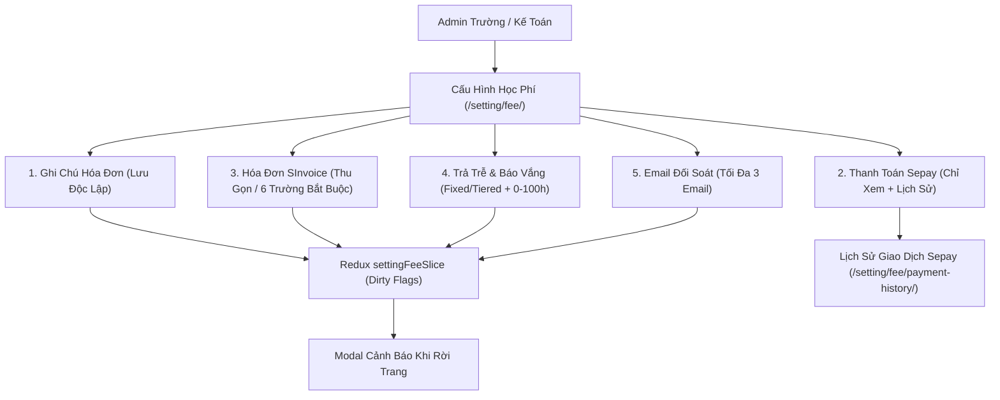

# Epic: Settings Fee Configuration (Cấu Hình — Học Phí & Chính Sách Hóa Đơn)

## Jira Story

- Story: As a School Administrator and School Accountant, I want a centralized Settings Fee Configuration dashboard to manage invoice notes, view Sepay integration secrets, configure SInvoice electronic invoices, set late pickup fees and absence meal refund thresholds, and maintain reconciliation email recipients, so that school tuition and childcare policies operate seamlessly.
- Jira issue type: Epic
- Acceptance owner: `sophia-product-manager`
- Product hypothesis: Partitioning the fee settings into 5 independent form blocks with isolated dirty states and separate Save buttons prevents unintended cross-block overwrite and eliminates configuration save failures.
- Research evidence: `docs_legacy/operating-portal/M6-cau-hinh/SM3-hoc-phi.md`, `TASK-SET-001` through `TASK-SET-006`, PRD `US-SET-01` to `US-SET-05`, `FR-SET-001` to `FR-SET-006`, `AC-046` to `AC-049`.

## Priority

- Priority: P1
- Severity if missed: High — Accurate invoice notes, legal e-invoicing (SInvoice), after-hours childcare surcharges, and reconciliation reporting are core operational requirements for private Vietnamese K-12 institutions.
- Rationale: Mandatory for compliance with Vietnamese electronic invoicing laws (Decree 123/2020/NĐ-CP) and daily childcare accounting.
- Target release: Phase 1 — Enterprise Operational Readiness.

## Outcome

Delivers the **Settings Fee Configuration (Cấu Hình — Học Phí)** sub-module (`/setting/fee/`) and **Sepay Payment History** view (`/setting/fee/payment-history/`) under **Cấu Hình (M6)** for the School Operating Portal.

The module provides 5 independent configuration forms:
1. **Ghi chú hóa đơn học phí (UC-01):** Free text printed at the bottom of student tuition bills with independent dirty tracking and Save button (`BR01`).
2. **Thanh toán tự động Sepay (UC-02):** Read-only credentials display with masked API secret and webhook URLs, eye reveal toggle icons, and link to monthly transaction history (`BR02`, `BR16`).
3. **Cấu hình hóa đơn điện tử SInvoice (UC-03):** Collapsible master switch hiding fields when OFF (`BR04`), 6 mandatory fields with red asterisk (*) when ON (`BR05`), permanently masked password (`BR06`, Resolution K019), and auto-create/split switches.
4. **Cấu hình trả trễ & báo vắng hoàn tiền ăn (UC-04):**
   - *Về muộn:* Toggle switch disabling inner controls when OFF (`BR08`), supporting Fixed Rate (5-60 min combobox + hourly rate, `BR11`) or Tiered Bracket Table (Start Time, End Time, Amount in VND, where Row 1 is non-deletable, `BR13`). Mode switching preserves draft bracket data in memory (Resolution K020).
   - *Cơ chế hoàn tiền ăn:* Dual-category model partitioning absences into Group A (Ngày nghỉ lễ / Sự kiện trường - fixed 100% refund guarantee for Tiền ăn & Ăn sáng) and Group B (Học sinh tự nghỉ - independent % inputs: 50% main meal, 70% breakfast, `FR-001` - `FR-004`). Includes live interactive calculation simulation card (September 162.000đ test vector) and 0-100 hours advance notice threshold (`BR12`).
   - *Giảm trừ hóa đơn tháng sau (M+1):* When generating invoices in `Tài chính > Học phí`, system automatically deducts previous month's reconciled meal refunds with itemized breakdown descriptions (`FR-005` - `FR-007`).
5. **Cấu hình đối soát học phí (UC-05):** Distribution list of up to 3 accountant emails with RFC 5322 regex validation (`ERR-HP-01`), duplicate rejection (`ERR-HP-02`, Resolution K021), and input disabling upon reaching capacity (`BR14`).

Navigation departure with unsaved changes in any block triggers the system confirmation modal (`BR03`).

## PM Notes

- PM-visible status: Active implementation slice under execution.
- Demo narrative: Access `/[schoolCode]/setting/fee/`, edit invoice note text and observe only Block 1 Save button active, toggle SInvoice OFF and observe collapsed card, toggle Late Pickup and switch between fixed and tiered table modes, add 3 reconciliation emails and observe input locking, click navigation link without saving and verify modal guard.
- Acceptance impact: Delivers complete settings fee control center with zero regression to student records or billing routines.
- Tradeoffs and rationale: Dedicated independent Save buttons prevent form validation errors in one block from blocking saves in other blocks.

## Relationship Map

| Relation | Target | Label | Rationale |
|---|---|---|---|
| ENABLES | `F-019-001-settings-fee-configuration` | `ENABLES` | Enables the settings fee configuration feature specification. |
| USES | `M-019-001-settings-fee-configuration` | `USES` | Consumes state machine and validation contracts. |
| ENABLES | `P-019-001-settings-fee-configuration` | `ENABLES` | Delivers main settings fee and payment history pages. |
| IMPLEMENTS | `T-019-001-001-settings-fee-configuration` | `IMPLEMENTS` | Implemented via engineering task T-019-001-001. |
| RELATES_TO | `E-009-finance-invoices` | `RELATES_TO` | Tuition invoice generation reads invoice note and e-invoice configs. |
| RELATES_TO | `E-001-operations-attendance` | `RELATES_TO` | Attendance module applies late pickup fee and meal refund cutoffs. |

## Issues

| Issue ID | Source | Priority | Status | Owner | Evidence | Resolution |
| --- | --- | --- | --- | --- | --- | --- |
| ISSUES-E-019-settings-fee-configuration | Ada QA Review | P1 | Open | `ada-qa-agent` | Unit tests for email regex and tier row invariants | Validating 5-block dirty state isolation, SInvoice masked password, and 3-email cap |

## Acceptance Criteria

- [x] Criterion 1: Main settings page renders 5 independent configuration blocks with isolated Save buttons and dirty state tracking (`BR01`).
- [x] Criterion 2: Sepay automated payment block is read-only, displays masked credentials with eye toggle icons, and navigates to monthly payment history (`BR02`, `BR16`).
- [x] Criterion 3: Departing the page with unsaved edits in any block triggers confirmation modal dialog (`BR03`).
- [x] Criterion 4: SInvoice block collapses child inputs when toggled OFF, enforces 6 mandatory fields (*) when ON, and keeps password permanently masked (`BR04`, `BR05`, `BR06`, `K019`).
- [x] Criterion 5: Late pickup toggle disables controls when OFF, supporting fixed interval (5-60m) or tiered bracket table where Row 1 is non-deletable (`BR07`, `BR08`, `BR11`, `BR13`, `K020`).
- [x] Criterion 6: Absence meal refund toggle shows/hides Mon-Sat operating hours and dynamically updates conditional vs unconditional refund rules (`BR09`, `BR10`, `BR12`, `K022`).
- [x] Criterion 7: Reconciliation email list enforces regex format, duplicate prevention, and locks at 3 emails (`BR14`, `K021`).

## Mermaid Diagram

## Evidence

- Tests: Automated unit test suite `tests/unit/settingFee.test.mjs` verifying 19 test assertions.
- Build/lint: Clean Next.js static build `npm run build` prerendering `/setting/fee` and `/setting/fee/payment-history`.
- Verification: Full state machine and validation coverage for all 5 configuration blocks.

## Work Log

- Date: 2026-09-29
  - Action: Initialized Epic E-019 development ledger, defined 5-block architecture, registered ADR-013, implemented full UI and state slice, and verified with test suite.
  - Agent/skill: `sophia-product-manager`
  - Evidence: Verified via unit test suite `tests/unit/settingFee.test.mjs`.
  - Docs updated before code: `docs/prd.md`, `docs/tasks.md`.

## Change Log

- Date: 2026-09-29
  - Code change: Implemented contracts, validation, Redux slice, 5 form blocks, modal guard, and 2 page routes.
  - Documentation update: Updated development ledger, doc sync note, and manifest.
  - Evidence: `tests/unit/settingFee.test.mjs`.
