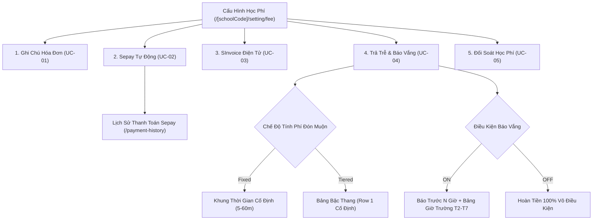

# Feature: Settings Fee Configuration (Cấu Hình — Học Phí)

## Jira Story

- Story: As a school accountant or administrator, I want to configure tuition invoice notes, electronic invoice SInvoice connection, automatic Sepay payment gateway, late pickup fees, meal refund rules, and reconciliation recipient emails in isolated blocks so that operational billing runs automatically and securely.
- Jira issue type: Feature
- Acceptance owner: `benny-frontend-engineer`

## Priority

- Priority: P1
- Severity if missed: High — Essential for financial operations and billing settings.

## User Value

School accountants and administrators can configure operational billing rules, payment integrations, and reconciliation parameters from a single intuitive dashboard with discrete block state isolation, preventing accidental overwrites and ensuring secure credential handling.

## PM Notes

- Each configuration block operates as an autonomous unit with its own Save and Discard buttons.
- SInvoice credentials require strict masking (`type="password"`) without reveal toggles to prevent on-screen credential disclosure.
- Sepay token provides an eye reveal toggle and copy button for integration debugging.
- Unsaved changes trigger a confirmation modal on page departure.

## Requirements Trace

- **FR-001:** Invoice note text area with dirty state tracking (UC-01).
- **FR-002:** Sepay automatic payment integration card with masked token and webhook URL (UC-02).
- **FR-003:** Sepay payment transaction history page with month and status filters (UC-02b).
- **FR-004:** Viettel SInvoice electronic invoice master toggle and 6 mandatory credential fields (UC-03).
- **FR-005:** SInvoice password permanent masking without reveal toggle (Resolution K019).
- **FR-006:** Late pickup calculation master toggle and mode switcher (Fixed vs Tiered) (UC-04a).
- **FR-007:** Tiered bracket dynamic table enforcing non-deletable baseline Row 1 (BR13).
- **FR-008:** Meal absence refund rule with advance notice combobox (0-100h) and Mon-Sat operating schedule (UC-04b).
- **FR-009:** Reconciliation recipient email list enforcing RFC 5322, duplicate rejection, and 3-email cap (UC-05).
- **FR-010:** Route guard modal warning of unsaved modifications on navigation (BR03).
- **FR-011:** Dual-category absence model partitioning Group A (School events/holidays - 100% guarantee) and Group B (Student self-absence - configurable % for main meal and breakfast).
- **FR-012:** Meal refund pure calculation engine computing exact refunds for Tiền ăn and Tiền ăn sáng (September 162.000đ test vector).
- **FR-013:** Next-month billing cycle ($M+1$) auto-deduction in `Tài chính > Học phí` with itemized breakdown descriptions.
- **FR-014:** Interactive calculation simulation card in Settings Fee interface.

## Code Scope

- TypeScript Contracts: `src/types/settingFee.ts`, `src/types/invoice.ts`
- Pure Validation & Calculation: `src/utils/settingFeeValidation.ts`, `src/utils/mealRefundCalculation.ts`
- Mock Data Seeds: `src/services/mockSettingFeeData.ts`, `src/services/mockMealRefundData.ts`
- Redux Slice: `src/store/slices/settingFeeSlice.ts`, `src/store/slices/invoiceSlice.ts`
- Root Redux Registration: `src/store/index.ts`
- Form Components:
  - `src/modules/settings/fee/InvoiceNoteBlock.tsx`
  - `src/modules/settings/fee/SepayIntegrationBlock.tsx`
  - `src/modules/settings/fee/SInvoiceBlock.tsx`
  - `src/modules/settings/fee/LatePickupAndRefundBlock.tsx`
  - `src/modules/settings/fee/ReconciliationEmailBlock.tsx`
  - `src/modules/settings/fee/UnsavedChangesModal.tsx`
  - `src/modules/finance/invoices/CreateInvoiceWizardModal.tsx`
- Page Routes:
  - `src/pages/[schoolCode]/setting/fee/index.tsx`
  - `src/pages/[schoolCode]/setting/fee/payment-history/index.tsx`
  - `src/pages/[schoolCode]/school/fee/create.tsx`
- Layout Navigation: `src/components/layout/PortalLayout.tsx`
- Unit Tests: `tests/unit/settingFee.test.mjs`, `tests/unit/mealRefund.test.mjs`, `tests/unit/invoices.test.mjs`

## Relationship Map

| Relation | Target | Label | Rationale |
| --- | --- | --- | --- |
| IMPLEMENTS | `E-019-settings-fee-configuration` | `IMPLEMENTS` | Implements the core functional scope for Settings Fee Configuration. |
| DEPENDS_ON | `M-019-001-settings-fee-configuration` | `DEPENDS_ON` | Architectural boundary and module definition. |
| ENABLES | `P-019-001-settings-fee-configuration` | `ENABLES` | Powers the UI surfaces for settings fee and transaction history. |
| RELATES_TO | `T-019-001-001-settings-fee-configuration` | `RELATES_TO` | Executed via engineering task note. |

## Mermaid Diagram

## Verification

- Automated test execution: `node --test tests/unit/settingFee.test.mjs` verifying 19 test assertions across all business rules.
- Production build compilation: `npm run build` validating zero TypeScript errors and static generation of both page routes.
- Component interaction verification: Discrete per-block save actions and dirty flag synchronization verified.

## Work Log

- Date: 2026-09-29
  - Action: Implemented settings fee configuration feature, Redux state slice, 5 form blocks, and unit tests.
  - Agent/skill: `benny-frontend-engineer`
  - Evidence: Verified via `tests/unit/settingFee.test.mjs`.

## Change Log

- Date: 2026-09-29
  - Code change: Implemented contracts, validation, Redux slice, 5 form blocks, modal guard, and 2 page routes.
  - Documentation update: Authored feature note F-019.
  - Evidence: `tests/unit/settingFee.test.mjs`.
