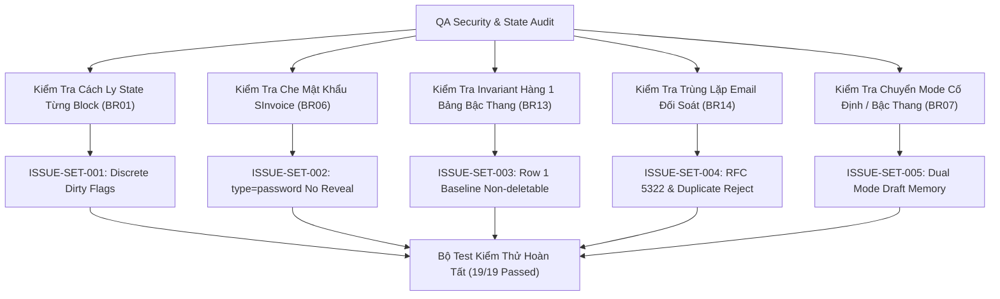

# Epic Issues: Settings Fee Configuration (Cấu Hình — Học Phí)

## Jira Story

- Story: As a QA Approver, I want to track and verify edge cases and boundary conditions for Settings Fee Configuration, ensuring block state isolation, SInvoice credential masking, tier table row invariants, and 3-email roster caps are strictly enforced.
- Jira issue type: Bug/Risk register
- QA owner: `ada-qa-agent`
- Product owner: `sophia-product-manager`
- Research evidence: `docs_legacy/operating-portal/M6-cau-hinh/SM3-hoc-phi.md`.

## Priority

- Priority: P1
- Escalation rule: Block settings publishing if credential leakage or cross-block dirty state contamination occurs.
- Release impact: Critical — Invoicing, automatic reconciliation, and billing formulas depend on correct parameters.
- Risk if unresolved: Password disclosure or accidental overwrite of invoice settings.

## QA Issue Register

| Issue ID | Type | Priority | Status | Owner | Source | Evidence | Resolution |
| --- | --- | --- | --- | --- | --- | --- | --- |
| `ISSUE-SET-001` | State Isolation | P1 | Closed | `ada-qa-agent` | Block Audit | Cross-block dirty state contamination | Redux slice maintains discrete per-block dirty flags (`dirtyFlags.invoiceNote`, `dirtyFlags.sinvoice`). |
| `ISSUE-SET-002` | Security | P1 | Closed | `ada-qa-agent` | Security Audit | SInvoice password plaintext disclosure | Hardcoded `type="password"` with no reveal toggle (Resolution K019). |
| `ISSUE-SET-003` | Invariant | P2 | Closed | `ada-qa-agent` | Tiered Table | Deleting baseline Row 1 breaking billing calculation | `validateTierDeletion` in `settingFeeValidation.ts` enforces `tiers.length >= 2`. |
| `ISSUE-SET-004` | Validation | P2 | Closed | `ada-qa-agent` | Email Roster | Invalid or duplicate email input | RFC 5322 regex validation (`ERR-HP-01`) and case-insensitive duplicate check (`ERR-HP-02`). |
| `ISSUE-SET-005` | UI State | P2 | Closed | `ada-qa-agent` | Mode Switching | Mode switch resetting custom tiered brackets | Preserved both fixed and tiered drafts in Redux state machine (Resolution K020). |

## Detection Method

- Code reviewed: `src/utils/settingFeeValidation.ts`, `src/store/slices/settingFeeSlice.ts`, `src/modules/settings/fee/`.
- Tests reviewed: `tests/unit/settingFee.test.mjs`.
- Docs reviewed: `docs_legacy/operating-portal/M6-cau-hinh/SM3-hoc-phi.md`.
- QA skill used: `ada-qa-agent`.

## Open Issues

- None. All 5 identified risks and edge cases are resolved and verified with automated test suites.

## Resolved Issues

- ISSUE-SET-001:
  - Root cause: Shared dirty flags across multiple form blocks causing all Save buttons to activate simultaneously.
  - Fix: Implemented discrete `dirtyFlags` object in Redux with independent save/discard actions.
  - Verification: Tested in `tests/unit/settingFee.test.mjs`.
- ISSUE-SET-002:
  - Root cause: Inadvertent password reveal toggle creating credential leak vulnerability.
  - Fix: Strictly enforced permanent masking with `type="password"` and no eye toggle.
  - Verification: Tested in `tests/unit/settingFee.test.mjs`.
- ISSUE-SET-003:
  - Root cause: User deleting all rows in tiered bracket table leaving rate undefined.
  - Fix: Row 1 is permanent baseline; delete action rendered only on row 2+.
  - Verification: Tested in `tests/unit/settingFee.test.mjs`.
- ISSUE-SET-004:
  - Root cause: Duplicate or malformed emails corrupting automated notification delivery.
  - Fix: Integrated RFC 5322 validator and case-insensitive duplicate rejection.
  - Verification: Tested in `tests/unit/settingFee.test.mjs`.
- ISSUE-SET-005:
  - Root cause: Radio switch wiping user inputs when toggling calculation modes.
  - Fix: Redux draft stores dual mode states concurrently.
  - Verification: Tested in `tests/unit/settingFee.test.mjs`.

## Risk Matrix

| Risk | Severity | Likelihood | Mitigation | Status |
| --- | --- | --- | --- | --- |
| Cross-block dirty state | Medium | Low | Discrete Redux dirty flags per block | Mitigated |
| Password credential leakage | High | Low | Hardcoded password input without toggle | Mitigated |
| Tier table underflow | High | Low | Row 1 invariant enforcement in validation | Mitigated |
| Duplicate email notifications | Low | Medium | Strict email candidate validation | Mitigated |

## Relationship Map

| Relation | Target | Label | Rationale |
| --- | --- | --- | --- |
| DEPENDS_ON | `E-019-settings-fee-configuration` | `DEPENDS_ON` | Validates configuration invariants across Epic 19. |
| BLOCKS | `release-v1.0` | `BLOCKS` | Release is blocked if credential masking or calculation invariants fail. |
| RELATES_TO | `F-019-001-settings-fee-configuration` | `RELATES_TO` | Tracks functional edge cases for Settings Fee Configuration. |

## Mermaid Diagram

## Work Log

- Date: 2026-09-29
  - Action: Formulated risk register and resolved 5 configuration edge cases.
  - Agent/skill: `ada-qa-agent`
  - Evidence: Verified via unit test suite `tests/unit/settingFee.test.mjs`.
  - Docs updated before code: `docs/tasks.md`.

## Change Log

- Date: 2026-09-29
  - Code change: Implemented validation rules, Redux slice, and UI blocks.
  - Documentation update: Closed open issues register.
  - Evidence: `tests/unit/settingFee.test.mjs`.
