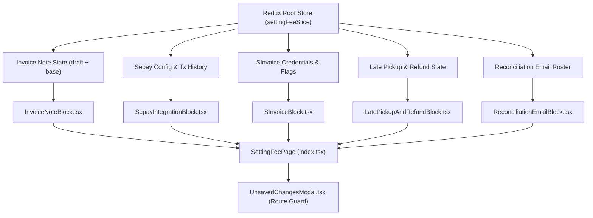

# Module: Settings Fee Configuration (Cấu Hình — Học Phí)

## Jira Story

- Story: As a technical lead, I want an encapsulated architecture module for settings fee configuration with isolated Redux draft state and independent form block controllers so that modifications in one block never cause regressions in others.
- Jira issue type: Module
- Acceptance owner: `alan-tech-lead`

## Priority

- Priority: P1
- Architectural criticality: High. Encapsulates all finance parameters, gateway credentials, tax invoice connections, and automated billing calculation algorithms.

## Responsibility

The Settings Fee Configuration module (`M-019-001`) owns the lifecycle, draft state management, validation enforcement, and persistence contracts for all administrative billing settings in the School Operating Portal. It ensures that form state across the five configuration blocks remains completely decoupled, preventing cascading dirty states or accidental data loss.

## Implementation Commentary

1. **State Isolation Architecture:** The Redux slice `settingFeeSlice` models each block with separate base state, draft state, and boolean dirty flag (`dirtyFlags.invoiceNote`, `dirtyFlags.sinvoice`, `dirtyFlags.latePickupAndRefund`, `dirtyFlags.reconciliation`). Mutations are applied strictly to draft objects until the corresponding `save*` action commits changes.
2. **Credential Security Protection:** In accordance with Resolution K019, SInvoice password input strictly enforces `type="password"` with no reveal toggle, protecting credentials against shoulder-surfing and DOM scraping. Sepay tokens utilize eye toggle reveal and clipboard copy helpers.
3. **Billing Calculation Invariants:** The late pickup calculation engine supports dual modes (Fixed Interval vs Tiered Brackets). In Tiered mode, Row 1 acts as a non-deletable baseline bracket (BR13) while subsequent rows support dynamic addition, modification, and deletion.
4. **Meal Refund Architecture & Multi-Meal Arithmetic:** The pure calculation engine `src/utils/mealRefundCalculation.ts` partitions absences into Group A (100% fixed for school holidays/events) and Group B (configurable % for main meal and breakfast). It integrates with `CreateInvoiceWizardModal.tsx` and `invoiceSlice.ts` to automatically apply previous-month meal deductions ($M+1$ cycle) to student tuition invoices.
5. **Reconciliation Deliverability:** Enforces RFC 5322 validation, case-insensitive duplicate prevention, and strict 3-email roster caps for automated statement delivery.

## Code Scope

- Types: `src/types/settingFee.ts`, `src/types/invoice.ts`
- Validation & Calculation Engine: `src/utils/settingFeeValidation.ts`, `src/utils/mealRefundCalculation.ts`
- Seed & Mock Store: `src/services/mockSettingFeeData.ts`, `src/services/mockMealRefundData.ts`
- Redux Slice: `src/store/slices/settingFeeSlice.ts`, `src/store/slices/invoiceSlice.ts`
- Component Blocks:
  - `src/modules/settings/fee/InvoiceNoteBlock.tsx`
  - `src/modules/settings/fee/SepayIntegrationBlock.tsx`
  - `src/modules/settings/fee/SInvoiceBlock.tsx`
  - `src/modules/settings/fee/LatePickupAndRefundBlock.tsx`
  - `src/modules/settings/fee/ReconciliationEmailBlock.tsx`
  - `src/modules/settings/fee/UnsavedChangesModal.tsx`
- Page Surfaces:
  - `src/pages/[schoolCode]/setting/fee/index.tsx`
  - `src/pages/[schoolCode]/setting/fee/payment-history/index.tsx`

## Relationship Map

| Relation | Target | Label | Rationale |
| --- | --- | --- | --- |
| IMPLEMENTS | `E-019-settings-fee-configuration` | `IMPLEMENTS` | Module architecture implementation for Settings Fee Configuration. |
| ENABLES | `F-019-001-settings-fee-configuration` | `ENABLES` | Provides state management and business rules to the feature. |
| RELATES_TO | `P-019-001-settings-fee-configuration` | `RELATES_TO` | Binds UI surfaces to the Redux store. |

## Mermaid Diagram

## Verification

- Tested via unit test suite: `node --test tests/unit/settingFee.test.mjs` verifying Redux state machine isolation, draft commits, and validation rules.
- Production build validation: `npm run build` with zero TypeScript compiler errors.

## Work Log

- Date: 2026-09-29
  - Action: Formulated module boundary and contracts for settings fee state isolation.
  - Agent/skill: `alan-tech-lead`
  - Evidence: Verified via `tests/unit/settingFee.test.mjs`.

## Change Log

- Date: 2026-09-29
  - Code change: Implemented contracts, validation, Redux slice, 5 form blocks, modal guard, and 2 page routes.
  - Documentation update: Authored module note M-019.
  - Evidence: `tests/unit/settingFee.test.mjs`.
