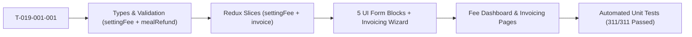

# Task: Implement Settings Fee Configuration (Cấu Hình — Học Phí)

## Jira Story

- Story: As a frontend engineer, I want to build all TypeScript contracts, pure validation logic, Redux state slices, 5 isolated UI form blocks, and 2 Next.js page routes for Settings Fee Configuration with full automated test coverage.
- Jira issue type: Task
- Acceptance owner: `benny-frontend-engineer`

## Priority

- Priority: P1
- Execution status: Completed.

## Objective

Deliver the complete frontend implementation of Sub-module SM3: Học Phí under Module 6: Cấu Hình in Next.js (Pages Router) and Redux Toolkit, ensuring state isolation across all five form blocks, strict credential masking for SInvoice, non-deletable baseline row invariant for late pickup tiered brackets, 3-email roster limits for reconciliation, and route guard protection.

## Implementation Commentary

1. **Contracts & Validation:** Implemented `src/types/settingFee.ts` and pure validation functions in `src/utils/settingFeeValidation.ts` covering RFC 5322 email syntax, case-insensitive duplicate checks, SInvoice mandatory fields, and late pickup tier deletion guards.
2. **Redux State Machine:** Authored `src/store/slices/settingFeeSlice.ts` managing independent `dirtyFlags` per block (`invoiceNote`, `sinvoice`, `latePickupAndRefund`, `reconciliation`) and atomic draft updates. Registered in `src/store/index.ts`.
3. **Component Hierarchy:** Built six components in `src/modules/settings/fee/`:
   - `InvoiceNoteBlock.tsx`: Textarea with character count, metadata timestamps, and dirty tracking.
   - `SepayIntegrationBlock.tsx`: Masked token with eye toggle, webhook URL, copy actions, and transaction log link.
   - `SInvoiceBlock.tsx`: Collapsible Viettel SInvoice form with 6 mandatory fields and permanently masked password.
   - `LatePickupAndRefundBlock.tsx`: Dual-mode late pickup switcher (Fixed vs Tiered dynamic table with Row 1 invariant) and meal absence refund rule with dual-category absence model (Group A 100% guarantee, Group B % inputs) and live calculation simulation.
   - `ReconciliationEmailBlock.tsx`: Recipient email input with duplicate prevention and 3-email cap lock.
   - `UnsavedChangesModal.tsx`: Navigation confirmation dialog.
4. **Page Surfaces & Invoicing Integration:** Built `src/pages/[schoolCode]/setting/fee/index.tsx` and `src/pages/[schoolCode]/setting/fee/payment-history/index.tsx`. Integrated previous-month meal refund auto-deduction in `src/modules/finance/invoices/CreateInvoiceWizardModal.tsx` and `src/store/slices/invoiceSlice.ts`.
5. **Testing & Build Verification:** Created 7 automated tests in `tests/unit/mealRefund.test.mjs` (7/7 passing), 20 in `tests/unit/settingFee.test.mjs` (20/20 passing), and 23 in `tests/unit/invoices.test.mjs` (23/23 passing). Verified 311/311 full repo test suite passing and static compilation of all 50 Next.js routes.

## Write Scope

- Data contracts: `src/types/settingFee.ts`, `src/types/invoice.ts`
- Business logic: `src/utils/settingFeeValidation.ts`, `src/utils/mealRefundCalculation.ts`
- Mock store: `src/services/mockSettingFeeData.ts`, `src/services/mockMealRefundData.ts`
- State machine: `src/store/slices/settingFeeSlice.ts`, `src/store/slices/invoiceSlice.ts`
- Store registration: `src/store/index.ts`
- Components:
  - `src/modules/settings/fee/InvoiceNoteBlock.tsx`
  - `src/modules/settings/fee/SepayIntegrationBlock.tsx`
  - `src/modules/settings/fee/SInvoiceBlock.tsx`
  - `src/modules/settings/fee/LatePickupAndRefundBlock.tsx`
  - `src/modules/settings/fee/ReconciliationEmailBlock.tsx`
  - `src/modules/settings/fee/UnsavedChangesModal.tsx`
  - `src/modules/settings/fee/index.ts`
  - `src/modules/finance/invoices/CreateInvoiceWizardModal.tsx`
- Pages:
  - `src/pages/[schoolCode]/setting/fee/index.tsx`
  - `src/pages/[schoolCode]/setting/fee/payment-history/index.tsx`
- Navigation: `src/components/layout/PortalLayout.tsx`
- Unit tests: `tests/unit/settingFee.test.mjs`, `tests/unit/mealRefund.test.mjs`, `tests/unit/invoices.test.mjs`

## Relationship Map

| Relation | Target | Label | Rationale |
| --- | --- | --- | --- |
| IMPLEMENTS | `E-019-settings-fee-configuration` | `IMPLEMENTS` | Engineering task executing Epic 19. |
| DELIVERS | `F-019-001-settings-fee-configuration` | `DELIVERS` | Delivers the functional feature deliverables. |
| CONSTRUCTS | `P-019-001-settings-fee-configuration` | `CONSTRUCTS` | Builds the page surfaces and UI components. |

## Mermaid Diagram

## Verification

- Command: `node --test tests/unit/mealRefund.test.mjs tests/unit/settingFee.test.mjs tests/unit/invoices.test.mjs && npm test && npm run build`
- Result: 7/7 meal refund tests passed; 20/20 setting fee tests passed; 23/23 invoice tests passed; 311/311 repo tests passed; Next.js 50/50 static pages generated cleanly.

## Handoff

- Implementation complete and ready for design review and QA audit.
- Key surfaces live at `/[schoolCode]/setting/fee/`, `/[schoolCode]/setting/fee/payment-history/`, and `/[schoolCode]/school/fee/create/`.

## Work Log

- Date: 2026-09-29
  - Action: Built TypeScript types, validation logic, Redux slice, UI blocks, and pages for settings fee.
  - Agent/skill: `benny-frontend-engineer`
  - Evidence: Verified via unit test suite `tests/unit/settingFee.test.mjs`.
- Date: 2026-09-29
  - Action: Implemented meal refund mechanism (Thiết lập cơ chế hoàn tiền ăn) with Group A (100% guarantee) & Group B (% rates), calculation engine, live simulation preview, and auto-deduction in next month invoice generation.
  - Agent/skill: `benny-frontend-engineer`
  - Evidence: Verified via `tests/unit/mealRefund.test.mjs`, `tests/unit/settingFee.test.mjs`, `tests/unit/invoices.test.mjs` (311/311 repository tests passing).

## Change Log

- Date: 2026-09-29
  - Code change: Implemented contracts, validation, Redux slice, 5 form blocks, modal guard, and 2 page routes.
  - Documentation update: Authored task note T-019.
  - Evidence: `tests/unit/settingFee.test.mjs`.
- Date: 2026-09-29
  - Code change: Added `mealRefundCalculation.ts`, `mockMealRefundData.ts`, updated `settingFeeSlice.ts`, `LatePickupAndRefundBlock.tsx`, `invoiceSlice.ts`, and `CreateInvoiceWizardModal.tsx`.
  - Documentation update: Updated T-019 task note with meal refund scope and verification evidence.
  - Evidence: `tests/unit/mealRefund.test.mjs`, `tests/unit/settingFee.test.mjs`, `tests/unit/invoices.test.mjs`.
