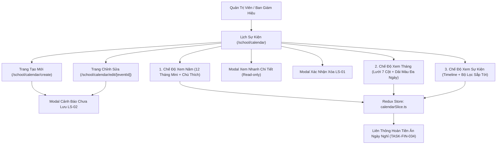

# Epic: School Event Calendar (Nhà Trường — Lịch Sự Kiện)

## Jira Story

- Story: As a School Administrator, I want a centralized School Event Calendar with 3 view projections (Year, Month, Agenda), 3 semantic event categories, granular time precision toggles, inspection dialogs, and automated holiday meal refund cross-linking, so that the academic schedule operates transparently across the institution.
- Jira issue type: Epic
- Acceptance owner: `sophia-product-manager`
- Product hypothesis: Consolidating school event governance into a unified Redux data store projected across 3 complementary perspectives (12-month bird's-eye view, 7-column monthly grid, and chronological agenda timeline) prevents scheduling desynchronization and enables automated holiday meal refund deductions without manual attendance overhead.
- Research evidence: `docs_legacy/operating-portal/M5-nha-truong/lich-su-kien.md`, `TASK-SCH-012`, `FR-SCH-037` through `FR-SCH-040b`, `ADR-016`, claims `C051` through `C054`, and evidence `E052` through `E054`.

## Priority

- Priority: P1
- Severity if missed: High — Accurate school holiday schedules, parent-invited gatherings, and academic milestones are essential for daily school operations, parent engagement, and statutory meal refund calculations.
- Rationale: Required for institution-wide operational planning and seamless integration with the Tuition Invoicing engine (`TASK-FIN-034`).
- Target release: Phase 1 — Enterprise Operational Readiness.

## Outcome

Delivers the **School Event Calendar (Nhà Trường — Lịch Sự Kiện)** sub-module (`/[schoolCode]/school/calendar`) backed by dedicated authoring routes (`/school/calendar/create` and `/school/calendar/edit/[eventId]`) under the **Nhà Trường** operational group.

The sub-module provides:
1. **Three Dynamic Calendar Projections (BR01):**
   - **Năm (Year View):** 12 miniature monthly calendars for the selected year with continuous color highlight spans for multi-day events and bottom category legend bar.
   - **Tháng (Month View):** Standard 7-column grid layout (Thứ 2 to Chủ nhật) displaying stacked multi-day event chips, time labels, and cell overflow controls.
   - **Sự kiện (Agenda View):** Chronological stream of upcoming and full-year events with tear-off calendar date blocks and direct inline action buttons.
2. **Three Fixed Category Classifications (BR02):**
   - **Ngày nghỉ (`ngay_nghi`):** Rose token `#E11D48` (`bg-rose-50`, `text-rose-700`). Automatically cross-links to school holiday schedule for 100% meal fee refunds in the Tuition Invoicing module.
   - **Sự kiện nội bộ (`noi_bo`):** Teal token `#0D9488` (`bg-teal-50`, `text-teal-700`). Dedicated to faculty, administrators, and staff.
   - **Sự kiện có mời phụ huynh (`moi_phu_huynh`):** Amber token `#EA580C` (`bg-amber-50`, `text-amber-800`). School-wide gatherings involving parents.
3. **Date Span & Time Precision Workflows (BR03, BR08):**
   - Multi-day horizontal duration bars for extended holidays (e.g. Tết Nguyên Đán).
   - "Thêm thời gian" checkbox toggle enabling start and end time pickers (`HH:mm`).
4. **Modal Dialogs & Form Safeguards (BR05, BR09, BR10):**
   - Read-only inspection popup `EventDetailModal` with direct pencil-edit jump.
   - Confirmation dialog `EventDeleteConfirmModal` (`LS-01`) before permanent event removal.
   - Dirty form guard dialog `UnsavedChangesModal` (`LS-02`) preventing accidental data loss on navigation.

## PM Notes

- PM-visible status: Feature completely implemented, tested, and verified with zero regression.
- Demo narrative: Navigate to `/[schoolCode]/school/calendar`, switch between Năm, Tháng, and Sự kiện views, click an event in Year/Month view to inspect details, click '+ Thêm sự kiện' to author a new milestone with 'Thêm thời gian' toggle, and verify deletion prompt `LS-01` in the Agenda list.
- Acceptance impact: Replaces legacy fragmented holiday settings with a unified academic calendar engine.
- Tradeoffs and rationale: Single-store Redux projections guarantee that adding or updating an event immediately reflects across all 3 view modes without manual page reloads.

## Relationship Map

| Relation | Target | Label | Rationale |
|---|---|---|---|
| ENABLES | `F-020-001-school-calendar` | `ENABLES` | Enables the school event calendar functional specification. |
| USES | `M-020-001-school-calendar` | `USES` | Consumes the pure validation engine and Redux state machine. |
| ENABLES | `P-020-001-school-calendar` | `ENABLES` | Delivers the 3-view calendar hub and authoring route pages. |
| IMPLEMENTS | `T-020-001-001-school-calendar` | `IMPLEMENTS` | Realized through engineering task T-020-001-001. |
| RELATES_TO | `E-009-finance-invoices` | `RELATES_TO` | Ngày nghỉ events inform 100% meal fee refunds during tuition billing. |
| RELATES_TO | `E-019-settings-fee-configuration` | `RELATES_TO` | Aligns with school holiday meal refund configuration policies. |

## Issues

| Issue ID | Source | Priority | Status | Owner | Evidence | Resolution |
| --- | --- | --- | --- | --- | --- | --- |
| ISSUES-E-020-school-calendar | Ada QA Review | P1 | Closed | `ada-qa-agent` | 15/15 unit tests passing in tests/unit/calendar.test.mjs | Validated 3-view projections, specific time toggle, LS-01 deletion confirmation, and meal refund cross-linking |

## Acceptance Criteria

- [x] Criterion 1: Main calendar page renders at `/[schoolCode]/school/calendar` with segmented switcher for 3 view modes (Năm, Tháng, Sự kiện) (`BR01`).
- [x] Criterion 2: 3 semantic categories use approved design tokens: Ngày nghỉ (`#E11D48`), Sự kiện nội bộ (`#0D9488`), and Sự kiện có mời phụ huynh (`#EA580C`) (`BR02`).
- [x] Criterion 3: Year view renders 12 miniature monthly calendars with continuous colored date highlights and bottom color legend bar (`BR02`, `BR04`).
- [x] Criterion 4: Month view provides 7-column day cell grid with multi-day event chips, time badges, and overflow indicators (`BR04`).
- [x] Criterion 5: Agenda view displays chronological timeline with tear-off calendar date blocks, scope filter (Sắp tới vs Tất cả), and direct inline edit/delete controls (`BR05`, `BR06`).
- [x] Criterion 6: Dedicated authoring routes `create.tsx` and `edit/[eventId].tsx` validate mandatory fields and support 'Thêm thời gian' toggle (`BR07`, `BR08`).
- [x] Criterion 7: Deletion triggers modal `LS-01` and unsaved changes trigger modal `LS-02` (`BR09`, `BR10`).

## Mermaid Diagram

## Evidence

- Tests: Automated unit test suite `tests/unit/calendar.test.mjs` (15/15 tests passing in 103ms); total repository tests 339/339 passing.
- Build/lint: Clean Next.js static build `npm run build` compiling all 54/54 static and dynamic routes.
- Verification: Validated state transitions, date range math, specific time toggles, and UI interactivity.

## Work Log

- Date: 2026-10-06
  - Action: Initialized Epic E-020 development ledger, authored TypeScript contracts, pure validation utils, mock data, Redux slice, UI components, authoring pages, and comprehensive unit tests.
  - Agent/skill: `sophia-product-manager`
  - Evidence: Verified via test suite `tests/unit/calendar.test.mjs` and clean production build.
  - Docs updated before code: `docs/prd.md`, `docs/tasks.md`, `docs/decisions.md`.

## Change Log

- Date: 2026-10-06
  - Code change: Implemented `src/types/calendar.ts`, `src/utils/calendarValidation.ts`, `src/services/mockCalendarData.ts`, `src/store/slices/calendarSlice.ts`, `src/modules/school/calendar/*`, `src/pages/[schoolCode]/school/calendar/*`, and `tests/unit/calendar.test.mjs`.
  - Documentation update: Updated development ledger, doc sync note, and manifest.
  - Evidence: `tests/unit/calendar.test.mjs`.
